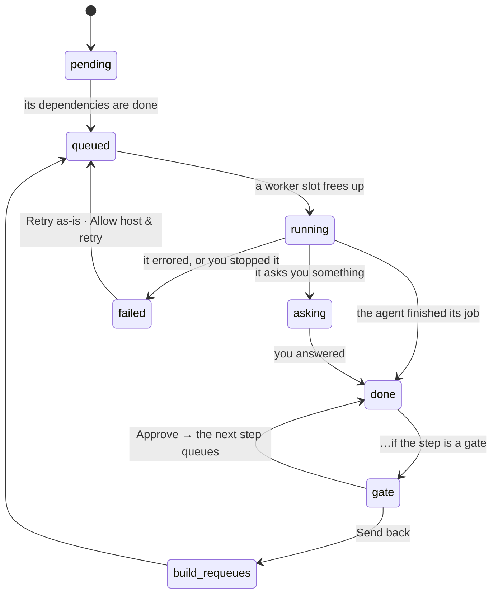

# Flow Bar And Step States

Every row in the [[Pulse View]] carries a **flow bar**: *"Five cells, left to right, one per step of the flow. The third cell is split in two because `build` and `tests` run side by side."* (monitor guide). The cells follow the flow's column grouping, `COLS = [['research'],['plan'],['build','tests'],['review'],['summarize']]`.

```
rsch  plan  b∥t   rev   sum
[███] [███] [▓▓▓] [   ] [   ]
            [███]
```

*"Read that bar as: research and plan are finished, build is running while tests has already passed, review is queued behind them, summarize hasn't started."*

## The step states

| Cell | State | What it means (guide) | Moves on |
|---|---|---|---|
| flat pale fill | **pending** | *"This step hasn't started, and can't yet — something it depends on is still unfinished."* | — |
| pale fill + hairline outline | **queued** | *"Everything it needs is ready. It's in line for the next free worker. Note the hairline outline: queued is not the same as pending."* | engine |
| petrol, sweeping | **running** | *"An agent has it right now. The cell sweeps while it works, and the cost climbs live."* | engine |
| ochre diagonal hatching | **waiting on you** (gate or asking) | *"Diagonal hatching, twice over: the agent work is finished but a human decision is holding the task. Hatching is deliberate — it reads as blocked even in greyscale."* | you |
| brick, white digit | **failed** | *"The run errored or you stopped it. The digit is the attempt number, so 3 means two earlier attempts were already thrown away."* | you |
| stone grey | **done** | *"Finished, artifact written, and drained to grey on purpose — most of a healthy bar is this, and colouring it would drown the part that matters."* | — |

The mockup code has seven run states: `pending`, `queued`, `running`, `gate`, `asking`, `failed`, `done`. `gate` and `asking` share the hatched cell (`s-hold`). The attempt digit appears only on a failed cell with more than one attempt.

## The life of one step

From the guide's state diagram:



The guide's SVG draws no Approve arrow: *"Approve → the next step queues"* is a free label beside the gate box, drawn here as the `gate → done` edge. The box labels in the diagram are part of the rule: *asking: "paused, billing stops"*; *failed: "spend becomes wasted"*; *build re-queues: "with your reason"*; *gate: "waiting for your call"*; *done: "artifact written"*.

## Tooltip

Hovering a cell shows `Label · model` plus one of: `not started`, `running 4m · $0.56`, `waiting for a worker`, `waiting for your approval (5m)`, `asked you a question (12m)`, `failed, attempt 3 · <error>`, or `<duration> · <cost>`. Then `· N attempts` when more than one. *"The bar is a summary; the tooltip is the detail; clicking the row is the full story."*

## Against the PRD

PRD §5 `step_instances.state` is `pending | running | awaiting_answers | awaiting_approval | done | failed | skipped`. There is no `queued` (the queue is the `jobs` table) and the monitor has no mark for `skipped`. On rework, backlog Story 5.2 turns downstream `done` into `skipped` *"so they re-instantiate"*. See [[Monitor Data Model]] and [[Monitor Open Questions]] #7.

The bar assumes one flow shape for every row. Tasks on different flows or versions would need different bars ([[Monitor Open Questions]] #3).

## Related

- [[Task Status Icons]]
- [[Hand-Off Rules]]
- [[Branching Joining And Loops]]
- [[Canvas Layout And Board Order]]
