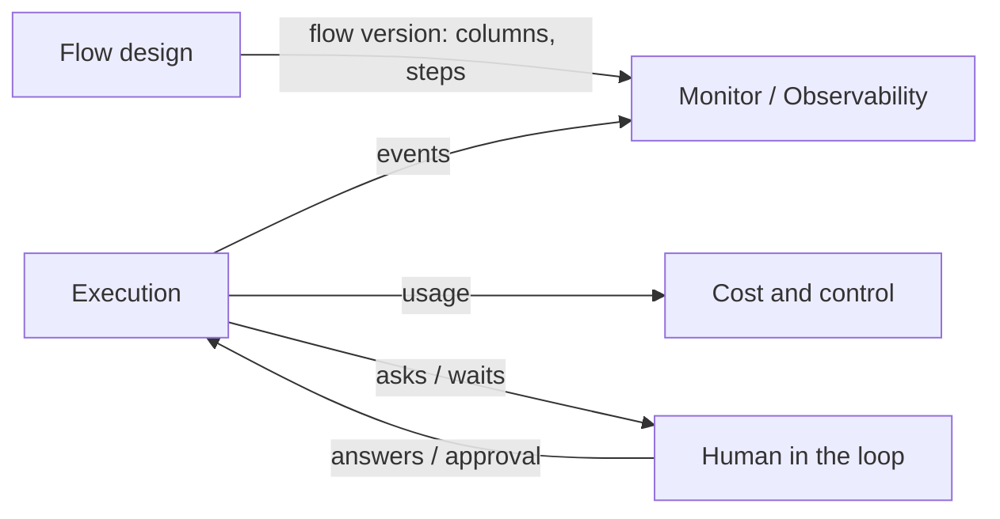

# Monitor Overview

## Purpose

The monitor guide opens with the screen's whole job: *"The monitor answers four questions: **does anything want me**, **is it progressing or stuck**, **am I saturated**, and **what is this costing**. Everything on the screen exists to answer one of those."* (`monitor-guide.html:267-270`)

The Monitor is the component you watch while FlowBoard works. It covers three things the older sources split up:

| Piece | Older name | Source |
|---|---|---|
| Status at a glance | **The board** — *"columns are the steps of the recipe, and each task sits in whichever step it has reached"* | feature map §5, PRD §13 `/p/[slug]` |
| What needs you | The *attention* cards and states on the board; the inbox's *"Everything waiting, most-urgent first"* | feature map §5, §12 |
| Live run viewer | *"A live screen that streams an agent's session as it happens"* | feature map §9, PRD §13 `/runs/[id]` |

The monitor mockup (`docs/mockups/monitor.html`) is the newest design of the first two. `docs/mockups/README.md` describes it as *"the monitoring module. A *needs-you* triage band over a task-pulse list, worker slots as a collapsed strip, and timeline and pipeline drill-ins."* It does not draw the PRD's Kanban columns. See [[Board Projection]] and [[Monitor Open Questions]] #1.

## Place in the system

The first four edges and their labels come from the drawio page *Functional components*. The Flow design edge is inferred from *"Columns come from the recipe"* (feature map §5). The drawio **Observability** group holds four cards, all solid (v1):

| Card | Text |
|---|---|
| Watch a live session | normalised events, collapsible tool calls |
| Read the step timeline | state, attempts, cost, duration |
| Open artifacts | plan.md vs summary.md diff |
| See status at a glance | state dot, current step, split badge |

*Read the step timeline* and *Open artifacts* belong to the task detail screen (the Task Detail component). These notes only cover them where the monitor's row detail shows them.

On the *Logical components* page, **Board `/p/[slug]`** (*projection of task + step state*) reads **Task & run state** in Core. **Run viewer `/runs/[id]`** (*live event stream (SSE)*) reads the **Run orchestrator**. The architecture catalogues the two halves as component **#4 Board projection (read model)** (`02-core-and-engine.md` §4) and **#8 Event stream & live viewer** (`03-execution-substrate.md` §8).

## Design principles

| Principle | Source wording |
|---|---|
| **A projection, not the model** | *"The board is a projection, not the model. The flow is a DAG. A card's column is derived from its furthest-advanced step instance."* (PRD §4) |
| **Pure derivation** | *"pure derivation, no writes."* (`02` §4) |
| **Only honest movement** | *"Nothing on this screen moves because you dragged it. A task's position is decided entirely by the engine following the flow, with exactly four exceptions — the four decisions that are yours"* (monitor guide, *Movement*) |
| **Colour means something is happening or wanted** | *"colour only appears where something is happening or something is wanted. When nothing is blocked, band 3 collapses to a single white line and every trace of amber leaves the screen. If you see amber, a human is the bottleneck."* (monitor guide, *Anatomy*) |
| **Most urgent at the top** | *"Reading down the screen is reading from *most urgent* to *least*."* (monitor guide) |
| **Done drains to grey** | *"*Done* is drained to stone grey on purpose — it's most of the screen, and colouring it would drown the part that matters"* (mockups README) |
| **The viewer never parses provider JSON** | *"the 7 `NormalizedEvent` kinds are the universal contract … The viewer never parses provider JSON."* (`03` §8) |
| **Catch up on reconnect** | *"reopen the page and it catches you up from the start."* (feature map §9) |
| **Waste is the number to attack** | *"Wasted is the number to attack. It's every dollar spent on an attempt that was thrown away"* (monitor guide, *Money*) |
| **Keyboard first** | *"This is the screen you'll live in, so it's built to be driven without a mouse."* (monitor guide, *Keyboard*) |
| **Calm, not alarming** | *"Reserve strong colour for the two or three states that genuinely need me right now."* (`docs/old/design/brief.md`) |

## What it is not

- **Not the engine.** The Monitor never decides where a task goes. It shows the engine's state, and it offers the human decisions the engine waits on. See [[Hand-Off Rules]].
- **Not the inbox.** The inbox (`/inbox`, the Human In The Loop component) is where you work through questions and batches one at a time. The Monitor's [[Needs You Band]] shows the same items so you can clear them without leaving.
- **Not the task detail screen.** Clicking a task's row opens an inline summary. The whole story (timeline, artifacts, diff) lives at the task detail screen.
- **Not the cost page.** The topbar shows *burn*, *today* and *wasted*. Rollups by project, step and model live on `/costs`. See [[Burn Today And Wasted]].

## Related

- [[Monitor Index]]
- [[Monitor Screen]]
- [[Board Projection]]
- [[Live Run Viewer]]
- [[Flow Design Overview]]
