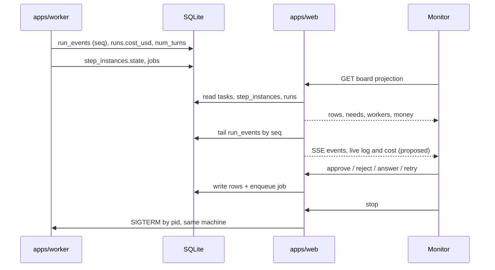

# Monitor Runtime

How the screen gets and keeps its picture. The mockup simulates everything in the browser; the sources describe the real version as a read model fed by SQLite.

## In the real system

Partly a **proposal**: no source defines a stream to the monitor or board ([[Monitor Open Questions]] #30), so the SSE leg is drawn as proposed. Stop follows backlog 3.4 and `03` §8 (a SIGTERM from the route); making it a worker job instead is #36. As built (2026-10-18), a SIGTERM by pid from outside is not reported as a stop: the run fails with exit 1, while `AgentRun.stop()` settles it as `{ exitCode: 130, error: 'stopped' }` ([[Agent Run Handle And Result]]).

The facts behind it:

- **Two processes, one file.** *"One laptop · two Node processes · one SQLite file"* (drawio *Harness architecture*). The SQLite card: *"the only shared state: opened by apps/web and apps/worker only, never from a sandbox"*.
- **The web process never spawns.** API routes *"zod-validated input → write rows → enqueue a job → return"*; Next.js *"never spawns agents"* (drawio). PRD §2: *"Next.js route handlers must never spawn a long-lived child process"*.
- **Read models.** The drawio *Read models* card: *"board projection (furthest-advanced step, split badges) · cost rollups incl. wasted spend"*.
- **Live updates.** The drawio *SSE endpoints* card: *"tail run_events by seq, questions and task state from SQLite (works across processes; catches up on reconnect)"*. Feature map §20: *"A steady stream keeps the board, the viewer, and the inbox current without you refreshing."* Front-end tech: *"EventSource for live updates · no client state store: the server is the source of truth"*.
- **Polling today.** Backlog 2.2: *"Polling hook: `cache: "no-store"`, catch network errors, surface an error state"*. `02` §4 suggests *"a materialized view refreshed on job completion instead of client polling, collapsing the three overlapping pollers the backlog flags into one."* Backlog 9.2: *"one summary poller"* for the chrome.
- **One clock.** The old handoff: *"`now` — one shared 1s ticker for every elapsed time and cost readout (one interval for the page, not one per row)."* Live cost *"Ticks up while a step runs, ~1s cadence, from the run's token accounting."*

The drawio and feature map §20 send a stream to the board (SSE: *"→ SSE → run viewer and board"*), while backlog 2.2 still polls and `02` §4 suggests a refreshed view. No endpoint is defined for the board stream ([[Monitor Open Questions]] #30).

## Derivations

All pure functions of the task's step and run rows:

| Function | Derives |
|---|---|
| `blocking(t)` | First run in flow order in `gate`, `asking` or `failed` |
| `statusOf(t)` | `fail` / `wait` / `run` / `done` / `idle` ([[Task Status Icons]]) |
| `whereOf(t)` | The step text column |
| `timingOf(t)` | The time column |
| `needsList()` | Every task's blocking run, sorted oldest first |
| `costOf`, `wasteOf` | Σ cost, Σ wasted over the task's runs |
| `burnRate()` | Σ model rate over running runs × 60 |
| `filtered()` | Filter + sort for [[Pulse View]] |

The architecture's version of the same idea: *"pure derivation, no writes."* (`02` §4).

## The mockup's simulation

| Constant | Value | Meaning |
|---|---|---|
| `SPEED` | 10 | Clock runs ×10 (the `DEMO ×10` tag) |
| `CAP` | 4 | Worker slots |
| `RATE` | haiku 0.008, sonnet 0.05, opus 0.14 | $ per minute |
| `DUR` | per step, seconds range | Planned run length |
| tick | every 700 ms | `tick()` advances running runs, finishes them, schedules, renders |

`tick()` updates each running run's elapsed time and cost; a run past its planned length calls `finish()`, which either gates or advances ([[Hand-Off Rules]]). `schedule()` fills free slots from the queue. Every action re-renders the whole screen. The needs band skips re-rendering while its reason input has focus, so typing is not lost.

## Related

- [[Event Stream And SSE]]
- [[Monitor Data Model]]
- [[Board Projection]]
- [[Worker Slots]]
