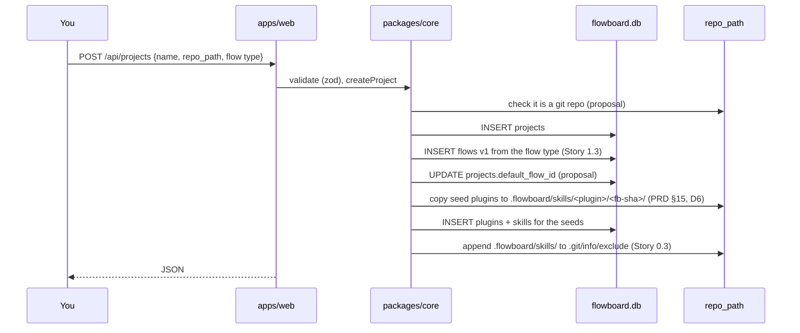

# Creating A Project

> **Create a new project** — *A short form: name it and choose which recipe new tasks should follow (or start empty).* (feature map §1)

## What the sources specify

| Source | Says |
|---|---|
| Feature map §1 | The form asks for a **name** and a **recipe**, or *"start empty"* |
| Feature map §1 | *"Connect a codebase — Point FlowBoard at a folder on your machine that holds a git repository."* |
| Backlog Story 1.3 | *"New‑project dialog with flow‑type select ("Empty" allowed); choosing one creates flow v1."* (**NEW**) |
| Backlog Story 1.3 | *"Empty state, error handling on submit (non‑JSON error bodies)."* (**BUG**) |
| PRD §12 | `POST /api/projects` |
| PRD §12 | handlers *"validate with zod, call a function in `packages/core`, return JSON"* |
| PRD §15 | *"Registering a project copies the seeds into its store under FlowBoard's commit; upgrading FlowBoard stages new seed commits as an available update rather than applying them."* |
| Capability Library D6 | *"Seeds are copied into each project's store on project registration and on FlowBoard upgrade, filed under FlowBoard's commit (`<plugin>/<fb-sha>/`)."* |
| Backlog Stories 0.3, 2.1 | `.flowboard/skills/` and `.vibe-worktrees/` go into the repo's `.git/info/exclude` |

The schema needs `name`, `slug` and `repo_path` (all `NOT NULL`, PRD §5). The feature map's form names only *name* and *recipe*; the repo path comes from *"Connect a codebase"*. Neither names a slug or check command field. See [[Projects Open Questions]] #3.

## Inputs

| Input | Column | Specified by | Status |
|---|---|---|---|
| Name | `name` | feature map §1 | sourced |
| Repo folder | `repo_path` | feature map §1 (*Connect a codebase*), PRD §5 | sourced, not as a form field |
| Flow type, or *Empty* | creates flow v1; `default_flow_id` | backlog Story 1.3 | sourced |
| Slug | `slug` | — | **proposal:** derived from the name, editable, uniquified |
| Check command | `check_command` | — | **proposal:** optional field on the same form |

## Registration, step by step

Every step below is sourced; their **order** and their grouping into one request are a **proposal** (see [[Projects Open Questions]] #3 and #8).

`.vibe-worktrees/` is not added at creation: backlog Story 2.1 lists *"append `.vibe-worktrees/` to `<repo>/.git/info/exclude`"* among the **Promote** steps. It does not say *first* promotion; appending on every promote repeats the line *(inferred)*. See [[Workspaces Open Questions]] #7.

## Flow types

The flow-type select's options are not listed. The sources ship these flows:

- *Software delivery*, the seeded flow (PRD §15). See [[Seeded Flows]].
- A *research pipeline*: *"Ships with a couple of complete ones (a full software-development pipeline and a research pipeline)"* (feature map §2). Backlog Story 1.2: *"The `researcher` web-research template is out of v1 until open-web egress has an answer."* Capability Library D31 agrees.
- Role starter flows (feature map appendix), an idea. See [[Role Starter Flows]].

Backlog Story 8.2 also lists *"Start from flow type"* (**NEW**) in the flow editor.

## Agents

`agents.project_id` is `NOT NULL`, so the seeded agents (`scout`, `architect`, `developer`, `tester`, `reviewer`, `scribe`, PRD §15) need a row per project. Capability Library D12: *"Seeded agents are files in FlowBoard's repo and take the same path"* as seed plugins. So creating a project presumably also inserts the seeded agent rows *(inferred)*. No source says so directly. See [[Seeded Capabilities]] and [[Projects Open Questions]] #8.

## Errors

Only one is named: the backlog BUG about *"non‑JSON error bodies"* on submit (Story 1.3). Duplicate slug (`UNIQUE`), a missing folder, a non-git folder and a path already used by another project are not addressed. See [[Project Rules And Edge Cases]]; the general error shape is [[Settings And Plumbing Open Questions]] #18.

## Related

- [[Project Default Flow]]
- [[Project Repository]]
- [[Seeded Capabilities]]
- [[Projects API And Routes]]
- [[Projects List Page]]
