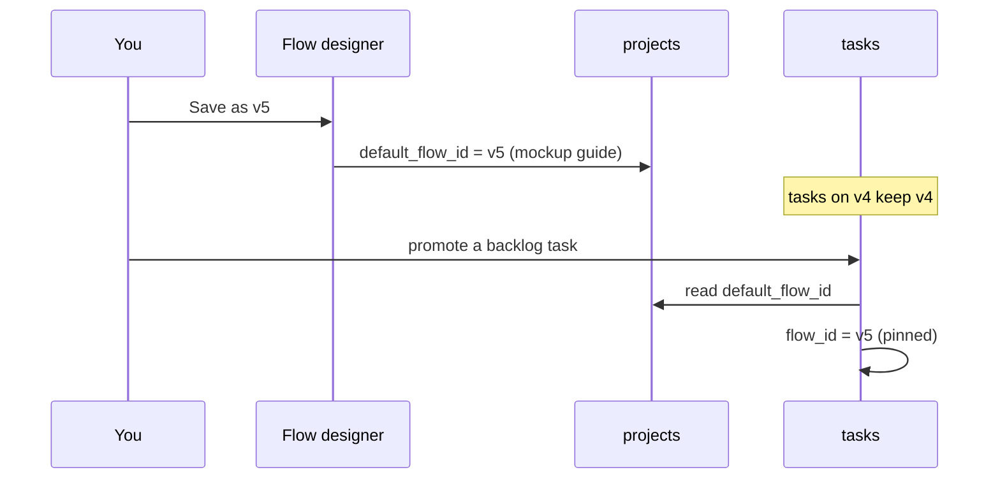

# Project Default Flow

> **A default recipe per project** — *Each project remembers which recipe to use, so new work starts the right way without you picking every time.* (feature map §1)

`projects.default_flow_id TEXT` (PRD §5), nullable, with no `REFERENCES` clause. Flows point back at the project (`flows.project_id … ON DELETE CASCADE`), and the project points at one flow **version**, since every version is its own `flows` row (`UNIQUE (project_id, name, version)`).

## Four names for it

| Name | Source | Wording |
|---|---|---|
| default flow | PRD §5 | `default_flow_id` |
| active flow | PRD §13 | board: *"Columns come from the project's active flow ordered by `board_order`"*; drawio *Board*: *"Order = board_order of the active flow version."* |
| adopted flow | `flow-designer.html`, `flow-designer-guide.html` | chip *"adopted 12 Sep"*; *"Your project has adopted **Software delivery v4**."* |
| default recipe | feature map §1 | quoted above |

[[Flow Data Model]] already maps *adopted* to `projects.default_flow_id`. No source says *active* is the same column, though nothing suggests another. See [[Projects Open Questions]] #7.

## How it is set

| Moment | What happens | Source |
|---|---|---|
| Creating a project | *"New‑project dialog with flow‑type select ("Empty" allowed); choosing one creates flow v1."* | backlog Story 1.3 (**NEW**) |
| Saving a flow | *"Saving does not overwrite v4 — it creates v5 and points your project at it."* The **Save as v*n*** action *"Writes a new version and points the project at it."* | `flow-designer-guide.html` |
| Adopting a library flow | **Use this flow** *"Adopts the previewed flow as the one you are editing. Marks it unsaved immediately."* Saving then points the project at the new version. | `flow-designer-guide.html` |
| Seeding | *"Seed one project and one flow, **Software delivery**, that reproduces my actual workflow."* | PRD §15 |

The PRD's `PUT /api/flows/:id -- creates a new version` (§12) does not say it moves `default_flow_id`. Only the mockup guide does.

## How it is read

- **A task pins it, at promotion or at start.** `POST /api/tasks/:id/promote -- backlog -> todo, pin flow, create worktree` (PRD §12). `tasks.flow_id` is *"null while in backlog, pinned on promotion"* (PRD §5). Backlog Story 2.1: *"Pin `tasks.flow_id` at promotion; project flow edits never move in‑flight tasks."* But PRD §4 says *"Flows are version-pinned at task start"*, and the drawio *Functional components* page has a **Start task** card reading *"pin flow version"*. With D1's separate promote and Start, those are two moments. See [[Flow Design Open Questions]] #7. Either way, the pinned version is presumably the project's default at that moment *(inferred)*; no source names the column it is read from. See [[Version Pinning]] and [[Starting A Task]].
- **The board draws it.** Columns are *"Backlog"* and *"Todo"*, then the active flow's steps by `board_order`, then *"Done"* (PRD §13).
- **Editing never moves running work.** *"Flows are version-pinned at task start. `tasks.flow_id` points at a specific flow version. Editing a project's flow never moves an in-flight task."* (PRD §4)

The read on promotion is a **proposal** inferred from PRD §5 and §12; PRD §4 would move it to Start. See [[Projects Open Questions]] #7.

## Gaps

- **"Empty".** Does choosing *Empty* create an empty flow v1 or leave `default_flow_id` null? Not stated.
- **Null default.** What does promoting a task do when the project has no default flow? Not stated.
- **Several flows.** The schema allows several named flows per project. The board shows one. Tasks pinned to another flow or an older version have no stated column layout. See [[Board Projection]].
- **No FK.** `default_flow_id` can point at a deleted or archived flow, or at a flow of another project. No rule forbids it.

All in [[Projects Open Questions]] #7.

## Related

- [[Flows And Flow Versions]]
- [[Adopting And Adapting A Flow]]
- [[Version Pinning]]
- [[Creating A Project]]
- [[Flow Design Open Questions]]
