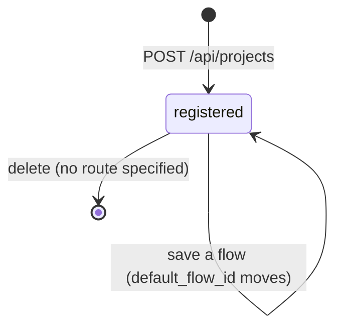
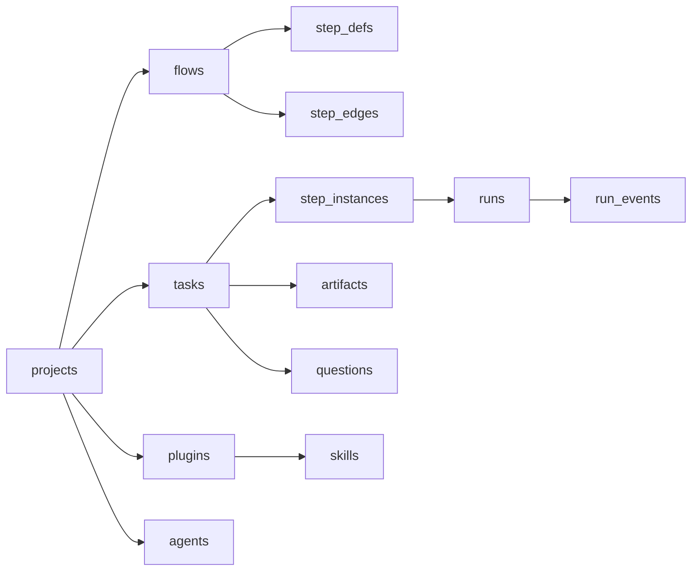

# Project Lifecycle And Deletion

A project has no `status` column and no state machine. The sources specify one transition, **create**. Everything after that is a gap.

| Action | Specified? | Source |
|---|---|---|
| Create | yes | `POST /api/projects` (PRD §12); new-project dialog (backlog Story 1.3) |
| List | yes | `GET /api/projects` (PRD §12); `/` (PRD §13) |
| Rename, change slug | no | — |
| Change repo path | no | — |
| Change default flow | indirectly | the flow-designer guide's **Save as v*n*** *"points the project at it"* |
| Change check command | no | — |
| Archive | no | `flows.is_archived` exists; `projects` has no equivalent |
| Delete | no endpoint or UI | only the schema's `ON DELETE CASCADE` implies it can happen |

Only the first transition is sourced. The others are a **proposal** drawn from the guide and the schema.

## What a delete would remove

If a project row is deleted with `foreign_keys = ON` (backlog Story 1.1, `02` §1), the cascades in PRD §5 remove:

Three consequences follow from the sources, none of them stated by any of them:

> [!warning] The cost journal goes with it
> `runs` cascades from `tasks`. A delete erases the project's spend history, while `02` §1 proposes *"treat `runs` as an **append-only usage journal** — never mutate cost after the result lands"*. See [[Cost Ledger]] and [[Projects Open Questions]] #9.

> [!warning] Files stay behind
> A database cascade does not touch the disk. Worktrees under `<repo_path>/.vibe-worktrees/`, the plugin store under `<repo_path>/.flowboard/skills/` and the `.git/info/exclude` lines would remain. Worktree cleanup is otherwise *"only via explicit action, only when done/cancelled/failed"* (backlog Story 2.1).

> [!warning] Running work
> No source says what happens to a task that is running, parked or waiting on a question when its project goes. Cancel's rules (*"SIGTERM live runs, cancel pending questions, mark instances skipped"*, backlog Story 2.1) are the nearest model.

Memory is outside the cascade too: the `local` adapter's `memories` table stores `scope, scope_id` (PRD §11.2) with no foreign key, and Mem0 holds its memories outside SQLite. See [[Memory Open Questions]] #18.

**Proposal**, not in any source: v1 offers no delete; a later delete refuses while any task is non-terminal, and archives rather than erases so the cost journal survives. Listed in [[Projects Open Questions]] #9 and #10.

## Moving a repo

If the folder at `repo_path` moves, every worktree path stored on tasks (`tasks.worktree_path`), every artifact path (`artifacts.path`, *"absolute path on disk"*, PRD §5) and every plugin dir derived from `repo_path` breaks *(inferred)*. No source covers this. See [[Projects Open Questions]] #5.

## Related

- [[Project Rules And Edge Cases]]
- [[Projects Data Model]]
- [[What Belongs To A Project]]
- [[Task Workspace]]
- [[Cost Ledger]]
