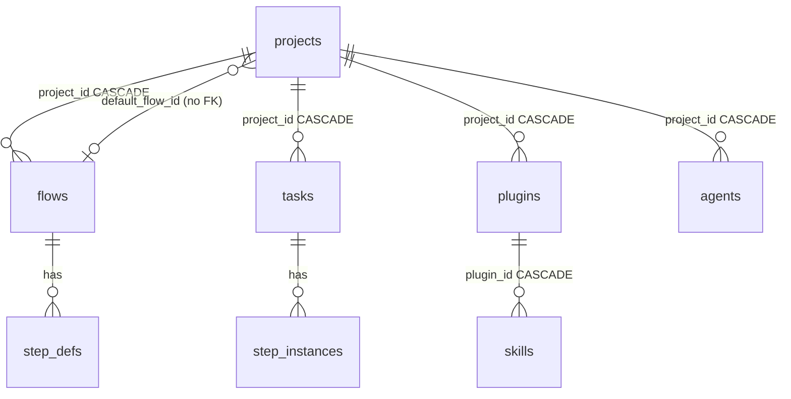

# Project Record

A project is one row in `projects` (PRD §5). It has no state machine, no status and no owner. It is a name, a slug, a repo path, a default flow and a check command.

```sql
CREATE TABLE projects (
  id            TEXT PRIMARY KEY,
  name          TEXT NOT NULL,
  slug          TEXT NOT NULL UNIQUE,
  repo_path     TEXT NOT NULL,           -- absolute path to the git repo
  default_flow_id TEXT,
  check_command TEXT,                   -- e.g. 'pnpm lint && pnpm test'; what a shell check step runs
  created_at    INTEGER NOT NULL
);
```

## Field by field

| Field | Required | Meaning | Where it is used | Note |
|---|---|---|---|---|
| `id` | yes | Primary key | Every `project_id` foreign key; API paths `/api/projects/:id/…` (PRD §12) | Format not stated (all ids are `TEXT`) |
| `name` | yes | Display name | Project cards (PRD §13), board header *"project name 14px/600"* (design handoff 1c) | The handoff sample is `billing-svc` |
| `slug` | yes, unique | URL key | Pages `/p/[slug]`, `/p/[slug]/flow`, `/p/[slug]/library` (PRD §13); the inbox batch header shows *"project slug 11px mono"* (handoff 1a) | Derivation not stated. See [[Projects Open Questions]] #4 |
| `repo_path` | yes | *"absolute path to the git repo"* | Worktree creation (PRD §11), plugin dir (PRD §5 comment), shell steps run in a worktree under it | No `UNIQUE`; validation not stated. See [[Project Repository]] |
| `default_flow_id` | no | The flow version new tasks start on | Task promotion pins a flow (PRD §12 `promote`); board columns come from *"the project's active flow"* (PRD §13) | No `REFERENCES` clause. See [[Project Default Flow]] |
| `check_command` | no | *"what a shell check step runs"* | A `kind='shell'` step whose `command` is null (PRD §5, §7) | No UI to set it is specified. See [[Project Check Command]] |
| `created_at` | yes | Unix time | — | No `updated_at`, unlike `tasks` and `agents` |

## What is not on the record

Read from the PRD schema and the absence of any later source adding them:

- No **status** or archive flag (flows have `is_archived`; projects do not).
- No **owner**, members or access list. See [[Project Visibility]].
- No **base branch**, **remote URL** or default branch. See [[Project Repository]].
- No per-project **sandbox tier**, **budget**, **model** or **memory** setting. Those live globally in `settings` or per step. See [[Repository Trust And Sandboxing]].
- No **updated_at**.

> [!note] The feature map's tagline
> §1 calls projects *"Your codebases and the settings for how agents work on each one."* In the schema, the only per-project "settings" are `default_flow_id` and `check_command`. Everything else that varies per project does so because a row points at the project (flows, agents, plugins), not because the project stores it. See [[Projects Open Questions]] #23.

## Relationships



See [[Projects Data Model]] for the full list.

## Related

- [[Projects Data Model]]
- [[What Belongs To A Project]]
- [[Project Repository]]
- [[Project Default Flow]]
- [[Project Check Command]]
