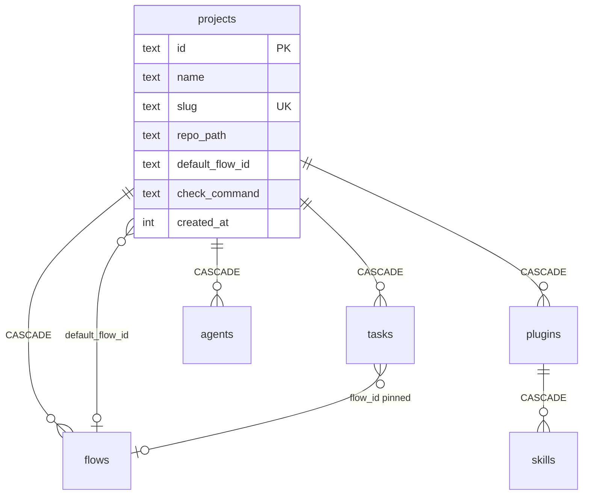

# Projects Data Model

Architecture component **#1 Domain model & migrations** (`02` §1): *"the 14 tables (PRD §5) plus the invariants — flow immutability, version pinning, guarded loops."* Projects own one table and are referenced by four.

## `projects`

| Column | Type | Constraint | Comment in PRD §5 |
|---|---|---|---|
| `id` | TEXT | PRIMARY KEY | |
| `name` | TEXT | NOT NULL | |
| `slug` | TEXT | NOT NULL UNIQUE | |
| `repo_path` | TEXT | NOT NULL | *"absolute path to the git repo"* |
| `default_flow_id` | TEXT | nullable, **no** `REFERENCES` | |
| `check_command` | TEXT | nullable | *"e.g. 'pnpm lint && pnpm test'; what a shell check step runs"* |
| `created_at` | INTEGER | NOT NULL | |

No source adds a column to `projects`. The architecture's genericization list (`02` §1) touches `runs`, `step_instances` and `skills`, not projects. The drawio *SQLite* card lists only *"projects (check_command)"*.

## Tables that point at a project

| Table | Column | On delete | Unique key with `project_id` |
|---|---|---|---|
| `flows` | `project_id TEXT NOT NULL REFERENCES projects(id)` | CASCADE | `(project_id, name, version)` |
| `tasks` | `project_id TEXT NOT NULL REFERENCES projects(id)` | CASCADE | `(project_id, import_key)` |
| `plugins` | `project_id TEXT NOT NULL REFERENCES projects(id)` | CASCADE | `(project_id, name)` |
| `agents` | `project_id TEXT NOT NULL REFERENCES projects(id)` | CASCADE | `(project_id, slug)` |

All PRD §5. `plugins` and `agents.project_id` are the v1 library design (Capability Library decisions D4, D5, D23).

Indirect references: `memories(scope, scope_id, …)` stores a project id as `scope_id` when `scope = 'project'` (PRD §11.2, local adapter), without a foreign key. `questions` reach a project only through `tasks` (PRD §5).

## Values derived from the project

| Value | Formula | Source |
|---|---|---|
| Plugin dir | `<repo_path>/.flowboard/skills/<name>/<commit_sha>/` — *"derived, not stored"* | PRD §5 |
| Worktree | `<repo_path>/.vibe-worktrees/task-<id>`, stored on `tasks.worktree_path` | PRD §11 |
| Branch | `vibe/task-<id>`, stored on `tasks.branch_name` | PRD §11 |
| Shell command | `step_defs.command ?? projects.check_command` | PRD §5 |

## Diagram

## Invariants the schema does not enforce

Each is implied by a source but has no constraint. **Proposals**, listed in [[Projects Open Questions]].

| Invariant | Why | OQ |
|---|---|---|
| `default_flow_id` names a flow **of this project** | flows are per project (PRD §5) | #7 |
| `tasks.flow_id` names a flow of the task's project | same | #7 |
| `repo_path` is absolute and a git work tree | column comment | #5 |
| `repo_path` is unique, or sharing it is safe | worktrees and plugin dirs live under it | #5 |

## Table count

`02` §1 and backlog Story 1.1 both say *"14 tables"*. PRD §5 as it stands defines 15: `projects`, `flows`, `step_defs`, `step_edges`, `tasks`, `step_instances`, `runs`, `run_events`, `artifacts`, `questions`, `plugins`, `skills`, `agents`, `jobs`, `settings`. The split of `skills` into `plugins` + `skills` (Capability Library decisions) is the likely reason. See [[Projects Open Questions]] #20.

## Related

- [[Project Record]]
- [[Projects Storage]]
- [[Flow Data Model]]
- [[Task Data Model]]
- [[Capability Data Model]]
- [[Settings And Plumbing Index]]
