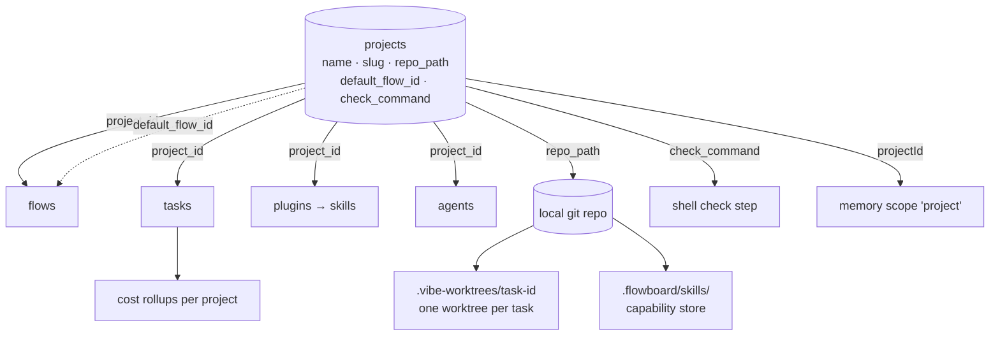

# Projects Overview

> *Your codebases and the settings for how agents work on each one.* (feature map §1)

## Purpose

FlowBoard runs agents against real code. A project tells it **which code**, and gives every other component a key to scope by. The feature map lists four v1 features and one idea:

| Feature | Feature-map wording (§1) | See |
|---|---|---|
| Connect a codebase | *"Point FlowBoard at a folder on your machine that holds a git repository. That's the code agents will read and change."* | [[Project Repository]] |
| A home screen listing your projects | *"The first screen shows each project as a card with how many tasks are in each state and how much you've spent this week."* | [[Projects List Page]] |
| Create a new project | *"A short form: name it and choose which recipe new tasks should follow (or start empty)."* | [[Creating A Project]] |
| A default recipe per project | *"Each project remembers which recipe to use, so new work starts the right way without you picking every time."* | [[Project Default Flow]] |
| 💡 Who can see each project | *"a teammate can be given access to a project and its repo, or not, so not everyone sees every codebase."* | [[Project Visibility]] |

The PRD adds one more per-project setting the feature map does not list in §1: the **check command**, *"what a shell check step runs"* (PRD §5). See [[Project Check Command]].

## Place in the system

| Source | Node or section | What it says |
|---|---|---|
| Architecture README | component **#1 Domain model & migrations** | `projects` is one of *"the 14 tables (PRD §5)"* (`02` §1). No component is dedicated to projects. |
| Drawio *Harness architecture* | **SQLite** card | lists *"projects (check_command)"* first among the tables |
| Drawio *Harness architecture* | **Project repo + git worktrees** card | *"<repo>/.flowboard/worktrees/task-<id> on branch fb/task-<id> / artifacts: .vibe/task-<id>/*.md \| *.json, committed alongside the code"* |
| Drawio *Harness architecture* | **GitHub** card, edge from the repo | *"skill install (git clone) · project remote"*; edge labelled *"host-side push / fetch"* |
| Drawio *FlowBoard ideation* | **Import & seed → Seed data** | *"One project, default flow, sample tasks, so the app is alive on first run."* |
| Drawio *Functional components* | **Intake → Seed project** | *"default flow + sample tasks"*. There is no Projects box on this page. |
| Drawio *Logical components* | **Inbox `/inbox`**, **Cost rollup** | *"open questions across projects"*; *"per project · step · model; wasted spend"* |
| PRD §14 | **M1 — Foundation** | *"Seed a project pointing at a scratch git repo. Projects list page renders."* |

## Design principles

| Principle | Source wording |
|---|---|
| Single user, no accounts | *"Single user, runs on my machine, no auth."* (PRD §1); *"No auth, no multi-tenancy, no user table. Do not add them 'for later'"* (PRD §2) |
| Local-first | *"your repos, your machine, no new service to run"* (`docs/pitch.md`) |
| The host owns git | the egress allowlist excludes *"the project's git remote, because the host does all git work and the agent never needs to push or fetch"* (PRD §11.1) |
| Keep the parent repo clean | *"append `.vibe-worktrees/` to `<repo>/.git/info/exclude` so the parent repo stays clean"* (backlog Story 2.1); installed plugins live in *"each managed project's `.flowboard/skills/`, which FlowBoard adds to that repo's `.git/info/exclude`"* (backlog Story 0.3) |
| Edits never move running work | *"Editing a project's flow never moves an in-flight task."* (PRD §4) |
| The model proposes, the check decides | a shell step *"runs `command` (or the project's `check_command`) … Its exit code *is* the outcome"* (`03` §6) |
| Everything reads the shared DB | domain model: *"everything reads it; keep it the *only* shared-state coupling"* (`02` §1) |

## What it is not

- Not a workspace. A workspace is a **task's** private worktree inside the project's repo. See [[Task Workspace]].
- Not a tenant. There are no owners, members or permissions in v1. See [[Project Visibility]].
- Not a settings bag. Global switches (draft mode, sandbox defaults, theme, escalation threshold, memory) live in `settings`, not on the project. See the Settings And Plumbing notes.

## Related

- [[Projects Index]]
- [[Project Record]]
- [[What Belongs To A Project]]
- [[Projects Glossary]]
- [[Settings And Plumbing Index]]
