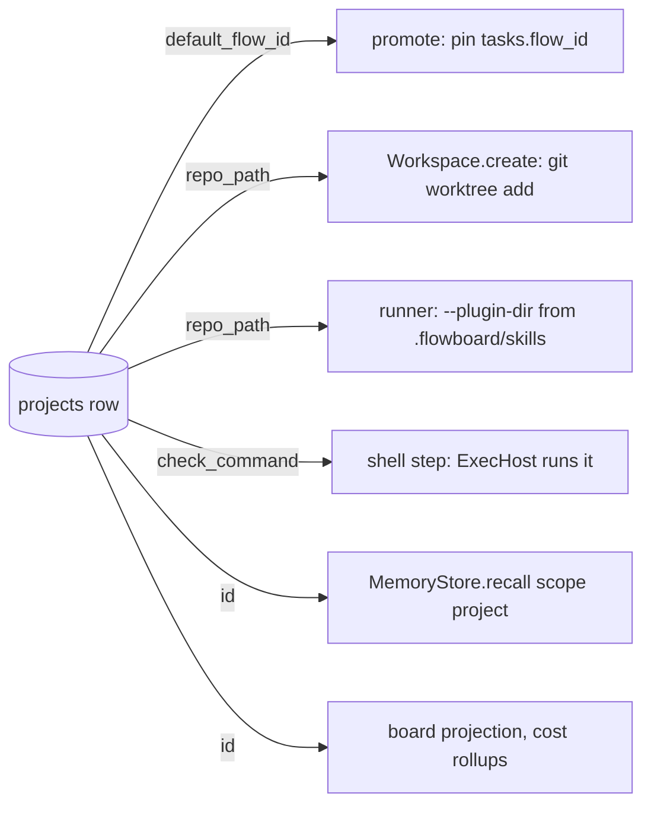

# Projects Runtime

A project does nothing at run time on its own. Its fields are read at five points in a task's life. This note traces each one.



## 1. Promotion pins the flow and makes the worktree

`POST /api/tasks/:id/promote -- backlog -> todo, pin flow, create worktree` (PRD §12). The worktree command uses the project's path twice:

```
git -C <repo_path> worktree add <repo_path>/.vibe-worktrees/task-<id> -b vibe/task-<id>
```

(PRD §11). The reference adapter takes the path at construction: `worktreeWorkspace(repoPath: string): Workspace` (`07`, *Workspace — git worktree adapter*). Backlog Story 2.1 adds: *"pre‑create `.vibe/task-<id>`; append `.vibe-worktrees/` to `<repo>/.git/info/exclude`"*. See [[Starting A Task]] and [[Task Workspace]].

The `Workspace` port's `TaskRef` is `{ id: string }` only (`reference/core/ports/workspace.ts`), so the repo is bound when the adapter is built, one adapter per project. That reading is a **proposal**; the sources show the constructor, not who calls it. See [[Projects Open Questions]] #24.

## 2. The runner mounts the project's plugins

`--plugin-dir <dir of each plugin the step names>`, and *"Each plugin dir is the commit recorded in the task's `capability_pins`"* (PRD §7). The dir is *"derived, not stored: `<repo_path>/.flowboard/skills/<name>/<commit_sha>/`"* (PRD §5). In a sandbox the drawio mounts it read-only: *"ro: skills/ → /skills"*. See [[Capability Runtime Mounting]].

## 3. A shell step runs the project's check

*"The runner executes `step.command` (or the project's `check_command`) in the task's worktree through the same execution host"* (PRD §7). Drawio *Shell executor = the sensor*: *"runs check_command in a fresh sandbox · exit 0 → pass, else fail · output tail → check_output · fingerprint → runs"*. See [[Shell Step Execution]] and [[Project Check Command]].

## 4. Memory recalls the project scope

*"Build the scope union for the run — `user` + the task's `project` + the step's `agent` + the `task`"* (`09`, lifecycle). The port comment: *"Union of scopes for a run: user + the task's project + the step's agent + the task."* (`reference/core/ports/memory-store.ts`). Recall and commit are host-side, *"so the sandboxed agent process never connects to the store"* (PRD §11.2). Only when memory is on; the default adapter is `none`. See [[Memory Carried Into A Task]].

## 5. Read models group by project

- **Board:** `GET /api/projects/:id/board -- board projection: columns + cards` (PRD §12). See [[Board Projection]].
- **Costs:** `runs → step_instances → tasks → projects`, *"Recharts stacked bars per project per day"* (backlog Story 8.1). See [[Spend Rollups]].
- **Inbox:** every project at once (PRD §10).

## Processes

Only `apps/web` and `apps/worker` open `flowboard.db` (PRD §3). Creating a project is a web request (`POST /api/projects`). Sections 2–4 run in the worker's runner. The PRD forbids the web app long-lived children (*"Next.js route handlers must never spawn a long-lived child process; they enqueue jobs and the worker picks them up"*, PRD §2), and the drawio's life-of-a-step says that on **Start** Next.js *"writes the task and step rows plus a start_run job, then returns. It never spawns anything."* Neither says whether the short `git worktree add` at promotion, or the seed copy at project creation, runs in the web process or as a job. See [[Projects Open Questions]] #24.

## Related

- [[Runner Pipeline]]
- [[Life Of One Step]]
- [[Projects Data Model]]
- [[Projects API And Routes]]
