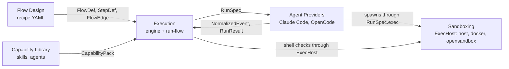
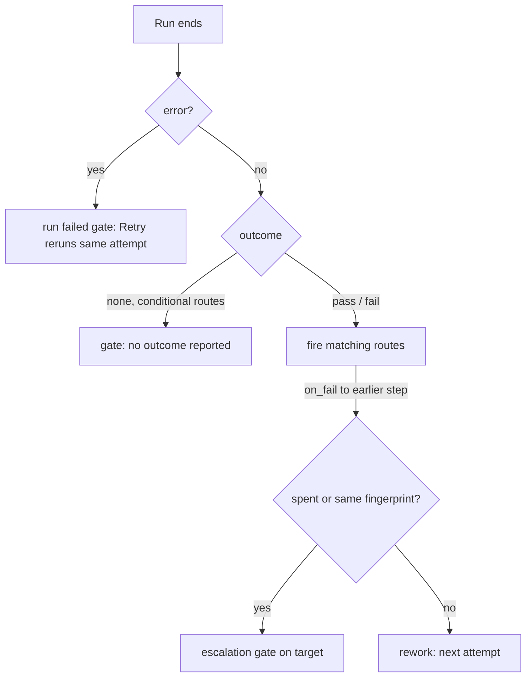
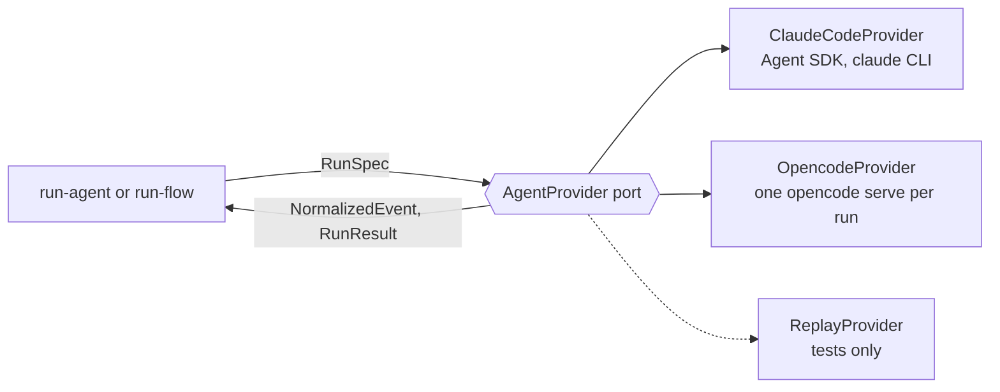
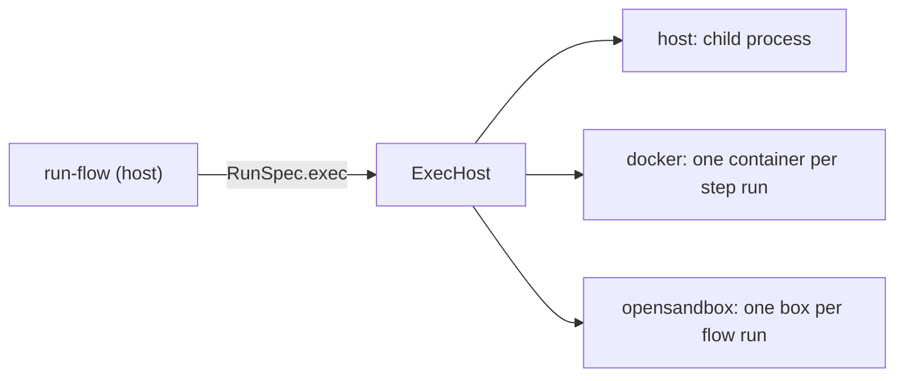

# Running agent work in FlowBoard

This page explains how FlowBoard turns a task into finished work by running AI coding agents and shell checks through a flow. It covers five components on one page: Flow Design, Execution, Agent Providers, Capability Library, and Sandboxing. Each section distills the component's folder of notes. To go deeper, follow the links at the end of each section.

> [!note] Design versus build
> Much of FlowBoard is designed further than it's built. Each section marks what is built, with the date it was built or corrected, and what is still design only. This page reflects the notes as of 2026-11-13. Where a note and the code disagree, the code-checked note wins.

## How the parts fit together

A task follows a *flow*, a recipe of steps and routes. *Execution* runs one step at a time and decides what comes next. Each agent step launches through an *agent provider*, which wraps one AI coding CLI. The *capability library* supplies the skills and agent roles a step names. *Sandboxing* decides where the process runs: on your machine, in a container, or in a remote box. The project's trust sets the floor; the flow's `sandbox:` can only raise it.



The components hand off through a few named types and keys:

| From | To | Hand-off |
|---|---|---|
| Flow Design | Execution | `loadFlow` validates the recipe; the `advance` engine runs core's `FlowDef`, `StepDef`, and `FlowEdge`. Each run pins its loaded flow in `runs/<stamp>-<name>/flow.json`. |
| Execution | Agent Providers | `run-flow` builds a `RunSpec` per agent step and reads back `RunResult { usage, exitCode, outcome?, error? }` plus the `set_outcome` verdict. The engine never sees provider JSON. |
| Capability Library | Agent Providers | `RunSpec.capabilities`, a list of `CapabilityPack` records mounted as `plugin_dir`, `system_prompt`, or `native`. As built, steps name `skills:` and `plugins:` folders directly. |
| Agent Providers | Sandboxing | `RunSpec.exec`, an `ExecHost`. Without it, adapters spawn on the host through `hostExecHost`. |
| Flow Design | Sandboxing | The flow-level `sandbox:` key (`runtime`, `image`, `env`, `egress`, `credentials`), which may only keep or raise the project's tier. A per-step `sandbox` key is an error. |

Three rules hold across every component:

- **Only a work outcome picks the next route.** A run ends `pass`, `fail`, or with no outcome. A rate limit, a crash, or a container that can't start is never a `fail`.
- **A missing outcome is never a pass.** A step with conditional routes that reports nothing waits at a gate.
- **A spent or stuck rework loop escalates to you.** It never fails the task. Only a person's **Fail the flow** ends a flow as `failed`.

Gate decisions carry different labels in the two places you answer them. The terminal shows `Approve (pass)`, `Reject (fail)`, `Retry this step`, and `Fail the flow`; the runs page shows **Approve**, **Send back**, **Retry**, and **Fail**. This page uses the terminal labels.

The sections follow one step from recipe to process:

1. [Flow Design](#flow-design): the recipe.
2. [Execution](#execution): how a task moves through it.
3. [Agent Providers](#agent-providers): how each agent step launches.
4. [Capability Library](#capability-library): the skills and roles a step uses.
5. [Sandboxing](#sandboxing): where the process runs.

## Flow Design

Flow Design is where you define the *recipe* a task follows: a graph of steps, each one an agent or a check command doing one job, wired together by routes that fire always, on a pass, or on a fail. As built (2026-11-10), a flow is a YAML file that `pnpm run-flow` runs, and you edit it by hand or on the **Flow Design** screen at `/flows` in the Next.js app. Execution takes over when a run starts.

### Key concepts

| Term | Meaning |
|---|---|
| Flow (recipe) | A reusable YAML file, `<name>.yaml`, named by its file name. It names no folder or task; each run gives them with `--folder` and `--task`. |
| Step | An entry under `steps:`. Its key is its only name and must match `^[a-z0-9][a-z0-9_-]*$`. |
| Agent step, shell step | A step with `shell:` is a shell step, or *check*: a plain command whose exit code is the verdict. Any other step is an agent step and needs a `prompt`, `skill`, or `system_prompt`. |
| Route | `{ from, to, condition }` in the top-level `edges:` list. `condition` is `always` (the default), `on_pass`, or `on_fail`. At most one route goes from one step to another. |
| Outcome | `pass` or `fail`. A shell step's exit code sets it; an agent step sets it with the `set_outcome` tool. A missing outcome is never a pass. |
| Rework route | An `on_fail` route to its own step, or to a step that reaches it along `always` and `on_pass` routes. The only loops a flow may have. |
| Artifact contract | Each step lists the artifact types it `requires` and `produces`. Every `requires` entry must be produced by a step before it along forward routes. |
| Approval gate | `gate: approval` on a step: when its run ends, the step waits for a person. |
| `budget_usd` | The required top-level ceiling for the whole flow, in dollars. `0` means no ceiling. |
| `max_attempts` | How many times rework may run a step, counting the first run (default 3). Valid only on a step that a rework route leads back to. |
| Flow version | In the design, an immutable snapshot that every save creates. As built, there are no versions: a run pins its loaded flow in `flow.json`. |

### How it works

A flow is a dataflow graph, not a call sequence. Each step runs with a fresh context, so steps hand off through declared artifacts: a step with `produces: [plan]` writes `plan`, and a later step with `requires: [plan]` gets it in its prompt as a file to read first.

Every reader loads a flow through one loader, `loadFlow` (`cli/src/flow-config.ts`), which calls core's pure `validateFlow` (`core/src/flow/flow.ts`). `run-flow --check`, every run start, and every `/api/flows` route call it, so the designer and the CLI report the same problems word for word, and nothing launches until the checks pass. Errors include an unproduced input, two producers of one type, a missing or competing entry step, an unreachable step, forward routes that loop, and an unknown key. Warnings, which block nothing, include a join behind a conditional route and a rework step that produces nothing for its target to read.

At run time, the engine resolves routes in this order:

1. When a step finishes, its `always` routes fire, and its `on_pass` or `on_fail` routes fire on its outcome. A shell step that exits 126 or 127, exits 125 in a sandbox, or dies by a signal opens a *run failed* gate instead.
2. If several routes fire, their targets start at the same time (a fan-out). A step with several forward routes into it is a join: it waits for each upstream step that can still run.
3. A rework route reruns its target with the failing step's outputs added to its inputs, and resets the steps below it. The attempt counter lives on the target. When it is spent, the flow stops at a gate (`<target> has used <n> of <max> attempts`) offering **Retry this step** and **Fail the flow**. A spent loop escalates; it never fails the task by itself.
4. A gated step opens its gate whatever outcome its run reported. **Reject (fail)** is offered only when the step has an `on_fail` route. A rejection is a fail, so it also fires `always` routes; use `on_pass` for a route a rejection must not take.
5. Gates also open on a fail that no route handles, on a missing declared output (`did not write: <types>`), and on a conditional step that reported no outcome (`no outcome reported`).
6. The flow ends `done` when no step is pending, running, or waiting at a gate. Only **Fail the flow** ends it `failed`.

The design versions every edit and pins running tasks to theirs (`tasks.flow_id`). As built, a save writes the file in place, and pinning protects running work instead: each run stores its loaded flow in `runs/<stamp>-<flow name>/flow.json`, and `--resume` never re-reads the YAML. Skills and plugins aren't pinned; every launch reads them afresh.

### Configure and use

To write a flow by hand, put the steps under `steps:` and the routes under `edges:`. This loop from [[Run Flow Review Loop]] sends work back to the implementer until a review passes:

```yaml
budget_usd: 6      # the most the whole loop may spend, every round included; 0 for no ceiling
entry: implement   # every step has an edge into it, so name the first
defaults: { adapter: claude-code, model: sonnet, limits: { max_turns: 30 } }
steps:
  implement: { prompt: prompts/implement.md, produces: [notes], max_attempts: 3 }
  review:
    prompt: prompts/review.md
    requires: [notes]
    produces: [review_notes]
    guards: { deny_paths: ["src/**", "tests/**"] }   # it reports issues; it doesn't fix them
edges:
  - { from: implement, to: review }
  - { from: review, to: implement, condition: on_fail }   # the loop
```

`prompt` paths resolve against the flow file's folder, so a recipe and its `prompts/` folder move together.

To check a recipe on its own, run the following command:

```
pnpm run-flow --check review-loop.yaml
```

A valid flow prints `-- flow ok: 2 steps, starting at implement`. Errors print as `<yaml path>: <field>: <message>` and exit with code 2; warnings print as `-- warning: <field>: <message>`. To check a run's inputs too, add `--folder <dir> --task <file>`.

To edit a flow on the **Flow Design** screen, follow these steps:

1. Run `pnpm dev`, and then open `http://localhost:3000/flows`.
2. In the library, select a flow, or enter a name and click **New flow**. A new file holds only `budget_usd: 0`.
3. To draw a route, drag from a step's right edge to another step. To change its condition, click its label; an `always` route shows its label only while you have it selected. To remove the selected step or route, press `Delete`.
4. To edit a step, select it and use the inspector. To edit the flow's **Budget**, **Starts at** (`entry`), and `defaults`, click the empty canvas.
5. Read the validation strip, which runs the check a quarter of a second after your last edit. To jump to a problem, click its row.
6. Click **Save**, or press `⌘S`. **Save** is disabled when nothing has changed, while the check runs or finds an error, and when the file changed on disk since you opened it.

To start a run, click **Run**. The runs page opens its **New run** sheet on the flow (`/runs?new=<flow>`), where you set **Folder**, **Task**, and an optional **Budget**, and then click **Start run**. **Run** is disabled while the flow has unsaved edits or fails the check, because a run reads the saved file.

### Limits and status

- **Built:** the `run-flow` loader and validator (2026-10-23), the designer at `/flows` (2026-10-24), and the prompt-file editor and **Run** button (2026-11-10).
- **No versions, adoption, or projects.** The designer hashes each file only to refuse a save over a changed file. No run records the hash, so you can't group runs or cost by version.
- **No `manual` step kind.** For a person's sign-off, use `shell: "true"` with `gate: approval`.
- **No known-types list.** A typo in `requires` fails as *no step before it produces that*. Capability-contract, provider-match, and tool-intersection checks aren't built.
- **The sandbox key is per flow, and the project's isolation is its floor** (2026-11-13): the key may keep that tier or make it stricter, never weaker ([[Repository Trust And Sandboxing#Built]]). The top-level `sandbox:` key sets `runtime` (`docker` by default, or `opensandbox`), `image`, `env`, `egress`, and `credentials`; a per-step `sandbox` is an unknown key. The designer has no field for it and keeps it as written.
- **Placeholders aren't filled.** `{{…}}` reaches the agent as written.
- **Designed, not built:** draft mode, `board_order` board columns, the library's domains, authors, variants, preview, and **Use this flow**, and the *unattended and unsandboxed* flag. The built library has search and a shape glyph derived from the routes.
- **Local only.** The flows API returns `403` unless the request's `Host` is `localhost`, `127.0.0.1`, or `[::1]`.
- Many of these rules are decisions dated 2026-10-23 and 2026-10-24 that remain open to review.

### Related notes

- [[Flow Design Overview|What Flow Design is for and where it sits]]
- [[Step Definitions|Every field on a step, designed and as built]]
- [[Connections And Routes|Route conditions and how the engine resolves them]]
- [[Branching Joining And Loops|Fan-out, joins, and rework loops]]
- [[Approval Gates|Gates you design and gates that open by themselves]]
- [[Flow Validation|Every check and its run-flow message]]
- [[Editing And Saving A Flow|What Save does and when it is disabled]]
- [[Version Pinning|How a run keeps the flow it started on]]
- [[Flow Design Screen|Anatomy of the designer at /flows]]
- [[Run Flow Reference|Flow file keys and the rules run-flow settles]]

## Execution

Execution is the part of FlowBoard that moves a task through its flow. It runs each step as a headless agent session or a shell command, reads the outcome, and then advances, fans out, waits at a join, loops back for rework, or stops at a gate for you. The design splits this across the flow engine, the runner, and the job queue and worker. As built (2026-10-23), the engine is `packages/core/src/flow/`, a pure function from the flow, its state, and an event to the next state and the commands to carry out, and the terminal command `run-flow` hosts it in place of the runner and the worker.

### Key concepts

| Term | Meaning |
|---|---|
| Step instance | One task's occupancy of one step definition, with a state, `attempts`, and an `outcome`. As built, `StepInstance` in `state.json`. |
| Run | One attempt at a step instance; a retry, rework, or resume adds a new run. As built, `RunRecord` in `state.json` plus a log, `<NNN>-<step>.jsonl`. |
| Outcome | `pass`, `fail`, or none. The outcome is the only thing the engine takes from a run to choose a route. |
| Rework | An `on_fail` route back to an earlier step. It reruns the target as its next attempt and wastes the superseded runs. |
| `max_attempts` | The cap on attempts at a rework target, first attempt included. A retry after an infra failure or a resume reruns the same attempt and doesn't count. The default is 3: one try and two reworks. Every loop into the same target shares one budget. |
| Fingerprint | A hash of a failing shell step's normalized output tail. The same fingerprint twice means the rework changed nothing. |
| Escalation | What a spent or stuck loop does: it starts nothing and puts a gate on the rework target for you to decide. |
| Gate | A decision the engine waits for. As built, three kinds: `verdict` (approval needed, no outcome reported, an unhandled fail, an unwritten output), `escalation`, and `run_failed`. |
| Infra failure | A run that ends with an error, such as a rate limit, a crash, a nonzero agent exit, or a timeout. It is never a `fail`. |
| Wasted spend | The cost of runs that a rework, an escalation, a **Retry this step** at a verdict gate, an interrupt, or an infra failure discarded (`wasted` on the run record). Runs that **Fail the flow** stops aren't wasted. |

### How it works

**Only a work outcome picks the next edge.** A shell step's exit code is its outcome: `0` sets `pass`, and anything else sets `fail`. An agent step's outcome is what it reported with the `set_outcome` tool, else the provider's `RunResult.outcome`, else none. A missing outcome is never a pass: if a step has an `on_pass` or `on_fail` route and reports nothing, it waits at a gate with the reason `no outcome reported`. At a verdict gate, your decision wins: **Approve (pass)** sets `pass` and **Reject (fail)** sets `fail`, whatever the agent concluded.

An infra failure never reaches the engine as a `fail`, and it never uses up an attempt. In the design, the runner classifies it. A transient failure (rate limited, overloaded, network error, killed by a signal) is retried as the same attempt after 30 s, 2 min, and 8 min, and anything else blocks the task. As built in `run-flow` (2026-10-23), nothing retries automatically. The run is marked wasted and its step waits at a *run failed* gate, where **Retry this step** reruns the same attempt. For a shell step, exit `126`, exit `127`, or a death by a signal is a setup failure, not a `fail`; under a sandbox (2026-11-10), so is exit `125`.

When a run ends without an error, `run-flow` checks the following, in order, and the first match wins:

1. An output the run didn't write opens a gate: `did not write: <types>`.
2. An approval step opens a gate: `approval needed`, plus the outcome and reason the step reported, if any.
3. A step with a conditional route and no outcome opens a gate: `no outcome reported`.
4. A `fail` that no `always` or `on_fail` route handles opens a gate: `failed, and no edge handles a failure`, with the step's reason in parentheses after `failed` if it gave one.
5. Otherwise, the step is `done` and its `always` routes plus the routes matching its outcome fire.

If more than one route fires, the targets start concurrently; this is the fan-out. A step that has forward routes into it from several steps is a join: it waits while any of those steps is pending, running, or at a gate, or can still be reached from one that is. Rework routes never make a join.

On rework, the engine checks the loop guard before it starts anything. First it checks the budget: would the target's next run pass `max_attempts`? Then it checks whether the failing shell step has the same fingerprint as its previous failed run. If either is true, the loop escalates. **A spent or stuck loop is handed to you; it never fails the task.** In `run-flow`, the target's gate reads `<target> has used <n> of <max> attempts` (or `<target> has used <n> attempts, past its max_attempts of <max>` after an earlier retry went past the budget) or `<step> failed the same way twice`, shows the failing step's `produces` artifacts, and discards everything below the target. You choose **Retry this step**, which grants one more attempt (past the budget, for a spent loop) and doesn't reset the counter, or **Fail the flow**. Only a person's **Fail the flow** ends a flow as `failed`.



### Configure and use

You configure execution in the flow file. The following excerpt from the run-flow reference shows a join, a check step, and a rework route that spends the `implement` step's budget. The other steps and routes of that example are left out:

```yaml
budget_usd: 5                      # required: the most the whole flow may spend, in dollars; 0 for no ceiling
steps:
  implement: { prompt: prompts/implement.md, requires: [plan], produces: [notes], max_attempts: 2 }
  check: { shell: pnpm test, produces: [check_output] }   # exit 0 is pass
edges:
  - { from: implement, to: check }                       # check waits for both: a join
  - { from: tests, to: check }
  - { from: check, to: review, condition: on_pass }
  - { from: check, to: implement, condition: on_fail }   # rework: spends implement's attempts
```

To make a rework useful, give the failing step a `produces` artifact. The rework run reads only declared artifacts. If a check produces nothing, `--check` warns: `steps.check: reworks "implement" on a failure but produces nothing, so implement runs again without seeing why`.

To run a flow from the terminal, follow these steps:

1. Check the recipe. In the usage line, `--check | --mermaid` means one of the two options:

   ```
   pnpm run-flow --check | --mermaid [--folder <dir> --task <file>] <flow.yaml>
   ```

2. Start the run in an existing folder, with a task file:

   ```
   pnpm run-flow --folder <dir> --task <file> [--budget-usd <n>] [--max-runs <n>] [--allow-dirty] [--page] <flow.yaml>
   ```

3. At each gate, choose `Approve (pass)`, `Reject (fail)`, `Retry this step`, or `Fail the flow` (Reject appears only on a step with an `on_fail` route), and then optionally type a note at `Note for the next run (optional)`. The note goes to the runs that the decision starts.

To steer a run from the browser, start it with `--page`, or click **+ New run** on `/runs`. The page then offers **Approve**, **Send back**, **Retry**, and **Fail** at each gate; the first answer, terminal or page, wins. **Stop run** works on any run whose host is alive.

To continue a run that was stopped, paused, or cut off by a crash, run the following command. After a spent budget, add `--budget-usd` with a higher ceiling, or `0` for none:

```
pnpm run-flow --resume <run folder> [--budget-usd <n>] [--max-runs <n>] [--page]
```

### Limits and status

- **Built (2026-10-23):** the engine and the `run-flow` host, with fan-out, joins, conditional routes, approval gates, rework with `max_attempts` escalation, fingerprints, shell checks, the `requires` and `produces` contract, `budget_usd`, `--max-runs`, and `--resume`.
- **Built later:** the runs page (`/runs`), which steers runs through files in the run folder; and (2026-10-24, corrected 2026-11-10) a flow-level `sandbox:` key, with `runtime: docker` (a container per step run) or `runtime: opensandbox` (one box per flow run).
- **Design only:** the `apps/worker` process, the SQLite `jobs` table with leasing, the `VIBE_MAX_RUNS` cap, automatic infra retries with backoff, task statuses such as `blocked`, parking and resuming an agent session, worktrees per task, and memory around a run.
- **Not built:** Cancel, Pause after the current run, and a Stop for a single run. Ctrl+C and **Stop run** stop every run; each cut-off run is wasted and `--resume` reruns it at the same attempt.
- **Known deviation:** the design principle "routes never spawn" doesn't hold. `POST /api/runs` and `POST /api/runs/:run/resume` start a detached `run-flow --page`. Nothing records this as a decision; it is open to Alex's review.
- **Open to review:** many `run-flow` rules are Claude's calls (2026-10-23), such as the one-`on_fail`-route rule and an escalation discarding everything below its target.

### Related notes

- [[Run Outcomes|How a run ends: pass, fail, or no outcome]]
- [[Advancement Rules|What the engine does after a run ends]]
- [[Fan-Out And Join|Running branches in parallel and waiting for them]]
- [[Rework Loop|Sending work back to an earlier step]]
- [[Loop Guard And Escalation|The attempt budget and what a spent or stuck loop does]]
- [[Infra Retries|Why a crash or rate limit is never a fail]]
- [[Stopping And Cancelling|Stop, Cancel, Pause, and shutdown, designed and built]]
- [[Execution State Machines|Task, step, run, and job states]]
- [[Run Flow Reference|The run-flow command and its flow file]]
- [[Execution Open Questions|Where the sources disagree or leave a gap]]

## Agent Providers

Agent Providers is the layer that lets FlowBoard drive different AI coding CLIs through one contract, the `AgentProvider` port. You describe a run once, as a `RunSpec`, and get back one stream of normalized events and one `RunResult`, whichever CLI ran it. As built (2026-10-18, fixed 2026-10-22), two real providers implement the port, Claude Code and OpenCode, plus Replay, a zero-spend test double. The port lives in `code/flowboard/packages/core/src/ports/`, and the adapters live in `packages/adapters/src/agent/<claude|opencode|replay>/`.

### Key concepts

| Term | Meaning |
|---|---|
| `AgentProvider` | The port. It has four members: `id`, `capabilities`, `resolveModel`, and `launch`. Code outside the adapters programs against it. Only the CLI imports an adapter: `cli/src/run.ts` constructs the providers, and `cli/src/config.ts` borrows OpenCode's `allowsAnyShell` check. |
| Adapter | An implementation of the port. An adapter does exactly two mappings: `RunSpec` to the provider's native options, and the provider's native stream to `NormalizedEvent`. |
| `RunSpec` | Everything needed to launch one attempt of one step: `prompt` (a six-part `PromptParts`), `model`, `effort`, `toolPolicy`, `tools`, `capabilities`, `cwd`, `exec`, `resume`, `limits`, `permissionMode`, `systemPrompt`, and `guards`. |
| `AgentRun` | The live handle that `launch()` returns without blocking: `sessionId` and `pid` (both promises), `events`, `result`, and `stop()`. |
| `RunResult` | `{ usage, exitCode, outcome?, error? }`. A set `error` means the run failed, even at exit code `0`. An unset `outcome` is never a pass. |
| `NormalizedEvent` | One of eight kinds: `assistant_text`, `thinking`, `tool_use`, `tool_result`, `system`, `usage`, `result`, and `error`. Each event can carry the native message as `raw`. |
| Provider capability | One of eleven flags, such as `effort`, `resume_fork`, `mcp_tools`, `native_cost`, and `tool_hooks`, that says what a CLI supports. |
| Logical model id | A provider-neutral model name that `resolveModel` maps to a native id. As built, there is no shared vocabulary (see *Limits and status*). |
| `GuardRules` | `RunSpec.guards`: `writeRoots`, `denyPaths`, and `denyCommands`. An adapter with `tool_hooks` checks every tool call against them inside the agent. |
| `ExecHost` | The seam that decides *where* a process runs, separate from *which* agent runs it. Adapters spawn through `RunSpec.exec`. |
| Ask-user shim | `packages/ask-user`, an MCP server named `flowboard` that gives the agent `ask_user` and `ask_user_batch`, plus `set_outcome` in a flow step that needs a verdict. It forwards each call to the address in `FLOWBOARD_ASK_SOCKET`: a Unix socket, or `host:port` with `FLOWBOARD_ASK_TOKEN` inside a Docker sandbox. |

### How it works

The caller builds a `RunSpec`, and the adapter does the rest. As built, the caller is `pnpm run-agent` (one run) or `pnpm run-flow` (a flow of runs); the runner that the design names as the caller isn't built.

1. The caller builds a `RunSpec` from its YAML and calls `provider.launch(spec)`.
2. The adapter maps the spec to native config:
   - **Claude Code** passes Agent SDK `query()` options. The SDK runs the installed `claude` CLI on your subscription login, and the adapter strips `ANTHROPIC_API_KEY` and `ANTHROPIC_AUTH_TOKEN` from its environment.
   - **OpenCode** starts one `opencode serve` per run on `127.0.0.1`, with the whole config in `OPENCODE_CONFIG_CONTENT`. It turns `toolPolicy` and `permissionMode` into ordered permission rules and answers every `permission.asked`, because an unanswered request hangs the run.
3. Both adapters inject each server in `tools` and pre-approve it, so no allow list can lock out `ask_user`. An explicit deny still wins.
4. The adapter normalizes the native stream (SDK messages on Claude, server SSE events on OpenCode) into `NormalizedEvent`s. Tool events keep the provider's own tool names and inputs, so a reader that looks inside a tool event has to know the provider.
5. When the run ends and its process exits, `result` settles. A `stop()` before the result settles it with exit code `130` and `error: 'stopped'`. A stopped or failed run reports its last running `usage`, not zero.



### Configure and use

To run one agent with either provider, use `run-agent`:

1. Write a task file, for example `task.md`.
2. Write a YAML file that names the adapter, model, folder, and prompt. Unknown keys are errors, so a typo never runs with a default:

   ```yaml
   adapter: claude-code          # required
   model: sonnet                 # required
   effort: high
   folder: proj                  # required
   prompt: task.md               # required
   permissions:
     mode: acceptEdits
     allow: [Read, Write, "Bash(pnpm *)"]
     deny: [WebFetch]
   guards:
     deny_paths: ["docs/**"]
   limits:
     budget_usd: 0.50
     max_turns: 20
   ```

3. Run `pnpm run-agent task.yaml`. The command prints each event, asks the agent's questions in the terminal, and logs the run to `runs/<YYYY-MM-DDTHH-MM-SS>-<adapter>.jsonl`. It exits `0` on success, `1` on failure, `2` on a config error (before anything launches), and `130` when stopped.

If you set `adapter: opencode`, write `model` as `providerID/modelID`, for example `openrouter/deepseek/deepseek-v4.1-flash`. A Claude alias such as `sonnet` fails there. On OpenCode, an allow entry that globs to any shell command (`*`, `b*`, `Bash(?*)`) needs `permissions.allow_unrestricted_shell: true`.

To mix providers in one flow, set `adapter` per step in a `run-flow` recipe. Each agent step is one `run-agent` run, and `defaults` supplies the shared keys:

```yaml
budget_usd: 5
defaults: { adapter: claude-code, model: sonnet, limits: { max_turns: 30 } }
steps:
  tests:
    adapter: opencode              # a second provider in the same flow
    model: openrouter/deepseek/deepseek-v4.1-flash
    prompt: prompts/tests.md
```

Run it with `pnpm run-flow --folder proj --task task.md delivery.yaml`, or check it first with `pnpm run-flow --check delivery.yaml`. Each agent run may spend only what is left of the flow's `budget_usd`; the provider stops the run at that cap. For routes, gates, and resuming, see [Flow Design](#flow-design) and [Execution](#execution).

To add a provider, follow the acceptance test from the design:

1. Implement `AgentProvider` under `adapters/src/agent/<name>/`: the option mapping, the stream parser, session resume, and the `capabilities` set.
2. Record a native stream and write the parser tests against it.
3. Translate the provider's tool names onto the Claude names that `checkToolCall` (`core/src/guard.ts`) knows, and pass the folder the shell is in. If you skip this step, the guard allows everything.
4. Construct the provider in the composition root. As built, that is `defaultProvider` in `cli/src/run.ts`.
5. Repeat by hand the port promises that the real adapters keep: exit code `130` on stop, `127` on a missing binary, `pid` of `-1` when nothing spawned, and `sessionId` that rejects when no id arrives. No shared conformance suite exists.

### Limits and status

- **Built (2026-10-18, fixed 2026-10-22):** the port, the Claude Code and OpenCode adapters, Replay, `run-agent`, and the ask-user shim. The decisions behind the 2026-10-22 fixes are open to Alex's review.
- **Built (2026-10-23):** `run-flow`, which runs several agent and shell steps as one flow. It is a terminal stand-in for the runner.
- **Not built:** the runner, job queue, database (`runs`, `run_events`), the designed run routes over `run_events` (the app's `app/api/runs/` routes read `run-flow`'s run folders instead), `PricingService`, `SpecTransform` and draft mode, and context-replay for resume.
- **Capability negotiation is design only.** No code reads `provider.capabilities`. Claude Code and OpenCode both declare all eleven flags, although OpenCode honours several in part: `plugins` mounts only `<dir>/skills`, `partial_stream` emits one `usage` event per step, and the adapter enforces `budget_cap` itself and never trips on an unpriced model.
- **No shared logical model vocabulary.** The Claude adapter passes aliases through as written. `run-agent` builds OpenCode with an empty `models` table, so OpenCode needs `providerID/modelID`.
- **The neutral vocabulary is Claude Code's.** `toolPolicy` entries and the six `PermissionMode` values are Claude's; OpenCode emulates them, and a pattern can match on one provider and not the other.
- **Guards have gaps.** Only file-edit tools and recursive `rm` are checked against paths. Any other permitted shell command can write anywhere, and a script, `eval`, or `git clean` gets around the `rm` rule.
- **Sandboxing.** The provider notes (2026-10-22) predate the sandbox runtimes and say only the host `ExecHost` tier exists. Since 2026-10-24, `run-flow` sets `RunSpec.exec` from a flow-level `sandbox` key (`runtime: docker` or `opensandbox`); see [Sandboxing](#sandboxing).
- **Codex is designed, not built.** `codex` is only a name in `ProviderId`. Whether OpenCode is in v1, and whether Codex is still next, is undecided (open question #38).
- **Exit classification is crude.** Neither adapter emits rate-limit or retry records, and a signal kill shows as exit code `1`, so a future runner has to match `error` text to classify failures.

### Related notes

- [[Agent Providers Index|Map of every Agent Providers note]]
- [[AgentProvider Port|The port's four members and an adapter's two jobs]]
- [[Run Spec|Every RunSpec field, tool policy, and guard rule]]
- [[Agent Run Handle And Result|How a run is stopped, settles, and fails]]
- [[Normalized Event Envelope|The eight event kinds and where each comes from]]
- [[Capability Negotiation|Designed graceful degradation per missing capability]]
- [[Run Config Reference|Every field of the run-agent YAML file]]
- [[Run Flow Reference|Every field of a run-flow recipe and how a flow runs]]
- [[Adding A Provider|The acceptance test for a new adapter]]
- [[Agent Providers Open Questions|Where the sources disagree or leave a gap]]

## Capability Library

The Capability Library holds the reusable building blocks that flow steps draw on: *skills*, which are packaged instructions invoked like slash commands, and *agents*, which are named roles with a prompt and defaults. A step names a capability, and the library is where you install, define, inspect, update, and remove those names for one project. The library feeds flow design, not run time directly: execution mounts whatever versions a task pinned when it started. The v1 design was settled on 2026-10-15 (decisions D1–D31); the library itself is designed but not built, while the provider adapters that mount its packs are built.

### Key concepts

| Term | Meaning |
|---|---|
| Capability | The logical building block a step names, for example `code-review` or `architect`. Provider-independent. |
| Provider pack | One packaging of a capability for one agent CLI: the `CapabilityPack` record. For Claude Code, a plugin directory. Not a *bundle pack*, the deferred kind that groups skills, agents, and flows. |
| Plugin | The v1 unit of install: one git repository cloned at one commit and mounted with `--plugin-dir`. Its skills are installed, updated, and removed together. |
| Skill | A packaged instruction described by a `SKILL.md`. It belongs to a plugin and is invoked fully qualified as `/<plugin>:<slug>`, so two plugins can both ship `code-review`. |
| Agent | A named role (the *who*): system prompt, default model, default effort, and allowed tools. In v1, `default_model` holds a Claude alias (`opus`, `sonnet`, or `haiku`) that serves as the logical model id. |
| Capability store | `<project>/.flowboard/skills/<plugin>/<commit>/`: per project, gitignored, one directory per commit. |
| Capability pins | `tasks.capability_pins`: the plugin commits and agent rows a task records at start. Every step of that task runs those versions. |
| Extra plugins | `step_defs.extra_plugin_ids`: plugins a step mounts beside its skill's plugin, so its prompt template can invoke a second `/<plugin>:<slug>`. |
| Used by | The steps that reference a capability, counted over each flow's latest version plus any version a non-terminal task pins. A non-zero count blocks removal. |
| Network tool (amber) | `Bash`, `WebFetch`, or `WebSearch`, or a plugin that ships `.mcp.json` or `hooks/`. Amber means the capability needs an egress allowlist change to work; it isn't a safety verdict. |
| Seed | A plugin or agent that ships in FlowBoard's repo and is copied into each project's store under FlowBoard's commit. |

### How it works

A step definition of kind `ai` sets `agent_id`, `skill_id`, or both (D27). The agent supplies the system prompt; the skill, the slash invocation. The step's tools are the agent's list intersected with the skill's `allowed-tools`, narrowed further by the step's `allowed_tools` when set (D28). As designed, the flow editor warns at design time when the intersection drops a tool the skill declares. The built editor at `/flows` takes the skill as free text and has no such check.

Flows reference capabilities by id, not by version. Tasks pin versions, so an update reaches every flow on its next task and never reaches a running task. The designed path from install to run is:

1. **Install.** The host clones a git URL into `_staging/<uuid>/`, parses `.claude-plugin/plugin.json` and `skills/*/SKILL.md`, and checks the requested tools and any `.mcp.json` or `hooks/`. Nothing is written until you confirm; then the plugin lands in the store under its commit, and its skills become selectable in the step editor.
2. **Task start.** The task records `capability_pins`.
3. **Build the run.** The worker resolves the step's capability from the pinned flow version and the version from the pins. It places only the plugin of the step's skill plus the step's `extra_plugin_ids` in `RunSpec.capabilities` (D14).
4. **Mount.** The `AgentProvider` adapter interprets each pack's `mount` union: `plugin_dir`, `system_prompt`, or `native` (D2).
5. **Sandbox.** The step's pinned commit directories are mounted read-only into the task's container. On the host tier, without Docker, a step whose plugins came from a git URL doesn't run; seeds still run (D15).
6. **Garbage collection.** After each update and each task that reaches a terminal state, FlowBoard deletes a commit directory that is neither the installed commit nor pinned by a non-terminal task (D11).

In the prompt, part 4 is the fully qualified invocation, for example `/grill-me:grill-me`, followed by the step's `prompt_template`. As built (2026-10-18), the Claude Code adapter moves the invocation to the front of the prompt, because the CLI treats only a leading `/` as a slash command. OpenCode rewrites it as `Use the "grill-me" skill.`.

### Configure and use

As built, no registry, library screen, or library API exists. The following tasks describe the decided v1 design for the route `/p/[slug]/library`.

To install a plugin from git, do the following:

1. On the library screen, click **+ Install from git** (proposed label; the mockup reads **+ Install from GitHub**).
2. Paste any git URL, including a `file:///…` URL for a skill you're writing, and click **Fetch**. If the repository has a dirty working tree, commit first; uncommitted work doesn't install.
3. Review what was found: name, commit, `SKILL.md`, the tools it asks for, and every skill as `/<plugin>:<slug>`.
4. Click **Install `<id>`**. To abandon the install, click **Close** or press `esc`.

The screen calls `POST /api/projects/:id/plugins/preview` with `{url}`, then `POST /api/projects/:id/plugins` with `{previewId}`. A skill's frontmatter looks like this mockup example:

```yaml
name: dependency-audit
version: 1.0.2
description: Audit dependencies for advisories and unpinned versions.
invokes: set_outcome
allowed-tools: Read, Bash, WebFetch
```

To wire a network-capable skill into a step, do the following:

1. In the flow editor, pick an agent, a skill, or both for the step.
2. Add the host that the skill needs to that step's egress allowlist. If you skip this step, the first run fails closed, because egress is default-deny at the step, not the capability.

To define an agent, click **+ Define agent** and enter the name, description, prompt, default model, default effort, and allowed tools. Seeded agents are read-only; to change one, click **Duplicate to edit**.

To update a plugin, do the following:

1. Click **Check for updates**. Updates are found only this way; nothing polls.
2. On a row with an amber dot, click **Update to n**, and then read the update note and the list of skills added and removed.
3. Confirm the update. If the new commit drops a skill that a step uses, FlowBoard refuses the update (`409`).

To remove a plugin or agent, click **Remove** and confirm. The button stays disabled while any step uses it, and `DELETE /api/plugins/:id` returns `409` while it's referenced. A running task is unaffected: it runs from its own pinned commit directory, as this store layout shows:

```
<project>/.flowboard/skills/            # gitignored, per project (D5)
├── _staging/<uuid>/                    # install preview; deleted on confirm or close (D24)
├── code-review/                        # a seed plugin
│   └── <flowboard-sha>/                # seeds are filed under FlowBoard's commit (D6)
└── fb-dependency-audit/                # a git-installed plugin
    ├── b62f10d…/                       # installed commit
    └── 9c41e07…/                       # older commit, kept while a live task pins it (D10, D11)
```

### Limits and status

- **Designed, not built (decided 2026-10-15):** the library screen, the v1 API, the `plugins`, `skills`, and `agents` tables, `capability_pins`, garbage collection, update checks, used-by, and seed copying. Every v1 roadmap item is open.
- **Stand-in:** `run-agent`, and each agent step of `run-flow`, replace the registry and worker. Their YAML `plugins:` become `plugin_dir` packs, and their `skills:` folders are copied into a temporary plugin named `local`, so `/name` becomes `/local:name`.
- **Built (2026-10-18):** the Claude Code adapter passes each `plugin_dir` to the Agent SDK's `plugins` option and fails a run whose plugin doesn't load. A live test confirmed `/<plugin>:<slug>` invokes headless.
- **As built (checked 2026-10-22), plugin MCP servers don't start.** The adapter sets `strictMcpConfig: true`, so D8's mount-as-is doesn't hold for `.mcp.json`. OpenCode mounts only a plugin's `skills/` folder.
- **As built, the agent prompt travels as `RunSpec.systemPrompt`**, not `--append-system-prompt`. `run-agent` injects the ask-user server as `flowboard`, and the adapter pre-approves each injected server, so the tools are allowed as `mcp__flowboard__*`, not the designed `mcp__vibe__*`.
- **As built, `run-flow` mounts a step's plugin folders into its sandbox**, read-only under Docker and copied in under OpenSandbox. There are no pinned commits yet, and the host tier doesn't refuse any plugin.
- **Provider scope:** v1 is Claude-only (D1), but OpenCode was built as a second provider on 2026-10-18; whether it's in v1 is Agent Providers open question #38. Provider packs, the coverage counter, the provider filter, and the provider-match check are deferred. Codex is designed, not built.
- **Deferred or out of scope:** bundle packs (D3), the `researcher` flow template (D31), and a plugin marketplace.
- **Open:** how an agent's default model and effort reach a run (#21), whether a plugin's own agents become library agents (#22), whose allowlist an amber mark points at (#23), reusing steps across projects (#20), and a plugin's author (#26).

### Related notes

- [[Capability Library Decisions|The v1 design decisions, D1–D31]]
- [[Capability Versus Provider Pack|Capability versus provider pack: the core split]]
- [[Capabilities In Flows|How steps reference skills and agents]]
- [[Capability Runtime Mounting|How a capability reaches a running agent]]
- [[Installing A Capability From GitHub|Install a plugin: clone, parse, check, confirm]]
- [[Updating And Removing Capabilities|Task pins, update preview, and blocked removal]]
- [[Capability Tools And Egress|Network tools and the egress allowlist]]
- [[Seeded Capabilities|The seed set and the Software delivery flow]]
- [[Capability Library Open Questions|Open questions about the library]]

## Sandboxing

Sandboxing runs agent and shell steps inside a security boundary, a container or a remote box, instead of directly on your machine. Agents run headless and read untrusted content, so a prompt injection can redirect them; a sandbox limits what they can reach. It has no screen of its own: it sits under the runner as the `ExecHost` port, and the project's isolation setting decides it, which a flow-level `sandbox:` key can only make stricter ([[Repository Trust And Sandboxing#Built]]).

### Key concepts

| Term | Meaning |
|---|---|
| Isolation tier | How strong the boundary is. The design defines `IsolationTier = 'host' \| 'container' \| 'gvisor' \| 'microvm'`, weakest to strongest. run-flow builds four: no sandbox (host), `runtime: docker`, `runtime: opensandbox`, and Docker under gVisor, which only an Untrusted project gets. No microVM tier exists. The project's trust picks the floor (host for Trusted, Docker for Normal, gVisor for Untrusted). |
| `ExecHost` | The port that decides *where* a process runs, independent of *which* provider runs it. A provider builds the command; the `ExecHost` spawns it. That makes any provider work at any tier ("2×N, not N×M"). |
| `SandboxProfile` | The settings an `ExecHost` applies: `tier`, `image`, `egressAllow`, `limits`, `mounts`, `env`, and `nonRoot`. |
| Egress allowlist | The outbound hosts a sandbox can reach; everything else is denied. The load-bearing control: prompt injection can't change what the firewall permits. |
| Credential injection | The box holds a fake key; a proxy outside swaps in the real one on requests to the provider's host, so the environment holds nothing worth stealing. |
| The box | One OpenSandbox sandbox that holds a whole flow run. run-flow stays on the host and drives the box through a relay. |
| `changes.patch` | The diff an OpenSandbox run writes to its run folder at the end. Your folder is never edited; you review the patch and apply it. |
| Permission gate | The design rule that `bypassPermissions` is allowed only on a sandbox tier. Not built as designed; see the limits that close this section. |
| In-agent guards | Checks inside the agent that deny out-of-scope tool calls, such as writes outside the write roots or `git push`. |

### How it works

A run must start in a folder a FlowBoard project owns, and the project's trust decides the sandbox (`cli/src/isolation.ts`): Trusted with no `sandbox:` key leaves `RunSpec.exec` unset, so both provider adapters spawn on the host with `hostExecHost` (`adapters/src/exec/host.ts`), a shell check is a plain host process, and an agent's file edits and shell commands ask you first. Normal with no key runs `{ runtime: docker, image: flowboard-cli }`. Untrusted runs Docker under gVisor, or is refused. A flow's own `sandbox:` key replaces the default when it is as strong. Whenever there is a sandbox, run-flow (`cli/src/flow-exec.ts`) sets `spec.exec` for every agent run and sends shell checks through the same `ExecHost`. See [[Repository Trust And Sandboxing#Built]].



The three levels behave differently:

| | Trusted, no `sandbox:` | `runtime: docker` (default; Normal's too) | `runtime: opensandbox` |
|---|---|---|---|
| Where steps run | Host | One `docker run --rm` container per step run | One box per flow run |
| Network | Open | Agent containers open (`egressAllow: ['*']`); check containers `--network none` | Deny by default, plus the `egress` allowlist |
| Keys | Host environment | Real values of the variables `sandbox.env` names, agent containers only | Fakes in the box; the real values are injected outside |
| Your folder | Edited in place | Bind-mounted, edited in place | Untouched; the run ends with `changes.patch` |

Under `runtime: docker`, every container runs as uid 1000 with `--read-only`, a tmpfs `/tmp`, `--cap-drop ALL`, `--security-opt no-new-privileges`, and `--pids-limit 512` (`adapters/src/exec/docker.ts`). The run's temp folder and the artifacts folder are mounted read-write. FlowBoard's code, the run folder, and the step's plugin folders are mounted read-only, each at its host path. A Unix socket can't cross Docker Desktop's VM, so the `ask_user` shim reaches the broker over TCP: `FLOWBOARD_ASK_SOCKET` is `host.docker.internal:<port>`, and a per-run `FLOWBOARD_ASK_TOKEN` authenticates it.

Under `runtime: opensandbox`, `flow-run.ts` drives one box (`adapters/src/exec/opensandbox/box.ts`) through these stages:

1. Run the usual host checks: folder lock, clean tree, and run folder.
2. Create the box from `image` with `networkPolicy.defaultAction: 'deny'` and one allow rule per `egress` host, turn on the credential proxy, and create a `bearer` vault binding for each credential set on the host. A credential that isn't set prints `-- warning: sandbox: <NAME> is not set; steps that need it will fail`.
3. Upload `git archive HEAD` of your folder, unpack it at the folder's own absolute path, commit it, and tag it `flowboard-base`.
4. Start `relay.cjs` as uid 1000 with a random 192-bit token, and save `{ id, token }` to `sandbox.json` (mode 0600) so `--resume` can find the box.
5. Run each step through the relay: one HTTP-upgrade connection per process, carrying framed stdio. Artifacts go in before every process; an agent step's outputs and verdict come back after it.
6. End the run. If the run ends `done` or `failed`, run-flow writes `git diff --binary` against `flowboard-base` to `<run folder>/changes.patch` and kills the box. If the run is `paused` or `stopped`, run-flow keeps the box (24 h TTL) for `--resume`.

The box can't dial the host: questions reach the host broker through a reverse tunnel on the relay.

### Configure and use

To run a flow in OpenSandbox, follow these steps:

1. Set up the server and images as described in `code/flowboard/docker/README.md`, section 3. Give the server an `api_key`, set `publish_host = "127.0.0.1"`, and set `[egress] mode = "dns+nft"`, because the credential vault refuses DNS-only mode.
2. Add a flow-level `sandbox:` key. Steps don't take a `sandbox` key; a per-step one fails as `unknown key`.

   ```yaml
   budget_usd: 1
   sandbox: { runtime: opensandbox, image: flowboard-sandbox }
   steps:
     implement: { adapter: claude-code, model: sonnet, prompt: implement.md, produces: [notes] }
     check: { shell: pnpm test, produces: [check_output] }
   edges:
     - { from: implement, to: check }
   ```

3. Export the server address and the real credentials on the host, run the flow, and apply the patch after you review it:

   ```sh
   export OPENSANDBOX_DOMAIN=127.0.0.1:8080 OPENSANDBOX_API_KEY=<server api_key>
   export CLAUDE_CODE_OAUTH_TOKEN=<from claude setup-token> OPENROUTER_API_KEY=<key>
   pnpm run-flow --folder ~/code/app --task task.md flow.yaml
   git -C ~/code/app apply "$PWD/runs/<run>/changes.patch"
   ```

   Replace `<server api_key>` with the server's `api_key`, and `<run>` with the run folder's name. Run the last command from the folder you started `run-flow` in; at the end of the run, `run-flow` prints the exact `git apply` command with the patch's absolute path.

To control what the box can reach, set `sandbox.egress`. It defaults to the API hosts of the steps' adapters: `api.anthropic.com` for a `claude-code` step, and `openrouter.ai` for an `opencode` step whose model starts with `openrouter/`. An explicit list replaces the defaults, so add `registry.npmjs.org` if a step installs packages. Entries are host names or `*.domain`; an IP address is an error.

To choose which keys are injected, set `sandbox.credentials`. Only `CLAUDE_CODE_OAUTH_TOKEN` and `OPENROUTER_API_KEY` are accepted.

To unblock a denied host during an OpenSandbox run, answer the **run failed** or escalation gate at the terminal prompt `Host to allow before the retry`, or on the runs page if you started the run with `--page`. On the page, enter the host in the host field, which comes pre-filled with the host the failed run most likely needed, and then click **Allow host & retry**. The live box can reach the host at once, and run-flow adds it to `sandbox.egress` in the run's `flow.json`, never to the recipe.

A Normal project already runs each step in a local container (`flowboard-cli`) with no `sandbox:` key. To choose the image or the variables yourself, or to run a Trusted project's steps in one, set `sandbox: { runtime: docker }` with an `image`, and list in `env` the variables agent containers need. `egress` and `credentials` are errors under Docker, and `env` is an error under OpenSandbox. If the flow has an agent step, `--check` and every start print `-- warning: sandbox: ai steps have open network access and the variables in sandbox.env`. Under OpenSandbox, they print `-- warning: sandbox: agents' edits stay in the sandbox; the run ends with changes.patch to review` instead.

### Limits and status

- **Built 2026-10-24, corrected 2026-11-10:** `runtime: docker` (per-step-run containers, hardened as described earlier in this section) and `runtime: opensandbox` (one box per run, egress allowlist, credential vault, `changes.patch`). The flow's key is optional and set once per flow; without it the project's tier applies. `flow.json` pins the tier in `config.sandbox` and `config.isolation`, and the run page shows it.
- **No egress proxy for Docker.** FlowBoard's own Squid or tinyproxy proxy on an internal `fb-sandbox` network is not built. Docker agent containers have open network access and hold real keys; only OpenSandbox enforces an allowlist and injects credentials.
- **Permission gate not built as designed.** No tier relaxes the refusal: on every tier, `bypassPermissions`, `auto`, or an unrestricted shell allow entry is refused unless the step sets `permissions.allow_unrestricted_shell: true`. `permissions.mode` defaults to `acceptEdits`.
- **Resource limits.** Memory and CPUs are the project's, set in `.flowboard.yaml` in the repo, never in a flow. Docker caps every container at 512 processes and, when the project file sets no memory, at a quarter of Docker's memory. OpenSandbox uses the SDK's defaults, 1 CPU and 2 GiB, unless the project file sets them ([[Run Flow Reference#Project file]]). `timeout_minutes` is the wall clock: 30 minutes by default for a shell step, none for an agent step. No mapping from `max_turns` or `max_budget_usd` to physical limits exists.
- **OpenSandbox limits.** The box holds only the last commit (no `node_modules`, submodules, or LFS objects), so install dependencies in a first shell step. Shell steps share the agents' allowlist. Anyone who can call the server can run root commands in the box.
- **Failure handling.** A sandboxed shell check that exits 125 is a setup failure (*"exit code 125: the sandbox could not start the command"*) and opens a **run failed** gate. The 2026-11-10 Docker fixes are tested only without a Docker daemon.
- **Built 2026-11-13:** the project's trust is the floor (Trusted: the machine with approvals; Normal: Docker; Untrusted: Docker under gVisor, refused where Docker has no `runsc`), and a run outside every project is refused. `--resume` works the isolation out again from the project's current trust and refuses if it changed or `flow.json` was edited. Untrusted boxes get only the agents' credentials, never the flow's `sandbox.env`.
- **Design only:** the `microvm` tier, `settings.sandbox_profile`, the `runs.sandbox` column, a per-step override, a startup Docker probe, the `flowboard-runner` image, and an injection scan over artifacts.
- **Residual risk, by design:** a hardened sandbox *"cannot stop a malicious repo from exfiltrating whatever is inside the sandbox … to whatever the allowlist permits."* Run trusted repos, keep the allowlist tight, and mount no host secrets. Plain containers also share the host kernel.

### Related notes

- [[Sandbox Threat Model|Why the sandbox exists and what it can't stop]]
- [[Isolation Tiers|The isolation ladder from host to microVM]]
- [[ExecHost Port|The ExecHost seam: any provider at any tier]]
- [[OpenSandbox Runtime|OpenSandbox as built: the box, the relay, the vault, and changes.patch]]
- [[Egress Allowlist|Default-deny outbound network]]
- [[Credential Injecting Proxy|Keeping real keys out of the box]]
- [[Permission Gate|The bypassPermissions rule and where sources disagree]]
- [[Sandbox Mounts|What is mounted, read-only, and never mounted]]
- [[Sandboxing Open Questions|Every gap and contradiction in the sources]]

