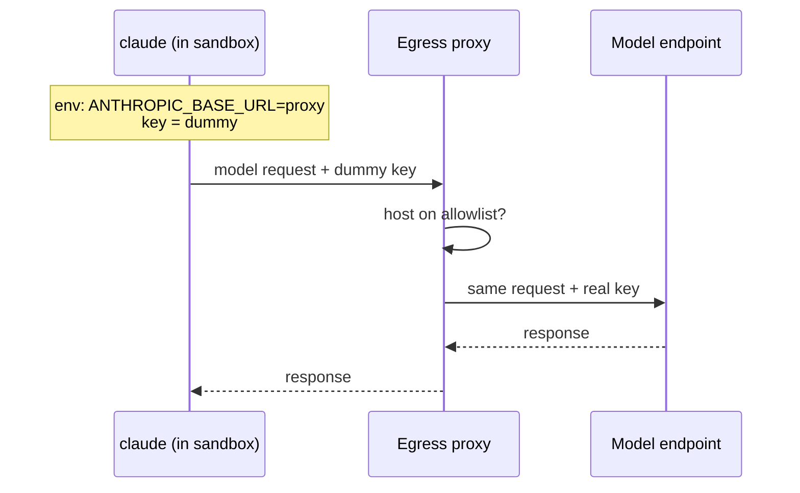

# Credential Injecting Proxy

> *"**No real credential enters the container.** The CLI gets `ANTHROPIC_BASE_URL` pointing at the egress proxy and a dummy key. The proxy swaps in the real credential, and only on requests to the model endpoint. A prompt-injected agent can read its own environment, so the environment holds nothing worth stealing."* — PRD §11.1

## How it works

- The proxy is the [[Egress Allowlist]] proxy. It *"injects the real API key on model requests"* (drawio *Egress proxy* card).
- Drawio *External services*: *"Anthropic API / only via the claude CLI and the proxy, which holds the key"*.
- Feature map §10: *"Its requests go through FlowBoard's network gatekeeper, which adds the key on the way out. A tricked agent that dumps its settings finds nothing worth stealing."*

## Fallback

*"Fallback if a CLI refuses: a short-lived, run-scoped token, never baked into the image."* (`08-sandboxing.md`)

The `SandboxProfile.env` comment in `01-ports.md`: *"run-scoped; never a real credential (the proxy injects it), never baked into the image"*. The reference file `exec-host.ts` is weaker: *"Run-scoped env (model/CLI auth). Never bake secrets into the image."* See [[Sandboxing Open Questions]].

## Verify before building

PRD §0 makes this an empirical check, the third item in a list it introduces as *"Two things you must verify empirically rather than assume"*:

> *"**That the CLI works through a credential-injecting proxy.** Run the probe above with `ANTHROPIC_BASE_URL` pointing at a local proxy that adds the real credential, and a dummy key in the environment (§11.1). If the CLI refuses, stop and tell me; the fallback is a short-lived, run-scoped token."*

## Where the real key lives

No source says where the proxy gets the real credential on the host. Raised in [[Settings And Plumbing Open Questions]] #24; listed as [[Sandboxing Open Questions]] #41.

## On the host tier too

`03-execution-substrate.md` §6 states it without naming a tier: *"No real credential is passed in: the CLI's `ANTHROPIC_BASE_URL` points at the egress proxy, which injects it."* Whether host-tier runs also route through the proxy is not stated. See [[Sandboxing Open Questions]].

## Other providers

The drawio lists `api.openai.com (later)` on the allowlist for the Codex adapter. `ANTHROPIC_BASE_URL` is Claude-specific; how the proxy injects a key for Codex is not described. Same as [[Agent Providers Open Questions]] #23.

## Related

- [[Egress Allowlist]]
- [[Sandbox Security Profile]]
- [[Sandbox Threat Model]]
- [[Sandboxing Runtime]]
