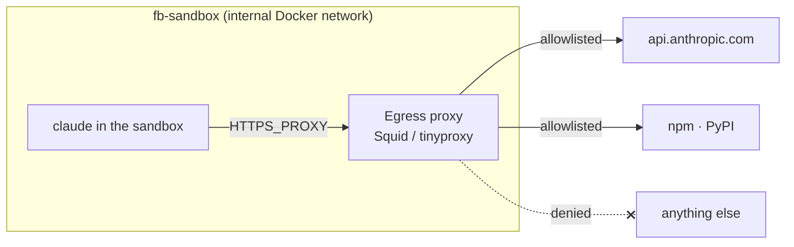

# Egress Allowlist

> [!important] Load-bearing
> *"**Egress restriction is the load-bearing control:** it holds even though `bypassPermissions` is on, because it is enforced below the agent's reasoning."* — PRD §11.1

## The rule

`08-sandboxing.md`: *"**Egress allowlist (load-bearing).** Default-deny outbound; allow only the model/CLI endpoint and the package registries the step needs. **Not the git remote**: the host does all git work."*

PRD §11.1: *"default-deny **network egress** with an allowlist (the model endpoint and the package registries a build needs; **not** the project's git remote, because the host does all git work and the agent never needs to push or fetch)"*.

Feature map §10: *"By default the agent can't reach the internet at all, except a short allow-list of places it genuinely needs (the AI service, package registries). So even a tricked agent can't leak your secrets."*

## What is on it

| Entry | Source |
|---|---|
| The model endpoint, *"via the credential-injecting proxy"* | `01-ports.md`, `08` |
| `api.anthropic.com` | drawio *Egress proxy* card |
| `api.openai.com` *(later)* | drawio *Egress proxy* card |
| npm / pnpm | `08` *Recommendation* (*"npm/pnpm"*) |
| npm / PyPI | drawio *Egress proxy* card, *Package registries* node |
| **Not** the git remote | everywhere: `08`, PRD §11.1, backlog 3.5, drawio (*"no git remote"*) |
| **Not** the memory store | *"memory adds nothing to the egress allowlist"* (`08`); PRD §16 checklist |
| `[]` | *"fully offline"* (`08`, `exec-host.ts`; `01-ports.md` says *"offline"*) |

Field: `egressAllow: string[]`, *"Domains reachable from inside; default-deny everything else."* (`exec-host.ts`)

## How it is enforced

- *"Implement as an egress proxy (Squid / tinyproxy) on an internal-only Docker network, so the container has no other route out"* (`08`). PRD §11.1: *"the container has no other route out."*
- Drawio: *"fb-sandbox is an internal Docker network, so the proxy is the only way out"*; the edge from the CLI to the proxy is labelled **F `HTTPS_PROXY`**.
- Alternative: *"an in-container firewall (`init-firewall`) is the alternative."* (`08`). Claude Code's dev container does it that way with `NET_ADMIN`/`NET_RAW` (`08` *Prior art*). See [[Sandboxing Prior Art]].

## Per step, not per capability

The capability library mockup and guide: *"Egress is default-deny at the *step*, not the capability. A skill that asks for `WebFetch` will still fail closed until the host it needs is on that step's allowlist"*. And: *"Installing does not grant anything. The capability declares what it wants; the step's sandbox still decides what it gets."* Details in [[Capability Tools And Egress]].

Where the per-step list is stored is not settled. PRD §11.1 keeps the allowlist in the global `sandbox_profile`, *"overridable per step"*. See [[Sandbox Configuration]].

## Why not the git remote

*"the host does all git work and the agent never needs to push or fetch"* (PRD §11.1). The drawio draws the push and fetch as a host-side edge: *"host-side push / fetch"* from the project repo to GitHub. The [[In-Agent Hooks]] also deny *"any `git push`"*.

## Why the seed flow starts offline-safe

*"`scout` gets `Read, Grep` only: it researches the repo, so the first step of every task never fails closed on egress."* (PRD §15). And the web-research template waits: *"The `researcher` web-research template is out of v1 until open-web egress has an answer."* (backlog Story 1.2).

## When a call is blocked

The architecture and PRD say only that egress is default-deny. In the mockups the sandbox refuses the call and the attempt fails; they show the cost and offer **Allow host & retry**. See [[Egress Denials]].

## Related

- [[Credential Injecting Proxy]]
- [[Egress Denials]]
- [[Sandbox Configuration]]
- [[Capability Tools And Egress]]
- [[Sandboxing Runtime]]
