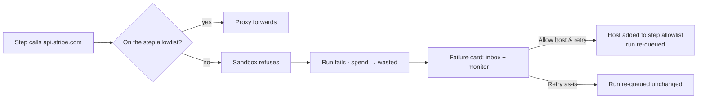

# Egress Denials

What happens when a step reaches for a host that is not on its allowlist. The architecture and PRD say only that egress is default-deny. Everything below comes from the mockups.

## The two sample failures

| Mockup | Task · step | Host | Cost | Wording |
|---|---|---|---|---|
| `task-detail.html` | `auth-refactor` · Build | `registry.npmjs.org` | `$0.48` wasted | *"attempt 1 — egress denied: registry.npmjs.org was not in the step allowlist"* |
| `inbox.html` | `billing-webhook` · build | `api.stripe.com` | `$1.44` wasted | *"Attempt 3 of 3 failed — egress denied to api.stripe.com"*; *"The sandbox refused the call: **api.stripe.com** was not on this step's allowlist. Three attempts, $1.44 spent and thrown away."* |
| `monitor.html` (*Needs you* card, rendered from a template) | `billing-webhook` · build | `api.stripe.com` | `$1.44` wasted | *"Attempt 3 of 3 failed — egress denied — api.stripe.com not in the step allowlist. $1.44 spent on the attempts so far."* |

Task-detail guide: *"**Wasted** — spend on attempts that were thrown away. Here, $0.48 on a build the sandbox killed for reaching registry.npmjs.org, which wasn't on that step's allowlist."* And: *"The host is on the allowlist now, so the next task down this flow will not pay it again."*

The monitor's sample log for a running task also shows one: *"◆ egress denied registry.npmjs.org → adding to step allowlist"* (sample data for a task named `sandbox-egress`).

## Allow host & retry

The failure card's primary action in the inbox and the monitor's *Needs you* band.

| Action | What it does (source wording) | Cost |
|---|---|---|
| **Allow host & retry** (`↵` in the inbox) | *"Adds the blocked host to this step's egress allowlist, then re-queues the run as the next attempt. For the common case: the sandbox correctly refused a call the step genuinely needs."* (monitor guide) | *"The failed attempt's spend moves to wasted."* |
| **Retry as-is** | *"Re-queues the run unchanged. For failures that aren't about the network — a flaky test, a rate limit, a transient error."* (monitor guide) | Same |
| **Open the log** | *"Jumps to the row detail, where the last output and the error line are shown together."* (monitor guide) | Nothing |

Inbox hint: *"Allowing the host adds **api.stripe.com** to this step's egress allowlist, then re-queues the run. The failed attempt's spend stays wasted either way."* Inbox guide: *"The fix is a one-line change to the step's allowlist, and the card offers it directly."*

## Library warning ahead of time

The capability library warns before this happens: *"One thing left, and the library cannot do it for you: add the advisory host to that step's egress allowlist, or the first run fails closed."* See [[Capability Tools And Egress]].

## Remembered

The task-detail sample memory has a task-scope entry: *"Attempt 1 died on an egress denial — npmjs.org is now on this step's allowlist."* See [[Memory Carried Into A Task]]. Memory commits only after a success (PRD §7, §11.2), so how a failed attempt became a memory is [[Memory Open Questions]] #13.

## What the sources leave open

> [!question] Gaps
> - **Is a denial an attempt?** The mockups count it (*"Attempt 3 of 3"*). PRD §7 treats a non-zero agent exit as an *"infrastructure failure, never a verdict on the work"*: either retried uncounted (transient, which includes *"network error"*) or `blocked`. Same as [[Execution Open Questions]] #22, [[Monitor Open Questions]] #11, [[Task Detail Open Questions]] #12.
> - **Does a denial end the run at all?** The mockups say the sandbox ended it: *"the sandbox killed build attempt 1"* (task-detail cost tab), *"a build the sandbox killed"* (task-detail guide). The architecture and PRD say only that egress is default-deny; a refused connection fails a tool call, and the agent may carry on. Whether the run exits non-zero is not stated.
> - **Which allowlist does Allow host & retry edit?** Global `sandbox_profile`, a per-step override, or the flow version? Flows are immutable versions (PRD §4). Same as [[Flow Design Open Questions]] #14 and [[Human In The Loop Open Questions]] #26.
> - **How does the runner learn which host was denied?** Presumably from the proxy log; not stated.
> - **No endpoint.** See [[Sandboxing API And Routes]].

## Related

- [[Egress Allowlist]]
- [[Failures And Escalated Loops]]
- [[Failures And Retries]]
- [[Wasted Spend]]
- [[Infra Retries]]
