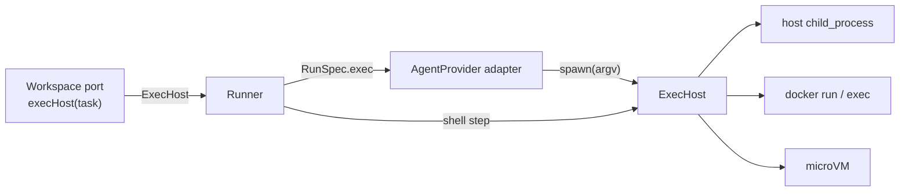

# ExecHost Port

> *"*Where* a process runs, decoupled from *which* agent runs it. An AgentProvider builds an argv; the ExecHost decides where it executes — host `child_process`, a hardened container, or a microVM. This keeps sandboxing orthogonal to the provider: **any provider × any tier, for free** (2×N, not N×M)."* — `01-ports.md` *ExecHost and sandboxing*

## The interface

From `docs/old/reference/core/ports/exec-host.ts`:

```ts
export type IsolationTier = 'host' | 'container' | 'gvisor' | 'microvm';

export interface SandboxProfile {
  tier: IsolationTier;
  image?: string;
  egressAllow: string[];
  limits?: { memoryMb?: number; cpus?: number; pids?: number; wallClockMs?: number };
  mounts?: Array<{ source: string; target: string; readOnly?: boolean }>;
  env?: Record<string, string>;
  nonRoot?: boolean;
}

export interface ChildHandle {
  pid: number;
  stdout: AsyncIterable<string>;
  stderr: AsyncIterable<string>;
  exit: Promise<number>;
  kill(signal?: string): void;
}

export interface ExecHost {
  readonly id: IsolationTier;
  readonly profile?: SandboxProfile;
  spawn(command: string, args: string[], opts: { cwd: string; env?: Record<string, string> }): ChildHandle;
}
```

`ChildHandle`: *"A spawned process, normalized so the runner tails it the same way at every tier."* `profile`: *"Absent for the `host` tier; present for sandboxed tiers."*

## Who owns it, who uses it



| Seam | Source |
|---|---|
| *"**One seam: `ExecHost`, owned by the Workspace.**"* | `08` |
| `execHost(task: TaskRef): ExecHost;` on `Workspace`: *"host child_process for the worktree adapter, or inside the sandbox for a container/microVM adapter."* | `workspace.ts` |
| `exec?: ExecHost;` on `RunSpec`: *"The adapter spawns through this instead of raw child_process, so sandboxing works for any provider. From `workspace.execHost(task)`."* | `agent-provider.ts` |
| *"The runner … gets the `ExecHost` from `workspace.execHost(task)` and passes it in the `RunSpec`; the provider adapter spawns through it."* | `08` |
| Shell steps run *"through the same `ExecHost`, so it is sandboxed like any agent."* | `03` §6 |

## Adapters

| Adapter | Source |
|---|---|
| `worktreeWorkspace` with `execHost: (task) => hostExecHost(dir(task.id)),  // container tier returns a docker ExecHost instead` | `07-ports-in-practice.md` |
| *"A `containerWorkspace` adapter implements the same interface against a devcontainer/sandbox; its `execHost` returns a container `ExecHost` that applies the security profile"* | `07` |
| `packages/adapters/exec/  # host, docker` | PRD §3 |
| `adapters/workspace/worktree/  container/` | architecture README layout |
| Workspace adapters: *"devcontainer, Docker sandbox, remote"* | architecture README port table |

## Why a separate seam

*"The sandbox is not a new kind of AgentProvider — it is *where the provider's process runs*."* `ClaudeCodeProvider` *"spawning through a container `ExecHost` is Claude-in-a-sandbox; the same provider through the host `ExecHost` is today's behavior, no provider change."* (`08`)

Dependency rule (architecture README): *"`core/` and `runner/` must never import from `adapters/` — only from `core/ports/`."* PRD §3 places the port: `ports/  # AgentProvider, ExecHost, MemoryStore, Notifier, TaskSource interfaces`.

> [!note] Not in the five-port table
> The architecture README's *"five ports that carry the whole program"* do not list ExecHost; it hangs off Workspace. PRD §3 lists it among the core ports. The reference `README.md` file tree omits `exec-host.ts`, though the file exists.

## Related

- [[Isolation Tiers]]
- [[Sandboxing Data Model]]
- [[Sandboxing Runtime]]
- [[Agent Launch Contract]]
- [[Task Workspace]]
