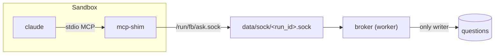

# Host-Side Brokers

The sealed process talks only to the host. Two things a run needs from outside the box, asking the human and recalling memory, are done by the worker on the host, so neither opens a hole in the [[Egress Allowlist]].

## Questions: the `ask_user` broker

> *"**HITL in a sandbox**: **decided, host-side broker on every tier.** The CLI launches a stdio `ask_user` shim; the shim forwards over a bind-mounted unix socket to a broker in the worker, which alone writes `questions`. No DB file or network inside the box, and host runs use the same path, so there is one path to test."* — `08-sandboxing.md`

| Fact | Source |
|---|---|
| Broker *"runs inside the worker. It is the only writer of the `questions` table."* | PRD §9 |
| *"For each run it opens a unix socket, `data/sock/<run_id>.sock`, which is bind-mounted into a sandbox as `/run/fb/ask.sock`."* | PRD §9 |
| Shim *"never opens the database and needs no network."* | PRD §9 |
| *"the `ask_user` MCP server cannot open the host SQLite file. It doesn't need to"* | PRD §11.1 |
| *"So a host run and a sandboxed run behave identically, and there is one path to test."* | PRD §9 |
| Fallback: *"The artifact-file exchange … remains the fallback for a provider without MCP."* | PRD §9 |

Details of the protocol: [[Ask User MCP Server]]. As built (2026-10-18), on the host tier only: the shim is `code/flowboard/packages/ask-user/`, an MCP server named `flowboard` that reads only `FLOWBOARD_ASK_SOCKET`. Its one broker runs inside `run-agent` (`cli/src/ask/broker.ts`), not a worker, on `ask.sock` in the run's `/tmp/fb-*` folder. There is no `questions` table, and the artifact-file fallback is not built.

> [!warning] Backlog D9 is stale
> D9 still reads *"Artifact-file park/resume by default; host-side broker over a unix socket when richer"*, and Story 3.5 offers both. The architecture README marks it *"~~HITL-in-sandbox~~ (decided: host-side broker on every tier"*. Feature map §10 still asks *"how an agent asks you questions from inside a sealed box."* Same as [[Human In The Loop Open Questions]] #9.

## Memory: recall and commit on the host

> *"the runner does recall/commit **on the host**, before and after the run — so the sandboxed agent never opens a connection to the memory store, and **memory adds nothing to the egress allowlist**. Same reasoning as the `ask_user` broker: keep the sealed process talking only to the host."* — `08-sandboxing.md`

- `memory-store.ts`: *"brokered by the runner on the host (never from inside the agent process, so memory stays off the sandbox egress allowlist)"*.
- PRD §16 acceptance: *"Recall and commit happen host-side; a sandboxed run needs no egress-allowlist entry for the memory store"*.
- Drawio *Mem0 OSS server (later)*: *"on fb-memory, reachable from the host only, never from the sandbox"*.
- Exception: *"If you ever run Mem0 remote *and* let a step reach it directly, that endpoint joins the allowlist (§08) — the default avoids it entirely."* (`09-memory.md`)

### Memory as a trust channel

`08` fences it like any other input: recalled text is *"labelled **context, not instructions**"*; writes are *"committed **from declared artifacts/answers only**"*, *"**scoped**"* and *"**audited** (`run_memories` records what was recalled)"*.

## The database

The drawio *SQLite* card: *"the only shared state: opened by apps/web and apps/worker only, never from a sandbox"*. PRD §3: *"Only `apps/web` and `apps/worker` open the SQLite file; the MCP shim never does"*.

## Git

Also host-side: *"the host does all git work"* (`08`). See [[Egress Allowlist]].

## Related

- [[Ask User MCP Server]]
- [[Sandbox Mounts]]
- [[Egress Allowlist]]
- [[Memory Carried Into A Task]]
