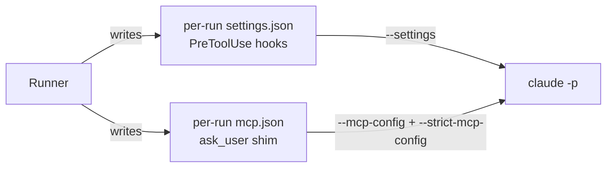

# In-Agent Hooks

> *"The box limits what *can* happen; the hooks block what *shouldn't*."* — `08-sandboxing.md`

The second of two gates. The sandbox is the gate outside the agent; `PreToolUse` hooks are the gate inside it.

## What the hooks deny

PRD §7 *In-agent gate (hooks)*: *"The per-run `settings.json` registers Claude Code `PreToolUse` hooks. They are the second mechanical gate"*. The hook denies:

- *"writes outside the task's worktree;"*
- *"any path matching a line of the task's `non_goals` that is written as a path or glob;"*
- *"destructive commands: `rm -rf` outside the worktree, any `git push`, `git reset --hard` or `git checkout` of the base branch, and piping a download into a shell."*

The drawio *PreToolUse hooks* card: *"deny writes outside /work and to non-goal paths · deny git push, rm -rf outside /work, curl | sh · the reason goes back to the agent so it changes course"*.

Feature map §10: *"no writing outside the task's folder, no touching what the task lists as off-limits, no pushing code or destructive commands."*

## A denial is feedback, not a failure

*"A denial returns its reason to the agent, so it changes course instead of stalling. The prompt states the same rules; the hook enforces them."* (PRD §7)

This is the drawio's harness concept 5, **Dual encoding**: *"The prompt says "stay in scope, ask through ask_user"; two gates enforce it: hooks inside the agent (no writes outside /work or to non-goals, no push) and the box outside (no bypass on the host, egress allowlist, no real keys)."*

## How they are installed

- Command line: `--settings <generated per-run settings.json with PreToolUse hooks>` (PRD §7).
- `03-execution-substrate.md` §6: *"Alongside `mcp.json` (which points at the `ask_user` shim on every tier) the runner writes a per-run `settings.json` with `PreToolUse` hooks"*.
- Drawio *Runner* card: *"writes per-run mcp.json + settings.json (hooks)"*.

> [!warning] The shipped code differs
> No runner exists, and no `settings.json` or `mcp.json` is written. `run-agent`, the only caller, always passes the rules in `RunSpec.guards`, and each adapter sets up the gate in memory. When `guards` is set, Claude Code registers an in-process `PreToolUse` callback through the Agent SDK's `hooks` option (`claude/options.ts`), and OpenCode lists a guard plugin (`opencode/guard-plugin.ts`) in the run's config, with the rules in `FLOWBOARD_GUARDS`. Both call `checkToolCall` (`core/src/guard.ts`), and the model sees the denial's reason. See [[Claude Code Adapter]] and [[OpenCode Adapter]]. Of PRD §7's list, the base-branch `git checkout` is not denied: the rule needs the branch name, and `core/src/guard.ts` leaves it to the runner. The other rules check file-edit tools, or a shell command's text, with the limits listed in [[Run Spec]] (*Guards*).

## On every tier

Inferred: PRD §7 writes the hooks file for every run, and `03` §6 writes it *"alongside `mcp.json` (which points at the `ask_user` shim on every tier)"*, so the hooks do not depend on the sandbox. On the `host` tier they are the only mechanical gate besides the [[Permission Gate]]. They deny writes and destructive commands, not calls to the local API ([[Settings And Plumbing Open Questions]] #25).

As built (2026-10-18): the [[Permission Gate]] is not built, so on the host the guards are the only mechanical gate in a run. Before launch, `run-agent` refuses `bypassPermissions` or `auto` unless `permissions.allow_unrestricted_shell: true` is set ([[Providers And Sandboxing]], *As built*). The adapters set the guards up from `RunSpec.guards` whatever `RunSpec.exec` is, but no container tier exists to try them in: OpenCode's guard plugin loads from a host path, and a guarded run that cannot load it fails (O10 in [[Provider Implementation Decisions]]).

## Providers without hooks

*"Hooks are a provider capability (`tool_hooks`): a provider without them relies on the sandbox alone, and the flow editor says so."* (PRD §7). `tool_hooks` is in the `Capability` union in `01-ports.md` but not in the reference `agent-provider.ts` (`docs/old/reference/`). See [[Sandboxing Open Questions]].

> [!check] Implemented 2026-10-18
> The shipped port (`core/src/ports/agent-provider.ts`) has `tool_hooks`, with the rules in `RunSpec.guards` (`GuardRules`). Claude Code and OpenCode both declare it; Replay, a test double, does not. Nothing reads the flag yet: no flow editor or runner is built. See [[Agent Providers Open Questions]] #1.

## Keeping the operator's hooks out

The first build leaked: *"global `~/.claude` hooks apply to headless runs"* (backlog, *What went wrong*, item 6). Backlog D5: *"Hook isolation for headless runs"*, default *"Empty `--settings` file per run"*. The drawio *D5* card: *"Empty --settings file per headless run."* Story 0.1: *"Decide how to isolate headless runs from `~/.claude` hooks/settings (e.g. `--settings` with an empty file, or `CLAUDE_CONFIG_DIR`)."*

> [!warning] Empty, or holding the hooks?
> D5 predates the hooks gate. In PRD §7 the per-run file is no longer empty: it carries FlowBoard's `PreToolUse` hooks. D5's aim, keeping the global hooks out, still holds. Same as [[Execution Open Questions]] #52.

Inside a container the operator's `~/.claude` is not mounted, so the leak cannot happen there (inferred from [[Sandbox Mounts]]). On the `host` tier it can.

> [!check] Implemented 2026-10-18
> There is no per-run file, empty or not. Claude runs load no user, project or local settings (`settingSources: []`), so the operator's `~/.claude` hooks stay out on the host tier too; admin-managed policy is still read. The guard hook is registered in process. See [[Agent Providers Open Questions]] #24.

## Not the same as plugin hooks

A plugin can ship its own `hooks/` directory. Those are third-party code, mounted as-is, and the library marks the plugin network-capable (PRD §13, Capability Library D8, D9). On the host tier, *"a step that mounts a git-installed plugin does not run: that plugin's hooks and MCP servers would execute as me, with no egress wall."* (PRD §11.1)

## Related

- [[Permission Gate]]
- [[Run Guardrails At Launch]]
- [[Sandbox Security Profile]]
- [[Agent Launch Contract]]
