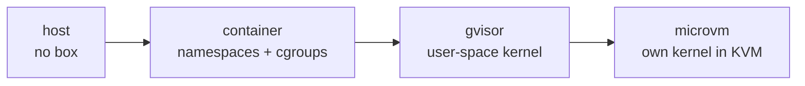

# Isolation Tiers

> *"Pick the weakest tier that covers the trust level of the repo and the content the step reads. Higher tiers cost startup time and complexity."* — `08-sandboxing.md`

## The ladder

From `08-sandboxing.md` *The isolation ladder*:

| Tier | Boundary | Startup | Use when |
|---|---|---|---|
| `host` | none (process on host, worktree cwd) | instant | trusted repo **and** not bypassing permissions |
| `container` | Linux namespaces + cgroups (shared kernel) | ~ms | default for headless/bypass runs on trusted-ish repos |
| `gvisor` | user-space kernel, syscall interception | fast, 10–30% I/O overhead | untrusted-ish content; kernel-escape resistance without a VM |
| `microvm` (Firecracker/Kata) | dedicated kernel in KVM | ~125–200ms | untrusted repos / running unreviewed generated code |

The type: `export type IsolationTier = 'host' | 'container' | 'gvisor' | 'microvm';` (`exec-host.ts`, `01-ports.md`).

*"Plain containers share the host kernel — a kernel exploit in agent-run code escapes the container. For genuinely untrusted code, gVisor or a microVM is the honest choice; for a single-user tool working on the user's own repos, a hardened container with egress control is a reasonable default and the microVM is an opt-in."* (`08`)

## The drawio's tier card

The *Agent sandbox* box on the drawio *Harness architecture* page: *"Tiers / host (no box, approval mode only) · container (default when autonomous) · gVisor runsc (untrusted repos, Linux hosts) · microVM / docker sandbox"*.

Two details only the drawio gives:

- **gVisor needs a Linux host** (*"gVisor runsc (untrusted repos, Linux hosts)"*).
- **Docker Desktop's `docker sandbox`** is named as a microVM option. `08` *Prior art* describes it as *"Docker Desktop's microVM-backed `docker sandbox` for stronger isolation"*.

## Codex at the `host` tier

*"Codex additionally has its *own* OS sandbox — Seatbelt on macOS, Landlock+seccomp on Linux, network off by default — so Codex at `host` tier still isn't unsandboxed; a container tier is defense-in-depth."* (`08`)

## Five vocabularies

The sources do not name the tiers the same way.

| Source | Values |
|---|---|
| `08-sandboxing.md`, `01-ports.md`, `exec-host.ts`, backlog Story 3.5 | `host` · `container` · `gvisor` · `microvm` |
| PRD §13 settings section | *"host / container / microVM"* (no gVisor) |
| PRD §3 code layout | `adapters/exec/  # host, docker` |
| drawio *Workspace manager* card | *"ExecHost per tier: host · docker · gVisor"* (no microVM) |
| `01-ports.md` `Workspace.id` | `'worktree' \| 'container' \| 'microvm' \| 'remote'` (an adapter id, not a tier) |
| flow-designer mockup `SANDBOX` | `'none'` · `'container'` · `'sealed container'` |

> [!question] Proposal: one mapping
> Reading across, `none` = `host`, and `docker` = `container`. *Sealed container* is defined only as *"a sealed container with no network"* (flow-designer guide). It could be a `container` with `egressAllow: []` (*"`[]` = fully offline"*, `01-ports.md`), or a stronger tier, as [[Step Guardrails]] proposes. Neither is stated. See [[Sandboxing Open Questions]].

## A `remote` tier, later

*"Managed sandbox platforms — E2B and Daytona (Firecracker / container microVMs, ~90–150ms cold start), Modal (gVisor): the cloud version of this, if FlowBoard ever grows a `remote` tier."* (`08`). The drawio's *Container workspace* adapter reads *"devcontainer · Docker sandbox · remote host"*, dashed (not in v1).

## Related

- [[Sandbox Security Profile]]
- [[Permission Gate]]
- [[Sandbox Defaults]]
- [[ExecHost Port]]
- [[Sandboxing Prior Art]]
