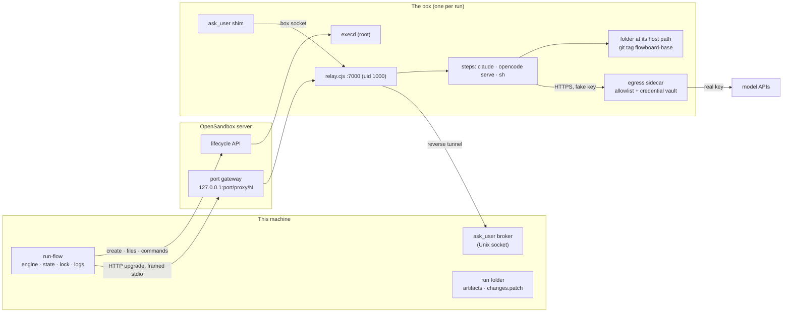

# OpenSandbox Runtime

`sandbox: { runtime: opensandbox }` runs a whole flow inside one [OpenSandbox](https://github.com/opensandbox-group/OpenSandbox) sandbox, called **the box**. run-flow stays on the host and supervises. The agents' edits never touch the host folder. Egress is an allowlist, and the real keys stay on the host. The run ends with a patch for the owner to review and apply.

Built 2026-10-24. It delivers the [[Egress Allowlist]], the [[Credential Injecting Proxy]] and the container workspace from the [[Sandboxing Roadmap]], through OpenSandbox rather than FlowBoard's own proxy. [[OpenSandbox Spike]] records why OpenSandbox was chosen and what was measured.

> [!note] Three runtimes
> | YAML | Where steps run | Network | Keys | Host folder |
> |---|---|---|---|---|
> | no `sandbox:` | host | open | host env | edited in place |
> | `runtime: docker` (default) | one container per step | shell offline, agents open | passed in by `sandbox.env` | bind-mounted, edited in place |
> | `runtime: opensandbox` | one box per run | allowlist | fakes inside, real injected outside | untouched; `changes.patch` at the end |

## Using it

```yaml
budget_usd: 1
sandbox: { runtime: opensandbox, image: flowboard-sandbox }
steps:
  implement: { adapter: claude-code, model: sonnet, prompt: implement.md, produces: [notes] }
  check: { shell: pnpm test, produces: [check_output] }
edges:
  - { from: implement, to: check }
```

```sh
export OPENSANDBOX_DOMAIN=127.0.0.1:8080 OPENSANDBOX_API_KEY=<server api_key>
export CLAUDE_CODE_OAUTH_TOKEN=<from claude setup-token> OPENROUTER_API_KEY=<key>
pnpm run-flow --folder ~/code/app --task task.md flow.yaml
# review, then:
git -C ~/code/app apply runs/<run>/changes.patch
```

Setup (server config, images): `code/flowboard/docker/README.md`, section 3.

### The `sandbox:` keys

| Key | Default | Meaning |
|---|---|---|
| `runtime` | `docker` | `opensandbox` selects this runtime |
| `image` | required | Must leave its user root (see [Image](#the-image)); normally `flowboard-sandbox` |
| `egress` | API hosts of the steps' adapters | Hosts the box may reach. Host names or `*.domain`; IP addresses are an error |
| `credentials` | keys of the steps' adapters | Host env variables injected on the way out. Only `CLAUDE_CODE_OAUTH_TOKEN` and `OPENROUTER_API_KEY`; others are an error |
| `env` | — | An error: it belongs to `runtime: docker` |

Defaults come from the steps (`flow-config.ts`, `NEEDS`). A `claude-code` step adds `api.anthropic.com` and `CLAUDE_CODE_OAUTH_TOKEN`. An `opencode` step whose model starts with `openrouter/` adds `openrouter.ai` and `OPENROUTER_API_KEY`. An explicit list replaces the defaults; add `registry.npmjs.org` when a step installs packages.

## How it fits together



Two channels connect host and box. Neither lets the box dial the host:

- **The lifecycle API** (OpenSandbox SDK, `@alibaba-group/opensandbox` 1.1.1): create and kill the box, upload and download files, run setup commands as root through execd.
- **The relay** (`relay.cjs`, uploaded at start): every process a step starts is one HTTP-upgrade connection through the port gateway, carrying framed stdio. Through these connections the Claude SDK drives the CLI over stdin and stdout as it does on the host.

## A run, start to end

`flow-run.ts` drives it; the box itself is `packages/adapters/src/exec/opensandbox/box.ts`.

1. **Checks on the host.** These are unchanged: the clean-tree check, the folder lock, and the run folder under `runs/`.
2. **`openBox`.**
   1. Create the box from `image` with `networkPolicy: deny` plus one allow rule per `egress` host, `credentialProxy: enabled`, and env `HOME=/tmp` plus a fake for each credential.
   2. Create the credential vault: one `bearer` binding per credential set on the host, on its host (`api.anthropic.com`, `openrouter.ai`).
   3. Upload `git archive HEAD` of the folder and unpack it at the **folder's own absolute path**. Commit it, tag `flowboard-base`, add `.flowboard/` to `.git/info/exclude`, and `chown` it to uid 1000.
   4. Upload `relay.cjs`, start it as uid 1000 with a random 192-bit token, and wait until `GET /` answers `relay`.
3. **`sandbox.json`.** `{ id, token }` goes in the run folder, mode 0600, so `--resume` can find the box again. It prints `-- sandbox <id>: <folder> at its last commit; egress <hosts>`, plus a warning for each credential that is not set.
4. **Each step** spawns through `box.exec(...)`, an `ExecHost` ([[ExecHost Port]]). Before every process it pushes the run's temp folder and the artifacts (see [Artifacts](#artifacts-in-and-out)), and the step's plugin folders once per box. After an agent step, its own outputs and verdict are pulled back.
5. **The end.**
   - `done` or `failed`: `git add -A && git diff --binary --cached flowboard-base` is written as bytes to `<run folder>/changes.patch`, and the box is killed. It prints `-- changes: … (n files); review it, then: git -C <folder> apply <patch>`.
   - `paused` or `stopped`: the box is kept (24 h TTL) and it prints `-- sandbox <id> kept for --resume`.
6. **`--resume`.** `connectBox(id, { folder, token })` reconnects and restarts the relay if the box restarted. If the box is gone, run-flow refuses (`cannot resume: sandbox <id> is gone: its edits cannot be resumed; start the flow again`). It never creates a fresh, empty box.

## The relay protocol

One connection per process. Upgrade `/spawn` with header `x-relay-token`; the gateway passes `Upgrade: websocket`. Each frame is `[type u8][length u32 BE][payload]` (`frames.ts`; `relay.cjs` keeps its own copy).

| Type | Direction | Payload |
|---|---|---|
| 6 `spec` | host → box, first | JSON `{command, args, cwd, env}`. Never in the URL: size limit, and gateway logs |
| 0 `stdin` / 5 `stdinEnd` | host → box | bytes / none |
| 4 `kill` | host → box | signal name; goes to the process's whole group |
| 1 `stdout` / 2 `stderr` | box → host | bytes |
| 3 `exit` | box → host | `{code, signal}`. Sent 200 ms after the process exits, then anything it left running is killed |
| 7 `ping` | box → host | none, every 5 s |

On the host, `RelayChild` (`relay-host.ts`) looks like a Node `ChildProcess`: `stdin`, `stdout`, `stderr`, `exit` and `close` events, `kill()`. It has **no `pid`**, because a host pid would name some other process. `kill()` in run-flow stops such an agent through its provider instead.

A connection silent for 30 s fails the step with `the sandbox relay (sandbox <id>) stopped answering`, so a half-dead box cannot hang a run. When the host hangs up, the relay SIGKILLs the process group. HTTP sockets are half-open, so it treats `end` as a hang-up. A malformed request gets 400 and ends only itself. The token is compared in constant time.

`/listen?path=<socket>` is the reverse tunnel ([[Host-Side Brokers]]). The relay listens on a Unix socket inside the box, and the host keeps one upgrade waiting. When the `ask_user` shim connects, the shim's first bytes pair it with that upgrade, and the host pipes it to its own broker socket and opens the next waiting upgrade.

## Agents in the box

The providers are unchanged in shape. They spawn through `spec.exec`, and four optional `ExecHost` hooks cover a box that does not share the host's disk:

| Hook | Used by | Box behaviour |
|---|---|---|
| `mapPath(p)` | `withAsking`, OpenCode guard plugin | `code/flowboard/...` → `/opt/flowboard/...` in the image |
| `exists(p)` | OpenCode guard-loaded marker | `files.getFileInfo` in the box |
| `endpoint(port)` | OpenCode client | the gateway URL for that port |
| `tunnel(box, host)` | `ask_user` | the reverse tunnel above |

- **Claude Code:** `claude` runs in the box through the relay. Its MCP `ask_user` shim is `node /opt/flowboard/packages/ask-user/src/main.ts`, on a socket in the run's temp folder, tunnelled to the host broker.
- **OpenCode:** `opencode serve` listens on `0.0.0.0` at a random port from 20000 to 59999, because parallel steps share the box. It retries on `EADDRINUSE`, up to 3 times. The client on the host reaches it through `endpoint()`, behind the server's password.
- **Auth:** the box holds `CLAUDE_CODE_OAUTH_TOKEN=sk-ant-oat01-000…` and `OPENROUTER_API_KEY=sk-or-v1-000…`. The egress sidecar replaces them with the real values on requests to their hosts. OpenSandbox sets `NODE_EXTRA_CA_CERTS` to its MITM CA itself.

## Artifacts in and out

The host's run folder is the record. The box keeps a mirror at the same path, inside the folder's `.flowboard/`, which stays out of the patch.

- **In, before every process:** every artifact file except the outputs of agent steps still running. Their copy in the box is newer (`pushable`, `flow-run.ts`). Files are merged, never replaced, because parallel steps share the box.
- **Out, after an agent step:** only that step's `produces` and its verdict (`.outcomes/<run>.json`, where `set_outcome` writes in a box). Other files may be newer on the host, for example a check's output.
- **Shell steps** are never pulled back: the host writes their artifact from the captured output, and the next push carries it in.
- **`pullFiles` safety:** the tar is made as uid 1000, of regular files only. It is unpacked in a scratch folder on the host, and only regular files are copied into place. An agent's link to `/etc/shadow` or `/` never lands on the host and is never read as root.

## The image

`flowboard-sandbox` (`docker/Dockerfile.opensandbox`) is `flowboard-cli` with `USER root`. OpenSandbox runs execd as the image's user, and setup needs root to create the host's paths (such as `/private/var/...`) and hand them to uid 1000. Every step still runs as uid 1000, because the relay starts as that user. FlowBoard's own code comes from the image's `/opt/flowboard`, so **rebuild `flowboard-cli`, then `flowboard-sandbox`, after changing FlowBoard**.

## Limits

- **The box holds the last commit only.** Uncommitted edits, ignored files (`node_modules`), submodules and LFS objects are not there; install dependencies in a first shell step. run-flow refuses a dirty folder anyway.
- **One box for the whole run.** Steps share its network policy and its files, and shell steps are online with the same allowlist.
- **Credentials:** only the two known names. Each is a `bearer` header on one host.
- **Server version quirks** (`opensandbox-server` with execd v1.1.0): commands are strings, not argv arrays, and command output comes back as messages without newlines, so the patch is read as a file.
- **The relay token adds nothing past the server's API key.** Anyone who can call the server can run root commands in the box, so the server must have `api_key` set and `publish_host = "127.0.0.1"`.

## Code map

| File | Role |
|---|---|
| `packages/adapters/src/exec/opensandbox/box.ts` | `openBox`, `connectBox`, `Box`: create, vault, repo, relay, push and pull, patch, kill |
| `packages/adapters/src/exec/opensandbox/relay.cjs` | runs in the box: `/spawn`, `/listen`, process groups, pings |
| `packages/adapters/src/exec/opensandbox/relay-host.ts` | `relayExecHost`, `RelayChild`, `upgrade`, `tunnel` |
| `packages/adapters/src/exec/opensandbox/frames.ts` | frame codec |
| `packages/core/src/ports/exec-host.ts` | `mapPath`, `exists`, `endpoint`, `tunnel` hooks |
| `packages/cli/src/flow-config.ts` | the `Sandbox` union, defaults, validation |
| `packages/cli/src/flow-run.ts` | box lifecycle, `sandbox.json`, `pushable`, `changes.patch`, resume |
| `packages/cli/src/flow-exec.ts` | relayed agent steps: tunnel, outcome path, pull |
| `docker/Dockerfile.opensandbox` | the root-user image |

## Testing

| Test | Needs |
|---|---|
| `adapters/test/opensandbox-relay.test.ts` | nothing: the relay runs on the host |
| `cli/test/flow-run.test.ts`, `flow-config.test.ts` | nothing: a fake `Box` |
| `adapters/test/opensandbox-box.test.ts` | `FLOWBOARD_OPENSANDBOX=1`, a server, `OPENSANDBOX_DOMAIN`, `OPENSANDBOX_API_KEY` |
| `cli/test/flow-opensandbox-live.test.ts` | the above plus `FLOWBOARD_LIVE=1`, `CLAUDE_CODE_OAUTH_TOKEN`, `OPENROUTER_API_KEY`; about $0.01 |

## Related

- [[OpenSandbox Spike]]
- [[ExecHost Port]]
- [[Egress Allowlist]]
- [[Credential Injecting Proxy]]
- [[Host-Side Brokers]]
- [[Sandboxing Roadmap]]
