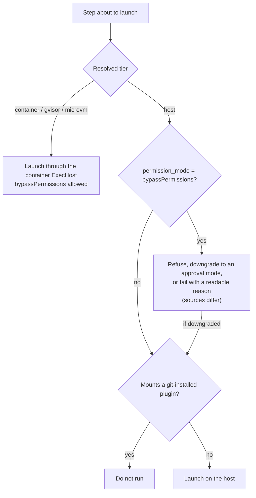

# Permission Gate

> *"Therefore **`bypassPermissions` is only allowed when the step runs in a sandbox tier.** On the host tier, refuse it (or downgrade to an approval mode)."* — PRD §11.1

`08-sandboxing.md`: *"**The gate:** the runner refuses `bypassPermissions` unless the resolved tier is `container`/`gvisor`/`microvm`. On `host` tier it downgrades to an approval/auto mode, or fails the step with a readable reason. A correctness rule, not a suggestion."*

## The decision

## Rules that make up the gate

| Rule | Source wording |
|---|---|
| No bypass outside a sandbox | *"the runner refuses `permission_mode='bypassPermissions'` unless the tier is a sandbox (`container`/`gvisor`/`microvm`)"* (`01-ports.md`); *"`bypassPermissions` requires a sandbox tier."* (`05` §11) |
| Non-root required | `nonRoot?: boolean; // default true; bypassPermissions requires it` (`01-ports.md`) |
| No Docker | *"Probe for Docker at startup; if absent, fall back to the host tier and disable `bypassPermissions`."* (PRD §11.1) |
| Git plugins on the host | *"On the host tier, a step that mounts a git-installed plugin does not run: that plugin's hooks and MCP servers would execute as me, with no egress wall. Seed plugins still run there."* (PRD §11.1; Capability Library D15) |
| Recorded | *"`runs.sandbox` records the tier that actually ran"* (PRD §11.1) |

Feature map §10: *"Fully-autonomous mode (no approval on each action) is only allowed when the agent is inside a box; otherwise FlowBoard refuses it."*

Drawio *Permission gate* card: *"bypassPermissions only when the tier is container / gVisor / microVM; host tier → approval mode"*. In the drawio's *Life of one step*, step **E**: *"The permission gate checks the tier; the runner writes mcp.json and the hook settings; the ExecHost starts a sandbox with the worktree at /work."*

## Where the sources disagree

> [!warning] Refuse, downgrade or fail?
> | Response on the host tier | Source |
> |---|---|
> | Refuse / reject | PRD §7 (*"`bypassPermissions` is rejected unless the tier is a sandbox"*); `01-ports.md` |
> | Refuse, or downgrade | PRD §11.1 |
> | Downgrade | `03-execution-substrate.md` §6; drawio |
> | Downgrade, or fail the step | `08`; backlog Story 3.5 (tagged **NEW/DEC**) |
> | No Docker: fall back to host and disable bypass, *"(or warn)"* | `08` *Recommendation* #4; PRD §11.1 and backlog 0.1 have no *or warn* |
>
> Also tracked as [[Execution Open Questions]] #53.

> [!warning] Which tiers count?
> `03-execution-substrate.md` §6 names only *"(container/microVM)"*. `08`, `01-ports.md` and the drawio include gVisor.

## The mockup's version of the rule

The flow-designer inspector shows a chip, *unattended and unsandboxed*, when a step has **no approval gate** and sandbox **none**. The guide: *"The inspector flags it rather than blocking it — but in the real product that's the combination the sandbox rule refuses outright."* The PRD rule pairs **permission mode** with the tier, not the approval gate, and the mockup has no permission-mode field. See [[Step Guardrails]] and [[Flow Design Open Questions]] #13.

## Testing

Backlog Story 3.5: *"assert … that `bypassPermissions` is refused on the `host` tier."* See [[Sandboxing Testing]].

## Related

- [[Run Guardrails At Launch]]
- [[Isolation Tiers]]
- [[Sandbox Configuration]]
- [[In-Agent Hooks]]
- [[Sandbox Threat Model]]
