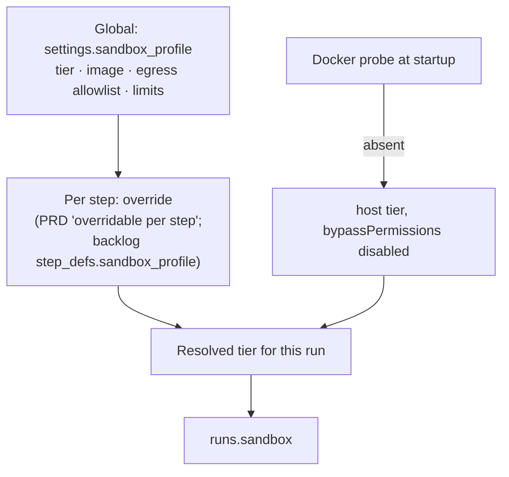

# Sandbox Configuration

> *"Configuration: a `sandbox_profile` in `settings` (tier, image, egress allowlist, limits), overridable per step; `runs.sandbox` records the tier that actually ran, alongside `runs.model`/`runs.effort`."* — PRD §11.1

## Three levels

## The settings section

PRD §13: *"Add a **sandbox** section in settings too: the default isolation tier (host / container / microVM), the container image, the network egress allowlist, and the resource limits. See §11.1."*

Feature map §19: *"**Sandbox defaults** — How locked-down agents should run by default"*. `08` *Recommendation* #2: egress allowlist *"editable in settings."* The drawio *Library · Costs · Settings* node lists *"sandbox tier"*.

Backlog Story 8.3 (Settings) lists draft mode, theme and escalation threshold, but not the sandbox section.

## Per step

| Source | What |
|---|---|
| PRD §11.1 | *"overridable per step"* |
| backlog Story 1.1 | *"an optional `step_defs.sandbox_profile` override"* |
| flow-designer mockup | **Sandbox** select per step: `none`, `container`, `sealed container`; default `sealed container` |
| flow-designer guide | *"How locked down the run is: none, a container, or a sealed container with no network."* |
| mockups (library, inbox, monitor, task detail) | *"this step's allowlist"*, *"that step's egress allowlist"* |

PRD §7 *Sandboxed runs* reads the tier from the step: *"When the step's sandbox tier is not `host`"*.

## Trusted-repo opt-out

`08` *Recommendation* #1: *"**`host`** only for non-bypass steps or an explicit trusted-repo opt-out."* Backlog D7 says the same. Where the opt-out is set (project, step, settings) is not stated.

## What each run records

`runs.sandbox`: *"the tier that actually ran"* (PRD §11.1), for audit, *"alongside `runs.model`/`runs.effort`"* (`08`: *"`runs.sandbox` records the tier for audit"*). Drawio *Runner*: *"records model, effort, tier"*.

## Related

- [[Sandbox Defaults]]
- [[Sandboxing Data Model]]
- [[Step Guardrails]]
- [[Sandboxing In The UI]]
- [[Permission Gate]]
