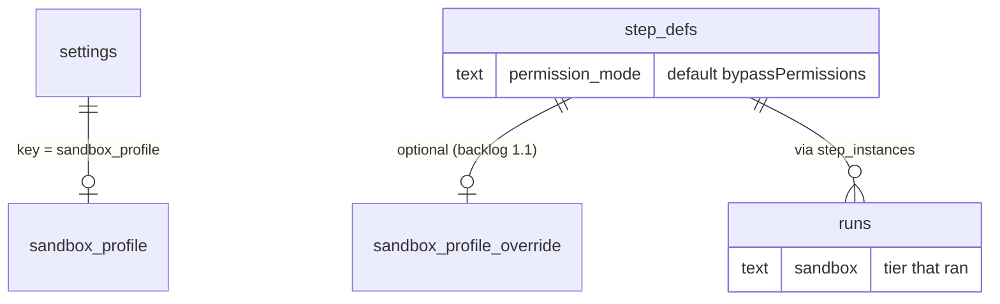

# Sandboxing Data Model

## In the database

| Field | Where | Meaning | Source | In PRD §5 `CREATE TABLE`? |
|---|---|---|---|---|
| `sandbox_profile` | `settings` row (key/value) | *"tier, image, egress allowlist, limits"* | PRD §11.1; drawio *SQLite* card (*"settings (memory, sandbox_profile)"*) | Yes, as a generic `settings(key, value)` table |
| `step_defs.sandbox_profile` | step definitions | *"an optional `step_defs.sandbox_profile` override"* | backlog Story 1.1 | **No** |
| `runs.sandbox` | runs | *"the tier that actually ran, alongside `runs.model`/`runs.effort`"* | PRD §11.1; backlog 1.1, 3.5; drawio (*"runs (… sandbox)"*) | **No** |
| `step_defs.permission_mode` | step definitions | `TEXT NOT NULL DEFAULT 'bypassPermissions'` | PRD §5 | Yes |
| `plugins.has_hooks`, `plugins.has_mcp` | plugins | *"ships hooks/ (marked as network-capable)"*, *"ships .mcp.json"* | PRD §5 | Yes |
| `tasks.non_goals` | tasks | *"what the agents must not touch or attempt"*; the source of the hooks' non-goal path rules | PRD §5, §7 | Yes |

> [!warning] Two columns only in prose
> `runs.sandbox` is named in PRD §11.1 and backlog Stories 1.1 and 3.5; `step_defs.sandbox_profile` only in backlog Story 1.1 (PRD §11.1 says just *"overridable per step"*). Neither is in the PRD §5 schema ([[Settings And Plumbing Open Questions]] #22). `runs.model` and `runs.effort` have the same gap ([[Cost And Control Open Questions]]). See [[Sandboxing Open Questions]].

## In code

`SandboxProfile` and `IsolationTier` (`exec-host.ts`, `01-ports.md`):

| Field | Type | Comment (source) |
|---|---|---|
| `tier` | `IsolationTier` | |
| `image` | `string?` | *"Base image for container/microVM tiers."* |
| `egressAllow` | `string[]` | *"Domains reachable from inside; default-deny everything else. `[]` = fully offline."* |
| `limits` | `{ memoryMb?, cpus?, pids?, wallClockMs? }` | *"Physical backstop to the logical max_turns / max_budget_usd caps."* |
| `mounts` | `{ source, target, readOnly? }[]` | *"Extra mounts beyond the task worktree. Never mount host secrets or the Docker socket."* |
| `env` | `Record<string,string>?` | *"Run-scoped env (model/CLI auth). Never bake secrets into the image."* |
| `nonRoot` | `boolean?` | *"Default true; `bypassPermissions` requires this."* |

Other types: `ExecHost`, `ChildHandle` ([[ExecHost Port]]), `RunSpec.exec` and `RunSpec.limits` (`agent-provider.ts`), the `tool_hooks` capability flag (`01-ports.md` only).

## Proposal: the shape of `sandbox_profile`

> [!example] Proposal, not a source
> The settings value is not specified. The natural reading is the `SandboxProfile` fields minus the runtime-only ones, as JSON:
> ```json
> { "tier": "container", "image": "flowboard-runner",
>   "egressAllow": ["api.anthropic.com", "registry.npmjs.org"],
>   "limits": { "memoryMb": 4096, "cpus": 2, "pids": 512, "wallClockMs": 1800000 } }
> ```
> The limit values are placeholders; no source gives any. A per-step override would hold the same shape, merged over the global one. Merge rules (replace or union the allowlist?) are unstated. Listed in [[Sandboxing Open Questions]].

## Entity view



## Related

- [[ExecHost Port]]
- [[Sandbox Configuration]]
- [[Execution Data Model]]
- [[Flow Data Model]]
