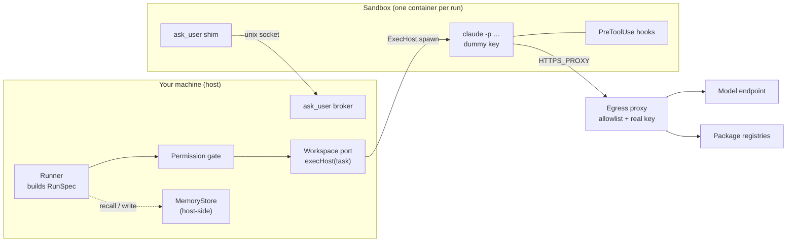

# Sandboxing Overview

## Purpose

`08-sandboxing.md` opens: *"Running each agent step inside a security boundary — a container or microVM — instead of directly on the host. Optional, off by default for trusted local repos, but the **recommended default whenever `bypassPermissions` is on**."*

Feature map §10 lists what the user gets:

| Feature | Feature map §10 wording |
|---|---|
| Levels of protection | *"From "no box" (fast, for work you trust) up to strong isolation for untrusted code."* |
| A wall around the network | *"By default the agent can't reach the internet at all, except a short allow-list of places it genuinely needs"* |
| Least privilege | *"It runs as a limited user, can't gain new powers, gets a throwaway filesystem, and only ever sees the one task's files"* |
| Hard limits | *"Ceilings on memory, processing, and time, so a runaway agent is stopped by the box, not just by its spending budget."* |
| The safety rule | *"Fully-autonomous mode (no approval on each action) is only allowed when the agent is inside a box; otherwise FlowBoard refuses it."* |
| Your keys stay outside the box | *"The agent never holds a real API key."* |
| Rules inside the agent too | *"The box limits what *can* happen; these checks block what *shouldn't*."* |

The pitch is stronger than *"optional"*: *"FlowBoard makes the safe path the default: each step runs in a **sandbox**"*, with the success metric *"**Zero autonomous runs happen unsandboxed**"* (`docs/pitch.md`). See [[Sandboxing Open Questions]] #3.

## Place in the system

Sandboxing is cross-cutting. `08-sandboxing.md` says it *"touches Workspace (11), AgentProvider (5), the runner (6), settings (15), and the HITL protocol (9)"*. It has no component number of its own in the architecture README's component index. It *"rides on the Workspace port via an `ExecHost` seam"* (architecture README).

Diagram drawn from the drawio *Harness architecture* page and `08-sandboxing.md` *How it fits the architecture*.

What the sandbox is **not**:

- Not a new kind of agent provider. *"The sandbox is not a new kind of AgentProvider — it is *where the provider's process runs*."* (`08-sandboxing.md`)
- Not deployment. *"shipping or *deploying* FlowBoard itself in a container is out of scope"* (PRD §17).
- Not multi-tenancy. *"it isolates the agent on the same single machine; it is not multi-tenancy or remote execution"* (PRD §17).
- Invisible to the rest of the app. *"Sandboxing is invisible to the engine, board, cost ledger, and viewer."* (`08-sandboxing.md`)

## Design principles

1. **Egress is the load-bearing control.** *"enforced below the agent's reasoning"* (`08-sandboxing.md`). See [[Egress Allowlist]].
2. **Two gates, inside and outside.** *"The sandbox limits what *can* happen; the hooks block what *shouldn't*."* (`03-execution-substrate.md` §6; PRD §7 has *"the sandbox limits what *can* happen, and the hooks block what *shouldn't*"*). See [[In-Agent Hooks]].
3. **One seam, any provider.** *"This keeps the matrix **2×N instead of N×M — any provider × any tier for free.**"* (`08-sandboxing.md`). See [[ExecHost Port]].
4. **Nothing worth stealing inside.** *"A prompt-injected agent can read its own environment, so the environment holds nothing worth stealing."* (PRD §11.1). See [[Credential Injecting Proxy]].
5. **The sealed process talks only to the host.** Questions and memory are brokered on the host, so neither adds to the allowlist. See [[Host-Side Brokers]].
6. **Pick the weakest tier that covers the trust level.** *"Higher tiers cost startup time and complexity."* (`08-sandboxing.md`). See [[Isolation Tiers]].
7. **Ephemeral.** *"One container per run/attempt, destroyed on completion — clean state, no cross-run contamination."* (`08-sandboxing.md`)

> [!warning] What it cannot do
> *"even a hardened sandbox with `bypassPermissions` cannot stop a malicious repo from exfiltrating whatever is *inside* the sandbox (including any credentials mounted there) to whatever the allowlist permits. Run trusted repos, keep the allowlist tight, mount no host secrets."* (`08-sandboxing.md`)

## Related

- [[Sandboxing Index]]
- [[Sandbox Threat Model]]
- [[Sandboxing Glossary]]
- [[Run Guardrails At Launch]]
