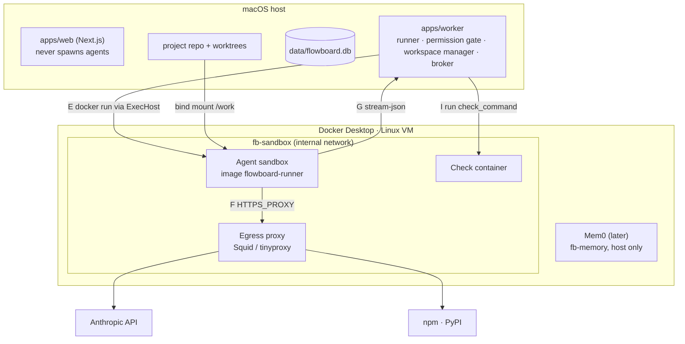

# Sandboxing Runtime

The moving parts behind a sandboxed run. Mostly from the drawio *Harness architecture* page: *"One laptop · two Node processes · one SQLite file · one throwaway Docker container per run."*

## Topology

## Components

| Component | What it is (source wording) | Source |
|---|---|---|
| Docker Desktop · Linux VM | *"one container per run, destroyed on exit"* | drawio |
| Agent sandbox | *"image flowboard-runner node · claude CLI · codex CLI · git · pnpm · toolchains"* | drawio |
| CLI inside | *"claude -p … --output-format stream-json / cwd /work · --mcp-config (shim) · --settings (hooks) · --strict-mcp-config · --max-turns · --max-budget-usd · ANTHROPIC_BASE_URL → proxy, dummy key"* | drawio |
| `ask_user` shim | *"forwards tool calls over /run/fb/ask.sock to the host broker; no DB file, no network. Same shim on the host tier"* | drawio |
| Check container | *"same image and mounts, no model, no API key: runs check_command and exits with its code"* | drawio |
| Egress proxy | *"fb-sandbox is an internal Docker network, so the proxy is the only way out / injects the real API key on model requests"* | drawio, PRD §11.1 |
| Permission gate | in the worker; see [[Permission Gate]] | drawio |
| Workspace manager | *"git worktree add / remove per task · ExecHost per tier: host · docker · gVisor"* | drawio |
| Runner | *"builds the RunSpec · draft-mode transform · writes per-run mcp.json + settings.json (hooks) · records model, effort, tier"* | drawio |
| Exec adapters | `packages/adapters/exec/  # host, docker` | PRD §3 |
| Container workspace adapter | *"Container workspace / devcontainer · Docker sandbox · remote host"*, dashed (not in v1) | drawio *Logical components* |

## Startup probe

*"Probe for Docker at startup; if absent, fall back to the host tier and disable `bypassPermissions`."* (PRD §11.1). Backlog Story 0.1: *"Probe Docker (or Podman) availability and version; decide the runtime and whether gVisor/Firecracker are worth an opt-in tier."* `08` *Recommendation*: *"**Docker as the baseline runtime**; `gvisor`/`microvm` opt-in for untrusted repos, behind the same `ExecHost` port."*

## RunSpec transformers

*"`runs.sandbox` records the tier; draft mode and the sandbox profile compose as `RunSpec` transformers."* (backlog Story 3.5). See [[Draft Mode And Spec Transforms]].

## Image contents

Only the drawio names the image (`flowboard-runner`) and its contents. *"Never bake secrets into the image"* (`exec-host.ts`). How the image is built, versioned or updated is not described. See [[Sandboxing Open Questions]].

## Related

- [[ExecHost Port]]
- [[Sandboxed Run Lifecycle]]
- [[Egress Allowlist]]
- [[Execution Runtime]]
