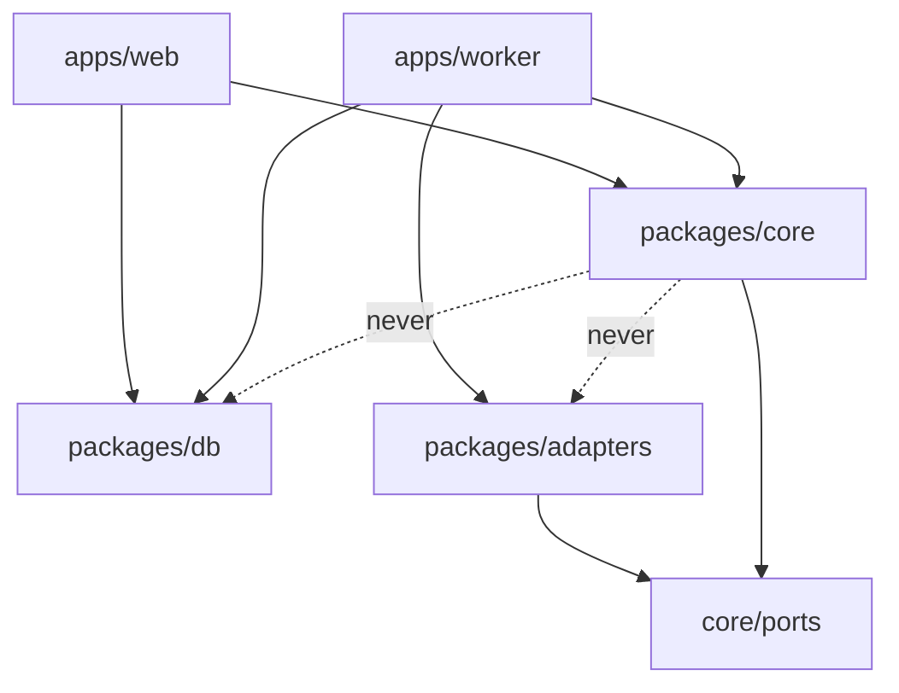

# Code Layout And Dependency Rule

## The rule

PRD §3: *"The one rule that matters: **`packages/core` imports no framework, no database driver and no CLI.** The engine, loop guard, advancement rules, prompt builder, fingerprinting and the port interfaces live there. Next.js is one shell around the core, not its home, so a later CLI, a different UI or remote workers reuse the same logic without a rewrite. Keep this rule from the first commit: it is cheap now and a rewrite later."*

Architecture `README.md`: *"**Dependency rule for the rebuild:** the domain (flow engine, board projection, question protocol, cost ledger) depends only on **ports**; everything provider-specific is an **adapter** behind one. `core/` and `runner/` must never import from `adapters/` — only from `core/ports/`. Enforce with a lint rule."* The drawio repeats it: *"core/ never imports adapters/ — Only core/ports. Enforce with a lint rule."*

The arrows into `packages/db` and `packages/adapters` are inferred from the layout; the PRD states only that core *"depends on nothing below"*.

## Two layouts in the sources

| PRD §3 (pnpm workspace) | Architecture `README.md` (*Suggested module layout*) |
|---|---|
| `packages/core/` — engine, prompt, ports, `events.ts` | `core/` — flow, engine, hitl, cost, memory, ports |
| `packages/db/` — schema, migrations, singleton | — |
| `packages/adapters/` — agent, exec, notify, memory | `adapters/` — agent, notify, workspace, source, memory |
| `apps/web/`, `apps/worker/`, `apps/mcp-shim/` | `runner/`, `worker/`, `app/` |
| handlers in `apps/web/app/api/` call `packages/core` (§12) | handlers in `src/app/api/` call `src/lib/` (`06` §15) |

The `docs/old/reference/` tree mirrors the second layout (`core/ports`, `core/hitl`, `adapters/agent/replay`, `adapters/source/markdown`). The only code in the repo is `code/flowboard/`: a stock `create-next-app` scaffold (Next.js 16.4.1, React 19.3.0, Tailwind 4) and, since 2026-10-18, a pnpm workspace (`packages/*`) holding the provider layer: `packages/core` (ports, guards, prompt), `packages/adapters` (Claude Code, OpenCode, Replay, the host ExecHost), `packages/ask-user` (the ask-user MCP shim, PRD §3's `apps/mcp-shim`) and `packages/cli` (`pnpm run-agent`). There is no `packages/db` and no `apps/` yet. `packages/core` imports only Node builtins, so the rule holds so far ([[Agent Providers Storage]]).

> [!question] Where does application logic that needs the database live?
> A handler must *"write rows → enqueue a job"* (drawio), but core may not import the DB driver (PRD §3). PRD §12 says handlers *"call a function in `packages/core`"*; `06` §15 says *"call a function in `src/lib/`"*, where ports are called. Neither names the layer that combines core rules with `packages/db`. See [[Settings And Plumbing Open Questions]] #13 and #15, and [[Execution Open Questions]] #63.

## Why it matters here

- Provider knowledge stays in adapters, so *"If a route ever needs to know whether it's Claude or Codex, something leaked upward."* (`06` §15)
- The acceptance test for the whole design: adding Codex needs *"Zero changes to: engine, board projection, HITL protocol, notifier, cost rollups, viewer, API."* (`06`)
- Draft mode is a pure function, so it can live in core ([[Settings Overrides And Spec Transforms]]).
- Reference files *"depend on **nothing but Node builtins**"* and avoid *"TS features that need a transform (e.g. parameter properties, enums) so strip-only runtimes keep working."* (`reference/README.md`)

## Related

- [[Thin Route Handlers]]
- [[Process Topology]]
- [[Settings And Plumbing Overview]]
- [[Settings And Plumbing Open Questions]]
