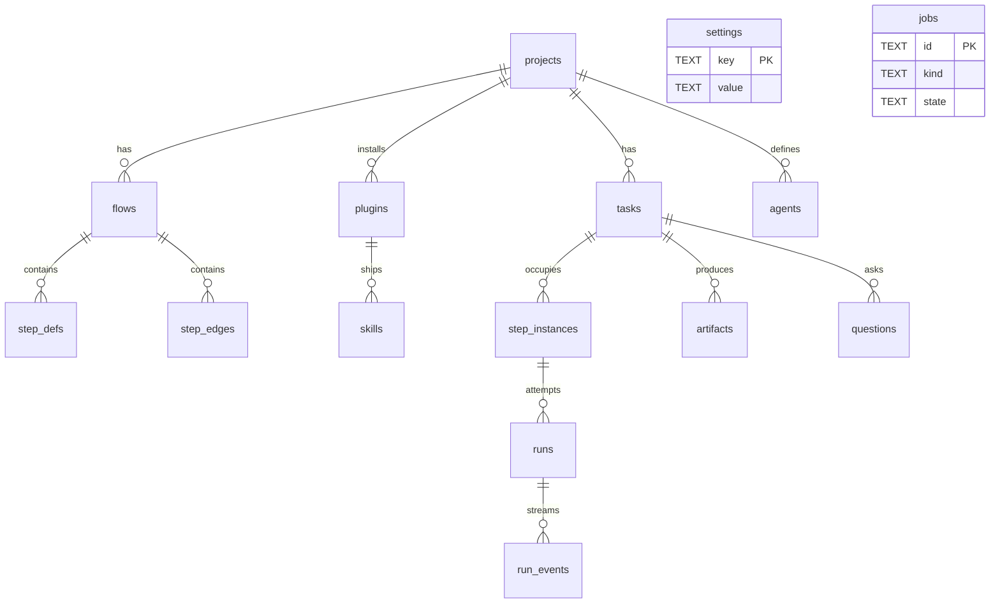

# Domain Schema

Architecture #1, *Domain model & migrations* (`02` §1): *"the 14 tables (PRD §5) plus the invariants — flow immutability, version pinning, guarded loops."* This note is the map of the tables and the platform-level changes the architecture asks for. Each table's columns are documented by the set that owns it.

## The tables

| Table | Owner set | Note |
|---|---|---|
| `projects` | Projects | [[Projects Data Model]] |
| `flows`, `step_defs`, `step_edges` | Flow Design | [[Flow Data Model]] |
| `tasks`, `step_instances`, `runs` | Execution, Task Detail; Intake And Import writes `tasks`, Workspaces owns `tasks.branch_name` and `worktree_path` | [[Execution Data Model]], [[Task Data Model]], [[Intake Data Model]], [[Workspaces Data Model]] |
| `run_events` | Monitor, Execution | [[Monitor Data Model]], [[Execution Data Model]] |
| `artifacts` | Task Detail | [[Task Data Model]] |
| `questions` | Human In The Loop | [[Human In The Loop Data Model]] |
| `plugins`, `skills`, `agents` | Capability Library | [[Capability Data Model]] |
| `jobs` | Execution | [[Job Queue]] |
| `settings` | Settings And Plumbing | [[Settings Data Model]] |
| `memories` (+ FTS5), `run_memories` | Memory (optional; not in PRD §5) | [[Memory Data Model]] |

`settings` and `jobs` have no foreign keys: they are platform tables, not domain tables.

> [!warning] 14 tables or 15?
> `02` §1 and backlog 1.1 (*"All 14 tables exactly as §5"*) say 14. PRD §5 now has 15, because the Capability Library's v1 design made the plugin the unit of install (Capability Library D4) and added `plugins`. Memory adds two more when enabled. See [[Settings And Plumbing Open Questions]] #21 and [[Projects Open Questions]] #20.

## Changes the architecture asks for

| Change | Why | Source | In PRD §5? |
|---|---|---|---|
| `runs.claude_session_id` → `agent_session_id` | one of *"the only leaks"* of the provider into the schema | `02` §1 | **no** — still `claude_session_id`. See [[Agent Providers Data Model]] |
| add `runs.provider` | `02` §1 gives no reason; `06` §12's `PricingService.price(provider, …)` is the obvious reader (inference) | `02` §1, `06` §12 | **no**. See [[Agent Providers Data Model]] |
| add `runs.model`, `runs.effort` | *"so draft mode can't corrupt cost views"* | `02` §1, backlog 1.1 | **no** |
| add `runs.sandbox` | the tier that ran, for audit | PRD §11.1, backlog 1.1 | **no** (only §11.1's prose). See [[Sandboxing Data Model]] |
| add `step_instances.reason` | rejection or failure text on the card | `02` §1, backlog 1.1 | **no** |
| add `step_defs.sandbox_profile` | per-step override | backlog 1.1 | **no**. See [[Sandboxing Data Model]] |
| `skills` gains `provider` + `format` | a plugin dir is one packaging | `02` §1 | superseded by Capability Library D1 (Claude-only v1) |
| `jobs.kind` includes `resume_step` | park and resume | backlog 1.1 (**DEC**) | **no** ([[Execution Open Questions]] #37) |

Backlog 1.1 calls the first three *"the three columns that proved necessary"*. See [[Settings And Plumbing Open Questions]] #22.

## Invariants

- **Flows are immutable.** *"Editing a flow creates a new version rather than mutating the old one."* (PRD §4)
- **Version pinning.** *"`tasks.flow_id` points at a specific flow version. Editing a project's flow never moves an in-flight task."* (PRD §4)
- **Guarded loops.** `max_attempts`, default 3 (PRD §4, §8).
- **Append-only usage journal** (idea): *"treat `runs` as an **append-only usage journal** — never mutate cost after the result lands; corrections are new rows."* (`02` §1). PRD §5's `runs.wasted` is set after the fact, which conflicts; see [[Execution Open Questions]] #46.
- **Artifacts on disk.** *"The `artifacts` table stores only type, path and metadata."* (PRD §6)

## Related

- [[Database And Connection]]
- [[Migrations]]
- [[Settings Data Model]]
- [[Execution Data Model]]
- [[Projects Data Model]]
- [[Memory Data Model]]
