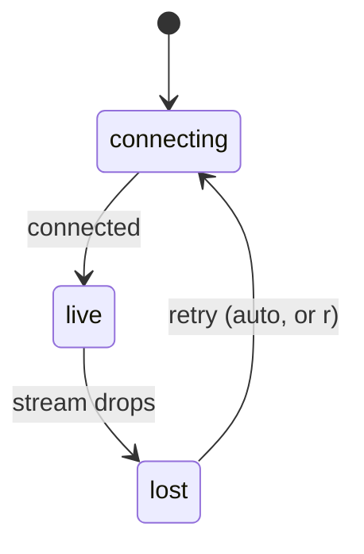

# Live Updates

Feature map §20: *"**Live updates** — A steady stream keeps the board, the viewer, and the inbox current without you refreshing."*

The run stream itself (the seven event kinds, `seq`, the parser) is documented in [[Event Stream And SSE]]. This note covers the transport as a platform rule: why SSE, why it tails the database, and how the client behaves when the connection drops.

## Why SSE that tails SQLite

| Rule | Source |
|---|---|
| SSE, not websockets | PRD §2: *"**Server-Sent Events** for live streaming (not websockets — SSE is enough and simpler in Next.js)"* |
| Tail the database, not memory | PRD §7: *"The SSE endpoint lives in `apps/web`, a different process, so it cannot share an in-memory emitter: it tails `run_events` by `seq` (with `Last-Event-ID` for catch-up)."* |
| Replay, then stream | PRD §12: *"The SSE endpoint replays existing `run_events` for the run, then streams new ones. Reconnect with `Last-Event-ID`."* Feature map §9: *"reopen the page and it catches you up from the start"* |
| Close on terminal state | backlog 3.4, `03` §8: *"sends `end` on terminal state"* |
| Not only runs | drawio: *"SSE endpoints / tail run_events by seq, questions and task state from SQLite (works across processes; catches up on reconnect)"* |
| No client store | drawio tech card: *"EventSource for live updates · no client state store: the server is the source of truth"* |

The reason is the process split ([[Process Topology]]). The worker writes; the web process serves. The database is the only thing both can see.

## The streams

| Stream | Endpoint | Source |
|---|---|---|
| One run's events | `GET /api/runs/:id/stream` | PRD §12 |
| The inbox | not named | PRD §10 (*"the inbox subscribes to an SSE stream"*); backlog 4.3 (*"SSE snapshot stream (pending + answered in last 2 min)"*); `04` §9 |
| The board | not named | drawio beat G (*"→ SSE → run viewer and board"*); feature map §20 |

> [!warning] The board has four transports in the sources
> SSE (drawio, feature map §20), a polling hook (backlog 2.2), *"a **materialized view refreshed on job completion** instead of client polling, collapsing the three overlapping pollers"* (`02` §4), and the old handoff's *"One websocket for run events"* (it also pushes answered questions: *"Server push (websocket) marks a question resolved"*). SSE is settled for runs and the inbox (PRD §2, §10, §12; `04` §9; backlog 4.3); open for the board. See [[Monitor Open Questions]] #30 and [[Human In The Loop Open Questions]] #31.

## Fewer pollers

The first build polled from several components at once:

- *"Collapse the three overlapping pollers (`/api/inbox/summary` ×2 + `/api/questions?state=pending`) into one."* — **BUG (perf)** (backlog 4.3)
- *"Wordmark, nav pills, amber inbox count, running dot + spend today; one summary poller."* (backlog 9.2)
- *"Polling hook: `cache: "no-store"`, catch network errors, surface an error state; unhandled rejection today."* — **BUG** (backlog 2.2)

## Client rules

| Rule | Source |
|---|---|
| Dedupe by `seq` on append | *"StrictMode double‑subscribe duplicates replay"* — **BUG** (backlog 3.4) |
| One shared ticker | *"`now` — one shared 1s ticker for every elapsed time and cost readout (one interval for the page, not one per row)"* (old handoff) |
| Elapsed is client-side | *"Recomputed client-side each second from the question's `asked_at`; no server round-trip."* (old handoff) |
| Drafts survive a push | *"`draftAnswers` … local until submit, so a partly-typed textarea survives a push update to another row"* (old handoff) |
| Pushes never move the cursor | *"resolution never moves the row the developer is currently on, and never re-sorts the batch"* (old handoff, 1e) |

## Connection states

The old handoff models the connection explicitly: *"`connection: 'live'|'connecting'|'lost'` + `lastSyncAt`"*.

| State | Behaviour (old handoff 1d) |
|---|---|
| `connecting` | Skeletons; footer *"connecting to orchestrator…"* |
| `lost` | *"Lost the orchestrator"* card: *"Answers you submit now will not reach the running steps"*, the raw cause, *Retry now* and *Open logs*. *"The stale queue stays visible below at `opacity .45` with controls disabled and an `as of 40s ago` stamp — never blanked."* It *"blocks submission rather than queuing it."* |

Backlog asks for the same elsewhere: *"loading skeleton; "lost the orchestrator" card; stale badge"* (4.3); *"Loading, 404 and stream‑lost states"* in the viewer (3.4); *"`aria-live` on the lost‑connection banner"* (9.4).

## Related

- [[Event Stream And SSE]]
- [[Process Topology]]
- [[Settings And Plumbing API And Routes]]
- [[Monitor Runtime]]
- [[Live Run Viewer]]
