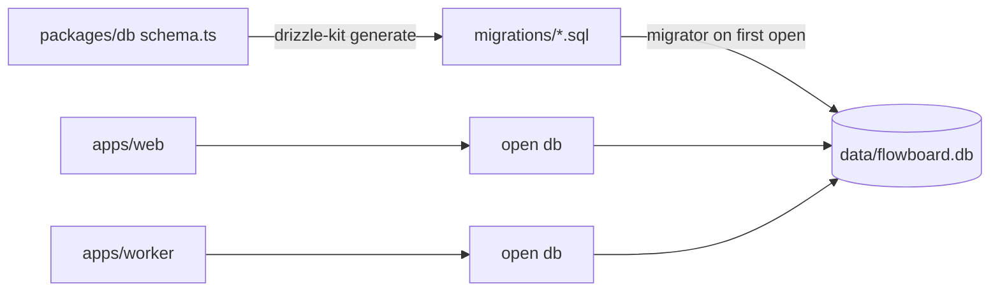

# Migrations

## What the sources say

| Rule | Source |
|---|---|
| *"SQLite via `better-sqlite3`, with **Drizzle ORM** and drizzle-kit migrations"* | PRD §2 |
| `packages/db/` holds *"Drizzle schema, migrations, the db singleton"*; `drizzle.config.ts` at the root | PRD §3 |
| *"Migrations via drizzle‑kit; migrator runs on first open."* — **PRD** | backlog 1.1 |
| M1 is *"Next.js + Tailwind + shadcn + Drizzle + schema + migrations"* | PRD §14 |
| *"later milestones depend on earlier schema being correct"* | PRD §0 |
| Drawio code layout: *"packages/db : Drizzle schema + migrations"* | drawio *Harness architecture* |

That is everything the sources say about migrations. There is no migration policy, naming scheme or rollback rule.

## How it fits together

## Things the schema will need migrations for

Each is already known, from [[Domain Schema]]:

- the `runs` and `step_instances` columns PRD §5 leaves out (`model`, `effort`, `sandbox`, `provider`, `agent_session_id`, `reason`);
- the optional `memories` (with FTS5) and `run_memories` tables, added at M9 (PRD §11.2). Memory is additive, so these can be created whether or not memory is on;
- keys added to `settings` need no migration, because `settings` is key/value. Their defaults live in code ([[Settings Data Model]]).

## Gaps

> [!question] Who runs the migrator?
> Both `apps/web` and `apps/worker` open the database on start (PRD §3). *"migrator runs on first open"* (backlog 1.1) means both may try at once.
>
> **Proposal:** run migrations once, before both processes start (a `predev` step), and have each process check the schema version on open and refuse to start on a mismatch. SQLite's write lock would serialise two migrators anyway, but a failed migration should stop both processes, not one. Listed in [[Settings And Plumbing Open Questions]] #23.

> [!question] Data inside JSON columns
> Flow versions are *"immutable JSON"* (`README.md`, architecture), and several columns hold JSON (`requires`, `produces`, `capability_pins`, `options`, `answer`, `settings.value`). A shape change in that JSON is not a schema change, so drizzle-kit will not see it. No source says how old flow versions are upgraded. Listed in [[Settings And Plumbing Open Questions]] #23.

## Related

- [[Domain Schema]]
- [[Database And Connection]]
- [[Settings And Plumbing Roadmap]]
- [[Flow Storage]]
