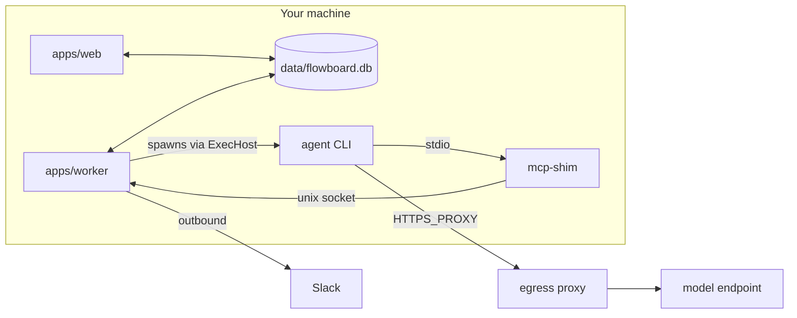

# Process Topology

The runtime shape of an install: which processes run, what each may touch, and how they talk. Drawio *Harness architecture* title: *"One laptop · two Node processes · one SQLite file · one throwaway Docker container per run."*

## The processes

| Process | Does | Opens the DB | Source |
|---|---|---|---|
| `apps/web` (Next.js) | Routes, server actions, SSE, components. *"Calls core; holds no rules"* | yes | PRD §3; drawio |
| `apps/worker` (Node) | Job loop, runner, `ask_user` broker, escalation timer. *"the harness proper; its rules come from packages/core"* | yes | PRD §3; drawio |
| `apps/mcp-shim` | *"tiny stdio MCP server; forwards to the broker over a unix socket"*, launched by the CLI per run | **no** | PRD §3, §9 |
| Agent CLI | `claude -p …`, on the host or in a container | no | PRD §7, §11.1 |
| Egress proxy | Squid or tinyproxy on an internal Docker network | no | PRD §11.1 |

*"`concurrently` to run `next dev` and the worker together under `npm run dev`"* (PRD §2). The PRD's package manager is pnpm, and PRD §16's first acceptance check is *"`pnpm dev` starts Next.js and the worker together"*. The drawio host card: *"pnpm dev → concurrently starts both processes"*.

## Rules

- **Only two processes open SQLite.** PRD §3: *"Only `apps/web` and `apps/worker` open the SQLite file; the MCP shim never does (§9)."* The drawio DB card: *"the only shared state: opened by apps/web and apps/worker only, never from a sandbox"*.
- **The web process never spawns agents.** PRD §2. See [[Thin Route Handlers]].
- **The worker is the only writer of run lifecycle.** `03` §7: *"the only writer of run lifecycle state"*. The broker is *"the only writer of the `questions` table"* (PRD §9).
- **They talk through rows.** The web process writes rows and a job; the worker leases it (*"UPDATE … SET state='leased' …"*, PRD §7). Live updates flow back by tailing tables ([[Live Updates]]).
- **Same machine.** Stop is *"SIGTERM by pid from the route (same machine)"* (backlog 3.4). Out of scope: *"multi-machine support"* (PRD §17). The worker is *"a **generic executor host** … the decoupling point that later allows remote executors or a fleet"* (`03` §7).

> [!warning] Does the MCP process open the database?
> PRD §3 and §9 say never. `02` §1 and backlog 1.1 describe a DB path env var *"so worker and MCP (spawned with a foreign cwd) open the same file"*, which is the first build's design. See [[Execution Open Questions]] #54.

## Ports and binding

The dev server runs on **3111**: *"Dev server on port 3111; README warns agents kill :3000"* — **FIX** (backlog 0.3; also *"agents killed port 3000 (moved to 3111)"*). The old handoff's error state shows *"`ECONNREFUSED 127.0.0.1:7717`"*, a port no other source names.

> [!warning] Gap — an unauthenticated API on a port
> There is no auth (PRD §2). No source says the server binds to `127.0.0.1` only, or how a `host`-tier agent (which runs as the user, outside the egress wall) is kept from calling the local API, for example to approve its own gate. See [[Settings And Plumbing Open Questions]] #25.

## Related

- [[Worker Lifecycle]]
- [[Job Queue]]
- [[Database And Connection]]
- [[Live Updates]]
- [[Environment And Configuration]]
