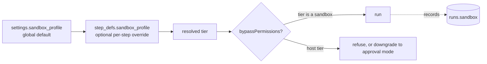

# Sandbox Profile Setting

Feature map §19: *"**Sandbox defaults** — How locked-down agents should run by default (see Sandboxing)."* The sandbox itself (tiers, egress proxy, hardening, hooks) is the Sandboxing component (feature map §10, `08-sandboxing.md`), documented in [[Sandboxing Index]]: see [[Sandbox Configuration]], [[Sandbox Defaults]] and [[Isolation Tiers]]. This note covers only the setting that picks its defaults.

## What the setting holds

PRD §11.1: *"Configuration: a `sandbox_profile` in `settings` (tier, image, egress allowlist, limits), overridable per step; `runs.sandbox` records the tier that actually ran, alongside `runs.model`/`runs.effort`."*

PRD §13: *"Add a **sandbox** section in settings too: the default isolation tier (host / container / microVM), the container image, the network egress allowlist, and the resource limits."*

| Field | Values | Source |
|---|---|---|
| Tier | `host` · `container` · `gvisor` · `microvm` | `IsolationTier`, `01-ports.md`, `exec-host.ts`; PRD §13 lists only host / container / microVM |
| Image | a container image; drawio names `flowboard-runner` | PRD §11.1, §13; drawio *Harness architecture* |
| Egress allowlist | domains; *"`[]` = offline"* | `SandboxProfile.egressAllow`; backlog 3.5 |
| Limits | `memoryMb`, `cpus`, `pids`, `wallClockMs` | `SandboxProfile.limits`; PRD §11.1 (`--memory`, `--cpus`, `--pids-limit`, wall-clock) |

The port type also has `mounts`, `env` and `nonRoot`. No source makes those user-editable.

> [!warning] Global allowlist or per-step allowlist?
> PRD §11.1 keeps one allowlist in `settings.sandbox_profile`, overridable per step. The mockups speak only of a per-step list: *"this step's egress allowlist"* (`inbox.html`), *"this step's allowlist"* (`inbox-guide.html`), *"not in the step allowlist"* (`monitor.html`, `task-detail.html`), and **Allow host & retry**, which *"Adds the blocked host to this step's egress allowlist"* (`monitor-guide.html`; also the inbox guide and the capability library). The flow-designer mockup also gives each step a **Sandbox** select with three levels, `none`, `container`, `sealed container` (default `sealed container`). `container` is an `IsolationTier`; `none` and `sealed container` match none. See [[Sandboxing Open Questions]] #6, #7 and #10.

## Layers

- Per-step override: *"an optional `step_defs.sandbox_profile` override"* (backlog 1.1). PRD §5's `step_defs` has no such column. See [[Domain Schema]].
- The gate: *"`bypassPermissions` is only allowed when the step runs in a sandbox tier. On the host tier, refuse it (or downgrade to an approval mode)"* (PRD §11.1). Documented in [[Permission Gate]] (Sandboxing) and [[Run Guardrails At Launch]] (Execution).
- Composition: *"draft mode and the sandbox profile compose as `RunSpec` transformers"* (backlog 3.5). See [[Settings Overrides And Spec Transforms]].

## Recommended defaults

From `08-sandboxing.md`, *Recommendation for FlowBoard*:

1. *"**Default tier = `container`** whenever a step's `permission_mode` is `bypassPermissions`; **`host`** only for non-bypass steps or an explicit trusted-repo opt-out."* This limits when `host` may be used; it does not make `host` the default for non-bypass steps.
2. *"**Egress allowlist on** by default (the model endpoint via the credential-injecting proxy + npm/pnpm; no git remote); editable in settings."*
3. *"**Docker as the baseline runtime**; `gvisor`/`microvm` opt-in for untrusted repos, behind the same `ExecHost` port."*
4. *"**Probe Docker at startup**; if absent, fall back to `host` and disable `bypassPermissions` (or warn)."*

Backlog D7 gives the same default: *"Container + egress allowlist; `host` only for non-bypass or a trusted opt-out"*, and D8: *"Docker baseline; gVisor/Firecracker opt-in per untrusted repo"*. The drawio *Tiers* card: *"host (no box, approval mode only) · container (default when autonomous) · gVisor runsc (untrusted repos, Linux hosts) · microVM / docker sandbox"*. The drawio egress proxy card lists *"api.anthropic.com · api.openai.com (later) · npm / PyPI · no git remote"*.

> [!warning] On by default, or off?
> `08` opens: *"Optional, off by default for trusted local repos, but the **recommended default whenever `bypassPermissions` is on**."* PRD §11.1 is titled *"optional, recommended for headless runs"*. `docs/pitch.md` says on: *"FlowBoard makes the safe path the default: each step runs in a **sandbox**"*. Every step defaults to `bypassPermissions` (PRD §5), so with the sandbox off every default step meets the gate. Feature map §10 (*"❓ How strong a box to use by default"*) and architecture `README.md` open decision 3 leave it open. See [[Sandboxing Open Questions]] #3.

> [!warning] A setting the environment can override
> PRD §11.1: *"Probe for Docker at startup; if absent, fall back to the host tier and disable `bypassPermissions`."* Backlog 0.1 probes *"Docker (or Podman)"*. So the setting is a preference. The effective tier also depends on what the machine has. No source says whether the settings screen shows that the probe failed. See [[Settings And Plumbing Open Questions]] #8.

> [!note] No limit values
> No source gives numbers for memory, CPUs, pids or wall-clock. See [[Settings Defaults]] and [[Resource Limits]].

## Related

- [[Settings Catalogue]]
- [[Settings Overrides And Spec Transforms]]
- [[Sandbox Configuration]]
- [[Sandbox Defaults]]
- [[Run Guardrails At Launch]]
- [[Step Guardrails]]
- [[Settings Defaults]]
