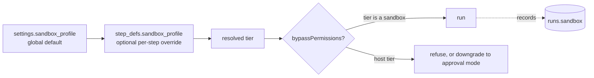

# Sandbox Profile Setting

Feature map §19: *"**Sandbox defaults** — How locked-down agents should run by default."* The sandbox itself (tiers, egress proxy, hardening, hooks) is the Sandboxing component (feature map §10, `08-sandboxing.md`). This note covers the setting that picks its defaults.

## What the setting holds

PRD §11.1: *"Configuration: a `sandbox_profile` in `settings` (tier, image, egress allowlist, limits), overridable per step; `runs.sandbox` records the tier that actually ran, alongside `runs.model`/`runs.effort`."*

PRD §13: *"Add a **sandbox** section in settings too: the default isolation tier (host / container / microVM), the container image, the network egress allowlist, and the resource limits."*

| Field | Values | Source |
|---|---|---|
| Tier | `host` · `container` · `gvisor` · `microvm` | `IsolationTier`, `01-ports.md`, `exec-host.ts`; PRD §13 lists only host / container / microVM |
| Image | a container image; drawio names `flowboard-runner` | PRD §11.1, §13; drawio *Harness architecture* |
| Egress allowlist | domains; *"`[]` = offline"* | `SandboxProfile.egressAllow`; backlog 3.5 |
| Limits | `memoryMb`, `cpus`, `pids`, `wallClockMs` | `SandboxProfile.limits`; PRD §11.1 (`--memory`, `--cpus`, `--pids-limit`, wall-clock) |

The port type also has `mounts`, `env` and `nonRoot`. No source makes those user-editable.

## Layers

- Per-step override: *"an optional `step_defs.sandbox_profile` override"* (backlog 1.1). PRD §5's `step_defs` has no such column. See [[Domain Schema]].
- The gate: *"`bypassPermissions` is only allowed when the step runs in a sandbox tier. On the host tier, refuse it (or downgrade to an approval mode)"* (PRD §11.1). Execution documents it in [[Run Guardrails At Launch]].
- Composition: *"draft mode and the sandbox profile compose as `RunSpec` transformers"* (backlog 3.5). See [[Settings Overrides And Spec Transforms]].

## Recommended defaults

From `08-sandboxing.md`, *Recommendation for FlowBoard*:

1. *"**Default tier = `container`** whenever a step's `permission_mode` is `bypassPermissions`; **`host`** only for non-bypass steps or an explicit trusted-repo opt-out."*
2. *"**Egress allowlist on** by default (the model endpoint via the credential-injecting proxy + npm/pnpm; no git remote); editable in settings."*
3. *"**Docker as the baseline runtime**; `gvisor`/`microvm` opt-in for untrusted repos"*.
4. *"**Probe Docker at startup**; if absent, fall back to `host` and disable `bypassPermissions` (or warn)."*

Backlog D7 gives the same default: *"Container + egress allowlist; `host` only for non-bypass or a trusted opt-out"*. The drawio egress proxy card lists *"api.anthropic.com · api.openai.com (later) · npm / PyPI · no git remote"*.

> [!warning] A setting the environment can override
> PRD §11.1: *"Probe for Docker at startup; if absent, fall back to the host tier and disable `bypassPermissions`."* So the setting is a preference. The effective tier also depends on what the machine has. No source says whether the settings screen shows that the probe failed. See [[Settings And Plumbing Open Questions]] #8.

> [!note] No limit values
> No source gives numbers for memory, CPUs, pids or wall-clock. See [[Settings Defaults]].

## Related

- [[Settings Catalogue]]
- [[Settings Overrides And Spec Transforms]]
- [[Run Guardrails At Launch]]
- [[Step Guardrails]]
- [[Settings Defaults]]
