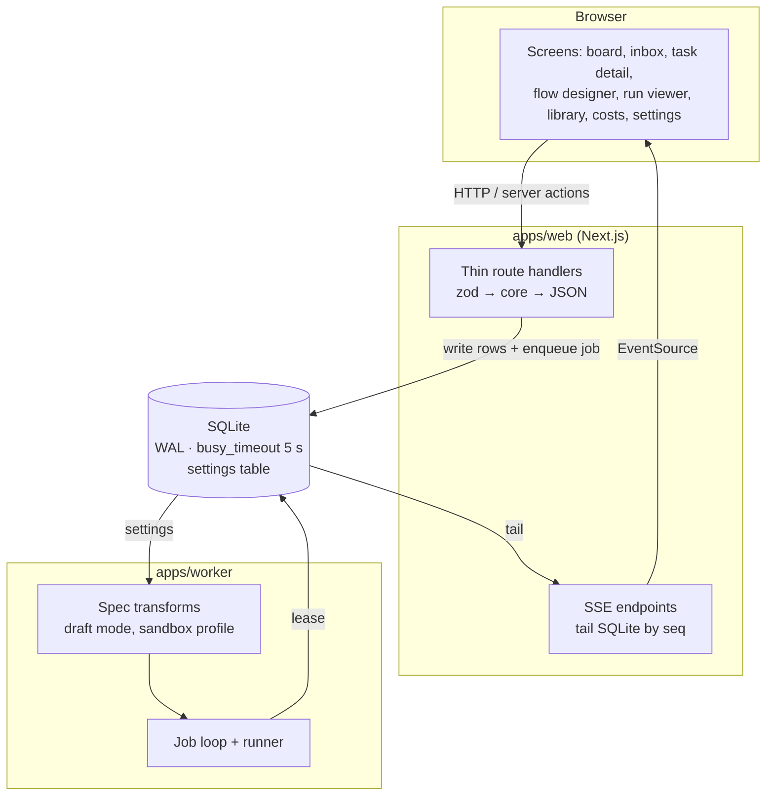

# Settings And Plumbing Overview

## Purpose

Settings And Plumbing is the platform layer under every screen. It has two halves:

- **Settings** are the global switches. Feature map §19: *"The global switches."* It lists four: draft mode, sandbox defaults, appearance, and nudge timing.
- **Plumbing** is everything that connects the screens to the data. Feature map §20: *"The internal connections that let the screens talk to the data and stream live updates. Mostly invisible, but a real part of the system."*

Architecture component **#15** (*Settings, draft mode, API*, `06` §15) names its role: *"global overrides and the thin presentation layer."* Component **#1** (*Domain model & migrations*, `02` §1) supplies the database the whole layer sits on. The project side of #1 (projects, repos, the check command) belongs to [[Projects Index|Projects]].

## Where it sits

Drawn from the drawio *Harness architecture* page, except the sandbox-profile transform, which comes from backlog 3.5 (*"draft mode and the sandbox profile compose as `RunSpec` transformers"*): *"API routes + server actions / zod-validated input → write rows → enqueue a job → return"*, *"SSE endpoints / tail run_events by seq, questions and task state from SQLite (works across processes; catches up on reconnect)"*, and the front-end tech card's *"EventSource for live updates · no client state store: the server is the source of truth"*.

## What the layer does

| Function | Summary | Note |
|---|---|---|
| Hold the global switches | Draft mode, sandbox defaults, appearance, nudge timing, memory | [[Settings Catalogue]] |
| Store them | A key/value `settings` table | [[Settings Data Model]] |
| Apply them to runs | Pure `RunSpec` transforms, resolved values recorded on the run | [[Settings Overrides And Spec Transforms]] |
| Expose the API | REST handlers that validate, call core, return JSON | [[Thin Route Handlers]], [[Settings And Plumbing API And Routes]] |
| Keep screens live | SSE that tails SQLite, replay with `Last-Event-ID` | [[Live Updates]] |
| Own the database | SQLite, pragmas, one file shared by two processes | [[Database And Connection]], [[Domain Schema]] |
| Evolve the schema | drizzle-kit migrations, run on first open | [[Migrations]] |
| Configure the install | Env vars, `.env.local`, ports, data directory | [[Environment And Configuration]] |
| Keep the core clean | `packages/core` imports no framework, DB driver or CLI | [[Code Layout And Dependency Rule]] |

## Design principles

- **Handlers are three-liners.** *"keep every handler a three-liner (validate → lib → JSON) and the ports stay the only place provider knowledge exists. If a route ever needs to know whether it's Claude or Codex, something leaked upward."* (`06` §15)
- **Routes never run agents.** *"Next.js route handlers must never spawn a long-lived child process; they enqueue jobs and the worker picks them up"* (PRD §2).
- **The database is the only shared state.** `02` §1: *"keep it the *only* shared-state coupling."* The web process and the worker talk through SQLite rows and the `jobs` table, not through memory. This is why live updates tail the database ([[Live Updates]]).
- **Overrides are transforms, not special cases.** Draft mode is *"a pure function applied before `launch()`"* and is *"composable with any future override"* (`06` §15).
- **Record what actually ran.** A transform records the *resolved* model, effort and tier on the run, so cost views stay honest (`06` §15, backlog 1.1, PRD §11.1).
- **Additive switches stay off by default.** Memory defaults to `none`: *"memory is additive, and nothing else in the app depends on it being on"* (PRD §13).
- **No auth, no tenancy.** PRD §2: *"No auth, no multi-tenancy, no user table. Do not add them "for later""*.

> [!note] No screen design
> There is no settings mockup and no field guide. PRD §13 describes three settings sections in prose (draft mode, sandbox, memory). The only rendered settings control is the **draft mode** toggle in the flow-designer mockup's topbar. See [[Settings Surfaces]].

## Related

- [[Settings And Plumbing Index]]
- [[Settings And Plumbing Glossary]]
- [[Settings Catalogue]]
- [[Thin Route Handlers]]
- [[Settings And Plumbing Roadmap]]
- [[Projects Index]]
