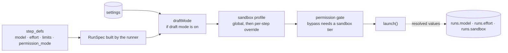

# Settings Overrides And Spec Transforms

How a global setting reaches one run. The rule comes from `06` §15: *"don't special-case it in the runner. Model it as a pure function applied before `launch()`"*.

```ts
type SpecTransform = (spec: RunSpec) => RunSpec;
const draftMode: SpecTransform = s => ({ ...s, model: 'fast-cheap', effort: 'low' });
```

`06` §15 writes the logical id `fast-cheap`; PRD §13 and the drawio force `haiku`. See [[Flow Design Open Questions]] #15.

## The chain



| Rule | Source wording |
|---|---|
| Overrides are pure functions | *"Provider-neutral, composable with any future override (force-local-model, cap-budget-globally, pin-a-model for an incident)"* (`06` §15) |
| The runner applies the chain | *"the runner ([03 §6]) applies the transform chain"* (`06` §15); *"Draft mode is applied here as a `RunSpec` transformer"* (`03` §6) |
| Draft mode and sandbox compose | *"draft mode and the sandbox profile compose as `RunSpec` transformers"* (backlog 3.5) |
| Record the resolved values | *"it records the *resolved* model/effort on the run so cost stays honest"* (`06` §15); *"`runs.sandbox` records the tier that actually ran"* (PRD §11.1) |
| Settings never edit a flow | *"Draft mode isn't a version … never makes a new version and never shows as unsaved"* (flow-designer guide) |
| Other readers | *"the flow editor and board read settings for display toggles"* (`06` §15) |

The drawio *Runner* card has the draft-mode transform and the recording step, but no sandbox-profile transform (that is backlog 3.5) and no permission gate (a separate *Permission gate* card): *"builds the RunSpec · draft-mode transform · writes per-run mcp.json + settings.json (hooks) · records model, effort, tier"*.

> [!warning] The shipped code differs
> No runner writes `mcp.json` or `settings.json` (2026-10-18). Each adapter builds its provider's config in memory from the `RunSpec`: Agent SDK options on Claude, with `guards` as an in-memory `PreToolUse` hook, and one config in `OPENCODE_CONFIG_CONTENT` on OpenCode. See [[Agent Providers Open Questions]] #4.

## Precedence

Only two layered settings exist in the sources:

| Setting | Lower layer | Higher layer |
|---|---|---|
| Sandbox profile | `settings.sandbox_profile` | `step_defs.sandbox_profile` (backlog 1.1). After both, the machine's Docker probe can force `host` (PRD §11.1) |
| Draft mode | step's own `model`, `effort` | global draft mode wins, for every step (*"overrides every step"*, PRD §13) |

> [!example] Proposal — the order of the chain
> No source fixes the order. Draft mode before sandbox resolution is natural, because the two touch different fields. The permission gate must run last, because it checks the *resolved* tier. Listed in [[Settings And Plumbing Open Questions]] #10.

## When a change takes effect

No source says. **Inference:** the transform runs when a `RunSpec` is built (*"applied before `launch()`"*), so a setting change reaches the **next run**, including later steps of tasks already in flight. A run already going keeps what it launched with. The escalation threshold is read when a question is inserted. See [[Settings And Plumbing Open Questions]] #10.

## Related

- [[Draft Mode And Spec Transforms]]
- [[Draft Mode Setting]]
- [[Sandbox Profile Setting]]
- [[Run Guardrails At Launch]]
- [[Agent Launch Contract]]
