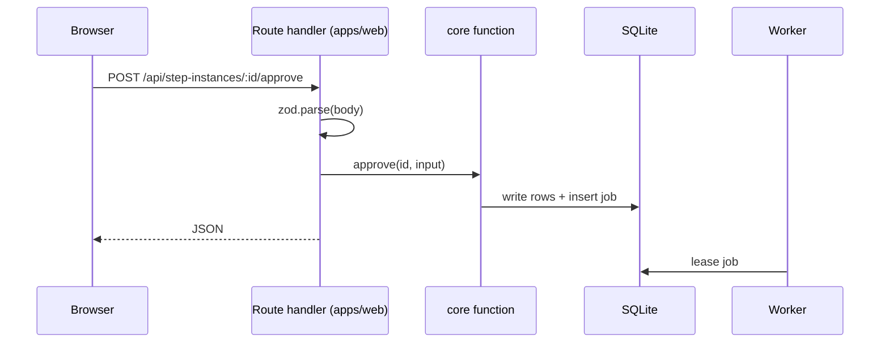

# Thin Route Handlers

Feature map §20: *"**Thin, predictable connections** — Every screen action goes through a small, well-defined request; no cleverness hidden in the screens themselves."*

## The rule

| Source | Wording |
|---|---|
| PRD §12 | *"REST route handlers under `apps/web/app/api/`. All handlers are thin: validate with zod, call a function in `packages/core`, return JSON."* |
| `06` §15 | *"REST route handlers under `src/app/api/` are *thin* — validate with zod, call a function in `src/lib/`, return JSON. Every port is called from `src/lib/`, **never from a route**, so the whole system stays testable headless."* |
| `06` §15, idea | *"keep every handler a three-liner (validate → lib → JSON) and the ports stay the only place provider knowledge exists. If a route ever needs to know whether it's Claude or Codex, something leaked upward."* |
| PRD §2 | *"Next.js route handlers must never spawn a long-lived child process; they enqueue jobs and the worker picks them up"* |
| PRD §3 | *"`apps/web` — Next.js: routes, server actions, SSE, components. Calls core; holds no rules"* |
| drawio *Harness architecture* | *"Process 1 · apps/web (Next.js) thin: validates, calls core, enqueues; never spawns agents"*; *"API routes + server actions / zod-validated input → write rows → enqueue a job → return"* |
| `01-ports.md` | The memory port *"is queried by the runner, never from a route"* |
| feature map §8 | *"The screens never run agents directly; they drop a job on the queue and a background worker picks it up."* |

## The shape of one handler

Drawio *Life of one step*, beats A–B: *"You press Start, or the engine advances a task. A server action validates the request."* then *"Next.js writes the task and step rows plus a start_run job, then returns. It never spawns anything."*

## What follows from it

- **Testable headless.** *"so the whole system stays testable headless"* (`06` §15). Tests call the core functions directly ([[Execution Testing]]).
- **Provider-blind.** Adding Codex needs *"Zero changes to: engine, board projection, HITL protocol, notifier, cost rollups, viewer, API."* (`06`, *Where a new provider actually touches the codebase*).
- **One exception: Stop.** *"Stop: SIGTERM by pid from the route (same machine), finalise as cancelled"* (backlog 3.4; `03` §8). This is the one route that acts on a process, and it relies on web and worker sharing a machine.

## Errors

No source defines an error envelope. The PRD uses `409` twice: *"409 if it drops an in-use skill"* and *"409 while in use"* (§12). The backlog records the failures of the first build:

- *"Empty state, error handling on submit (non‑JSON error bodies)"* — **BUG** (1.3)
- *"One error‑handling style for create and update"* — **BUG** (7.2)
- *"Polling hook: `cache: "no-store"`, catch network errors, surface an error state; unhandled rejection today"* — **BUG** (2.2)

> [!example] Proposal — not in any source
> Every non-2xx response is JSON: `{ error: { code, message, issues? } }`. zod failures return `400` with `issues`; a missing row `404`; an action refused by state (in use, already answered, not at a gate) `409`. Listed in [[Settings And Plumbing Open Questions]] #18.

## Related

- [[Settings And Plumbing API And Routes]]
- [[Code Layout And Dependency Rule]]
- [[Process Topology]]
- [[Job Queue]]
