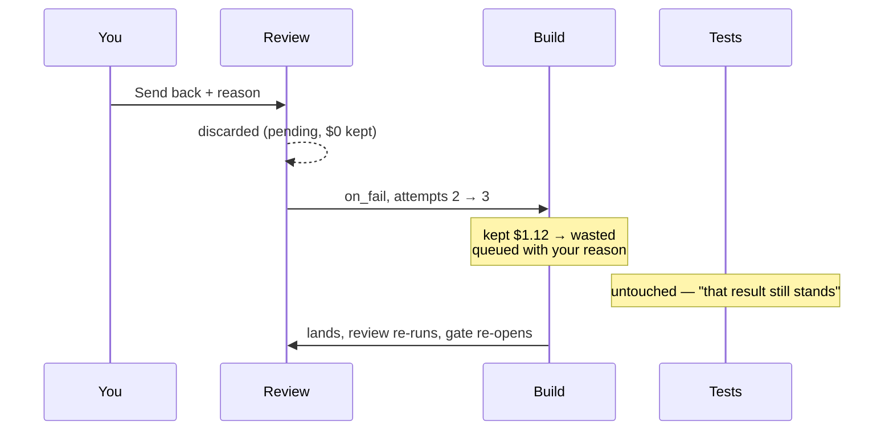

# Attempts And Send Back

How retries show up on one task, and what sending work back does to the attempts and the money.

## The rules (engine side)

| Rule | Source wording |
|---|---|
| Rework reuses the instance | *"Rework: same instance, `attempts++`, new run, downstream `done` → `skipped` so they re-instantiate, superseded runs `wasted=1`."* (`02` §3) |
| The counter lives on the target | *"The counter lives on the **target** instance, so every loop that sends work back to the same step shares one budget."* (PRD §8) |
| What counts | *"`max_attempts` counts total runs of the step, first try included (infra retries excluded). The default of 3 means one try and two automatic redos."* (PRD §8) |
| Rework sees the evidence | *"The new run's 'read these first' list (prompt part 2) also gets the artifacts the failing step produced, so a rework sees the raw `check_output` or `review`, not a summary of it."* (PRD §8) |
| Your reason travels | *"a rejection carries your reason into the next attempt"* (feature map §4) |
| Escalate when spent | *"Escalate, don't fail, when a loop is spent or stuck."* (PRD §8, backlog D3) |
| Hiccups don't count | *"A rate limit, network blip or crash is retried automatically after a short wait. It doesn't use up a try, but it still shows up in wasted spend."* (feature map §4) |
| Task memory | the `task` memory scope holds *"why attempt 1 failed"* so attempt 2 starts warm (`09-memory.md`) |

Full design-side treatment: [[Branching Joining And Loops]].

## How the screen shows attempts

| Where | Mark |
|---|---|
| Spine segment | red `↺2` after the duration when attempts > 1 |
| Story row | `↺ 2` in the fourth meta column |
| Story row, expanded | a red band: *"✕ attempt 1 — egress denied: registry.npmjs.org was not in the step allowlist — $0.48 spent on that attempt and thrown away."* |
| Header | **retries** = Σ (attempts − 1) across steps |
| Cost tab | the red portion of a step's bar |

The guide's watch-for on retries: *"One retry is ordinary; three is a signal. A step that keeps retrying is usually blocked by the environment, not confused by the task."*

## Send back, step by step

What the guide says happens when you send the review back:

| Figure | Before | After (guide) |
|---|---|---|
| kept | $2.13 | $1.01 |
| wasted | $0.48 | $1.60 |
| bill | $2.61 | $2.61 |
| Build attempts | 2 | 3 (queued) |

## Problems the sources leave

> [!warning] The mockup's send back shrinks the bill
> `sendBack()` moves Build's kept cost to wasted, but sets Review's `cost` to 0 without moving it. So the mockup's bill drops by $0.16 to $2.45, against the guide's *"the bill stays $2.61"*. The guide's own kept figure ($1.01) still includes Review's $0.16, though Review is *"discarded"*. The monitor README records the same class of bug on the monitor screen: *"sending a step back made the topbar's **today** total *shrink*"*.

> [!question] Tests are not re-run after a new build
> Guide: *"Tests are not re-run — they already passed and that result still stands."* The monitor guide: *"Tests already passed and that result still holds, so the engine doesn't spend on it twice."* But the PRD's seeded flow joins `implement` and `tests` into `check`, and rework *"downstream `done` → `skipped` so they re-instantiate"* (`02` §3). Tests are a sibling branch, not downstream of Build, so they stay done. But a **check** step would re-run. The mockup's flow has no check step. See [[Task Detail Open Questions]].

> [!question] Was the egress denial an attempt?
> Build's attempt 1 *"died on an egress denial"* and counts as an attempt (`attempts: 2`, `↺2`, *"retries 1"*). By PRD §7, a non-zero agent exit is an infrastructure failure, *"never a verdict on the work"*. It is either transient (auto-retried, not counted) or *"Anything else … put the task into `blocked`"*. An egress denial is neither a work verdict nor transient. The inbox mockup counts egress failures as attempts too. Its `billing-webhook` card reads *"Attempt 3 of 3 failed — egress denied to api.stripe.com"* and offers **Allow host & retry** / **Retry as-is** / **Open the log**.

> [!question] Attempt numbering differs between mockups
> The task-detail guide sends back to *"attempt 3"*. The monitor guide sends the same task back to *"attempt 2"* with $1.12 moving to wasted and none wasted before. The PRD acceptance list: *"Rejecting a review sends the task back to `implement` as attempt 2"*. The two mockups seed the task differently (see [[Sample Task Auth Refactor]]).

## Related

- [[Task Detail Index]]
- [[Deciding At A Gate]]
- [[Task Cost And Wasted Spend]]
- [[Step Instances And Runs]]
- [[Branching Joining And Loops]]
