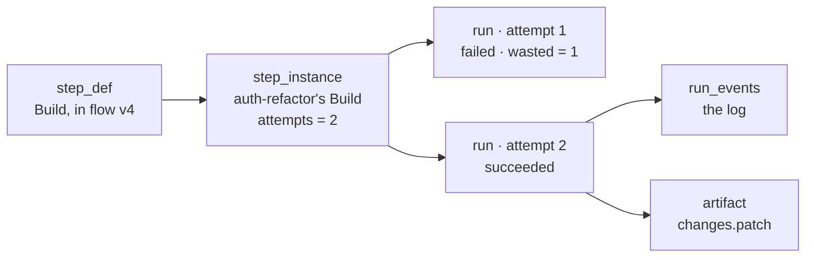

# Step Instances And Runs

Task detail's **Story** tab is a list of steps, and each one can hide several runs. The PRD separates the two layers:

> **Step instance** — one task's occupancy of one step definition. Has state and artifacts.
>
> **Run** — one attempt at a step instance. Rework loops create attempt 2, 3, 4 against the same step instance. — PRD §4

The drawio *FlowBoard ideation* card says the same: *"Step def → step instance → run / Rework loops create attempt 2, 3, 4 against the same instance."* The *Logical components* page names the Core box *"Task & run state / step def → step instance → run"*.

## Step instance states

PRD §5 `step_instances.state`:

| State | Meaning |
|---|---|
| `pending` | created, not yet started |
| `running` | a run is live |
| `awaiting_answers` | *"has unanswered required questions"* (PRD §8) |
| `awaiting_approval` | an approval gate, a missing outcome, or a spent/stuck loop (PRD §8) |
| `done` | finished, outcome recorded |
| `failed` | — |
| `skipped` | rework resets downstream `done` instances to `skipped` *"so they re-instantiate"* (backlog Story 5.2, `02` §3); Cancel also marks instances skipped (backlog Story 2.1) |

Each instance also carries `attempts` and `outcome` (`pass` / `fail` / null). Backlog Story 1.1 and `02` §1 add `step_instances.reason`: *"rejection/failure text shown on the card"*.

## Run states

PRD §5 `runs.state`: `starting`, `running`, `parked`, `succeeded`, `failed`, `cancelled`. A run carries `attempt`, `cost_usd`, tokens, `num_turns`, `wasted`, `fingerprint`, `error`, `started_at`, `ended_at`. Backlog Story 1.1 adds `runs.model` and `runs.effort`. PRD §11.1 adds `runs.sandbox` for the tier that ran.

> [!note] Two kinds of "attempt"
> An **attempt** is a work attempt, counted against `max_attempts`. An **infra retry** is *"a new run with the same `attempt` number"* (PRD §7). It is marked `wasted = 1` and *"does **not** count toward `max_attempts`"*. So one attempt can own several runs. *"`max_attempts` counts work, not weather."* (`03` §6)

## How the screen maps them

The mockup's `TASK.steps[]` is one row per **step**, with per-step `state`, `ms`, `cost`, `wasted`, `attempts`, `art` and `log`. It flattens instance and runs:

| Mockup field | Source concept |
|---|---|
| `state` (`done`, `running`, `gate`, `failed`, `queued`, `pending`) | the step instance state, renamed (see [[Task Detail Marks]]) |
| `attempts` | `step_instances.attempts` |
| `ms` | the kept run's duration |
| `cost` | spend on the kept run |
| `wasted` | spend on discarded runs |
| `failed` | text of the failed attempt, cf. `runs.error` / `step_instances.reason` |
| `log` | a summary of `run_events.summary` lines |
| `art` | the artifact(s) the step wrote |
| `ask` | a question asked during the run (see [[Questions Within A Task]]) |
| `agent`, `model`, `effort` | the step definition, or what actually ran (`runs.model`, `runs.effort`) |

Backlog Story 2.3 asks for the timeline to show *"state, attempts, cost, duration, **model/effort** per step"*, a line tagged **PRD/GAP**. The design brief asks for *"model and effort used"*. That is the run's actual values, which can differ from the step definition under draft mode (*"the *actual* model/effort recorded on the run"*, `03` §6).

> [!question] One row per step or per run?
> The mockup shows one row per step, with a `↺ 2` count and the failed attempt as a red band inside it. Earlier runs' logs are not listed separately. The guide calls the rows *"every run"*. See [[Task Detail Open Questions]].

## The log

Each expanded story row shows a short log. Line classes in the mockup:

| Class | Colour | Example |
|---|---|---|
| `g` | ink-3 (quiet) | `› read  src/auth/session.ts, src/auth/jwt.ts` |
| (none) | ink | `› write .flowboard/auth-refactor/brief.md` |
| `ok` | petrol | `✓ 34 passed  (2.1s)` |
| `hold` | ochre | `◆ item 3 not implemented`, `? asked you 2 questions — paused, billing stopped` |
| `bad` | brick | defined in CSS, unused in the sample |

The PRD's `run_events.summary` is *"short human-readable line for the session viewer"* (e.g. `Read src/auth/session.ts`, `Bash: pnpm test`; PRD §7). The full stream is the live run viewer at `/runs/[id]`. No source says how task detail links to it. The inbox (PRD §10) and the drawio inbox card both carry a *"link to the live session"*.

## Related

- [[Task Detail Index]]
- [[Attempts And Send Back]]
- [[Task Detail Tabs]]
- [[Task Data Model]]
