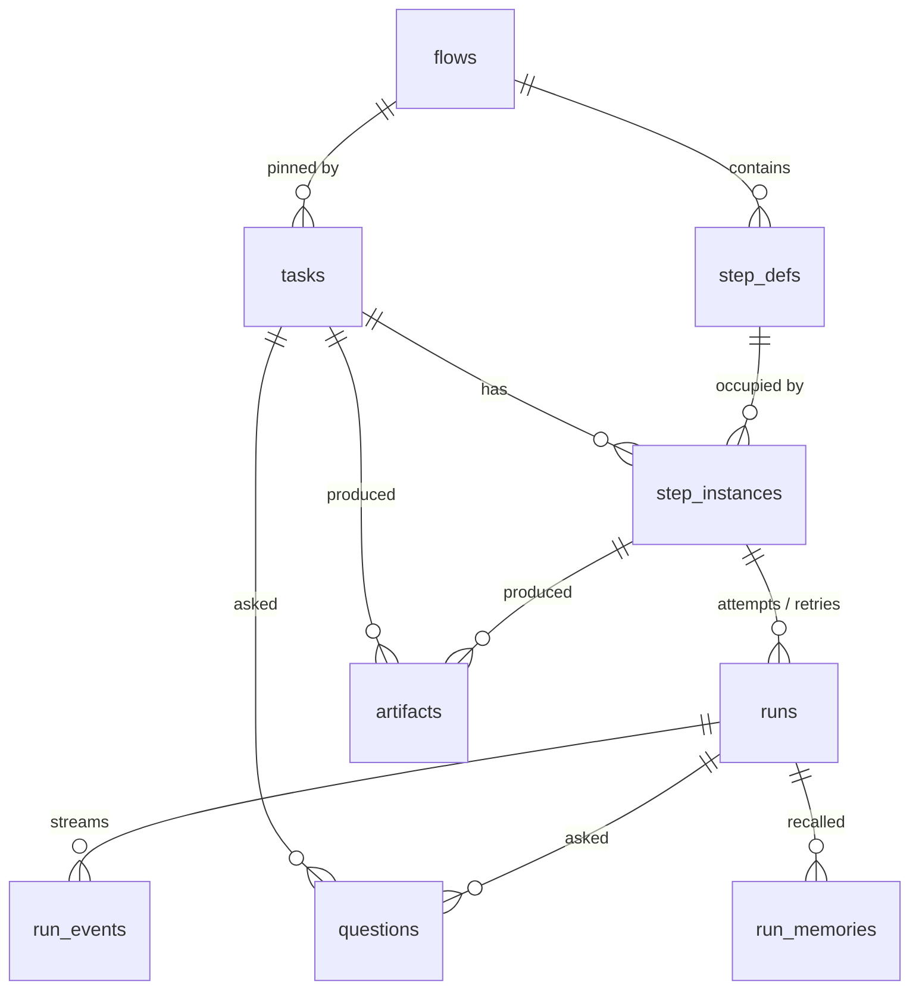

# Task Data Model

The tables task detail reads, from PRD §5, with the backlog's additions. Task detail writes nothing directly. Its actions go through the engine.



## Tables and the columns that matter here

| Table | Columns task detail uses | Notes |
|---|---|---|
| `tasks` | `id`, `title`, `body`, `acceptance_criteria`, `non_goals`, `status`, `flow_id`, `branch_name`, `worktree_path`, `capability_pins`, `created_at` | See [[Task Record]] |
| `step_instances` | `step_def_id`, `state`, `attempts`, `outcome`, `created_at`, `updated_at` | + `reason` (backlog Story 1.1) |
| `runs` | `attempt`, `state`, `cost_usd`, tokens, `num_turns`, `wasted`, `fingerprint`, `error`, `started_at`, `ended_at` | + `model`, `effort` (backlog 1.1), `sandbox` (PRD §11.1); `claude_session_id` → `agent_session_id` and + `provider` (`02` §1) |
| `run_events` | `seq`, `type`, `summary`, `v` | the log lines |
| `artifacts` | `step_instance_id`, `type`, `path`, `bytes`, `created_at` | pointers only (PRD §6) |
| `questions` | `prompt`, `kind`, `state`, `answer`, `answered_at`, `answered_via`, `created_at` | *you were asked* |
| `step_defs` | `name`, `agent_id`, `skill_id`, `model`, `effort`, `advance_mode`, `max_attempts`, `board_order` | the spine order, and `agent · model · effort` |
| `flows` | `name`, `version` | *Software delivery v4* |
| `run_memories` | `run_id`, `memory_id`, `scope` | optional (PRD §11.2) |

## Deriving the screen's figures

How the mockup's numbers map onto the schema. **This mapping is a proposal**; no source writes it down.

| Screen figure | Derivation (proposal) |
|---|---|
| bill | Σ `runs.cost_usd` for the task |
| wasted | Σ `runs.cost_usd` where `wasted = 1` |
| kept | bill − wasted |
| agent time | Σ (`ended_at` − `started_at`) over runs. Whether wasted runs count is unstated. The mockup sums only the kept duration per step. |
| waiting on you | now − the time the gated instance entered `awaiting_approval`, or the oldest pending question's `created_at`. No column records the first. `updated_at` is the nearest. |
| retries | Σ (`step_instances.attempts` − 1). Infra retries excluded. |
| step duration | the latest non-wasted run's duration |
| plan vs built | a new artifact (see [[Plan Versus Built]]) |
| recipe average | the `/costs` read model's *"cost per completed task, trended by flow version"* |
| started | the first run's `started_at`, or a new `tasks.started_at` |
| waiting since | as *waiting on you* |

## Columns the screen implies but the schema lacks

All of these are **proposals**, listed in [[Task Detail Open Questions]]:

- `tasks.owner`: the aside's owner. Blocked by *"no user table"* (PRD §2).
- `tasks.started_at`: the aside's *started*. Derivable from runs.
- `step_instances.awaiting_since` (or an event log): for *waiting on you*. Not needed if derived from `updated_at`.
- a **paused** task status: for **Pause**.
- a per-item plan comparison: a new artifact type, not a column.

## Types in the reference code

No `Task`, `StepInstance`, `Run` or `CostEntry` type exists in `docs/old/reference/`. The nearest are:

| Concept | Nearest type | File |
|---|---|---|
| Task | `TaskRef { id }`; `ParsedTask { import_key, title, body? }` (import only) | `workspace.ts`, `task-source.ts` |
| Run | `RunResult { usage, exitCode, outcome?, error? }`; `AgentRun` (a live handle: `sessionId`, `pid`, `events`, `result`, `stop()`) | `agent-provider.ts` |
| Run cost | `Usage` | `events.ts` |

```ts
// docs/old/reference/core/ports/events.ts
export interface Usage {
  input: number;
  output: number;
  cacheRead: number;
  cacheWrite: number;
  numTurns: number;
  /** Absent when the provider lacks `native_cost`; PricingService fills it from tokens. */
  costUsd?: number;
}
```

```ts
// docs/old/reference/core/ports/agent-provider.ts
export interface RunResult {
  usage: Usage;
  exitCode: number;
  /** Drives conditional edges; read from the produced JSON or set_outcome. Unset is NOT 'pass': the engine parks the step at a human gate. */
  outcome?: 'pass' | 'fail';
  /** stderr tail on failure. */
  error?: string;
}
```

> [!warning] The shipped code differs
> The shipped ports (`core/src/ports/events.ts`, `agent-provider.ts`, 2026-10-18) change these comments. `costUsd` is USD as the provider reports it, Claude's only on the result and OpenCode's on every event; absent means price it from tokens. `numTurns` counts the main agent's turns. `RunResult.usage` keeps the last running totals when a run ends before its result, and a set `error` means failed even on exit 0. `AgentRun.pid` is now a promise (`-1` if nothing was spawned), and `stop()` settles the run as `{ exitCode: 130, error: 'stopped' }`. See [[Agent Run Handle And Result]] and [[Normalized Event Envelope]].

And an informal shape in `docs/old/design/README.md`:

```text
StepRun = { stepDefId, state: 'running'|'awaiting_answers'|'awaiting_approval'|'failed'|'done',
  model, effort, attempt, maxAttempts, costUsd, startedAt, pendingQuestionCount, oldestQuestionAt }
tasks: Task[] with currentStepRuns: StepRun[] (length > 1 = parallel branches)
```

`oldestQuestionAt` is the field a *waiting on you* timer needs for questions.

## Related

- [[Task Detail Index]]
- [[Task Record]]
- [[Step Instances And Runs]]
- [[Task Detail Runtime]]
- [[Flow Data Model]]
