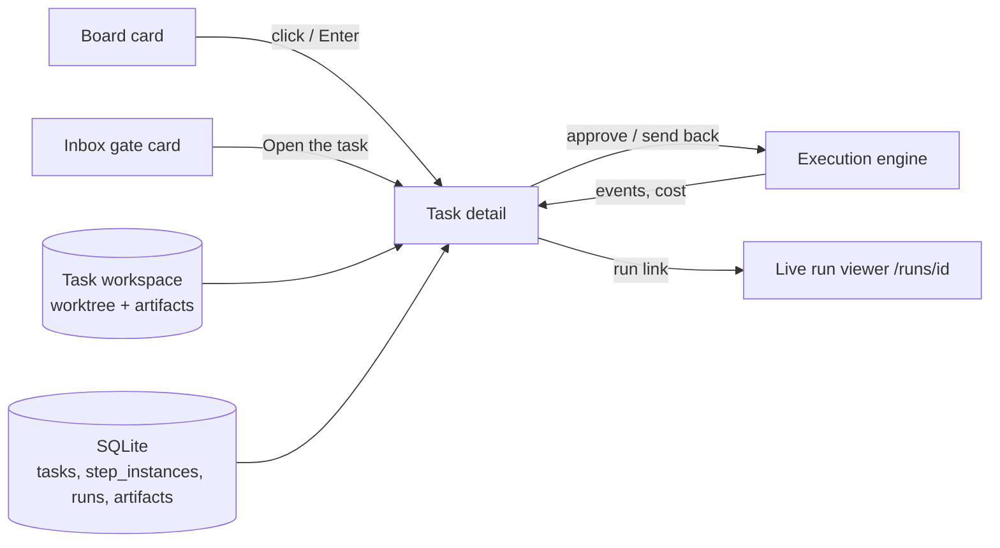

# Task Detail Overview

## Purpose

The feature map (§3 *Tasks*) promises *"A detail view per task — Open a task to see its whole story: each step, how long it took, what it cost, whether it needed approval, links to everything it produced, and a side-by-side 'what we planned vs what got built.'"*

The task-detail field guide narrows that to one decision: *"This screen exists for one moment: an agent has finished work and wants your go-ahead."* Its title is *"One task, and the evidence for deciding about it."*

The tracker scopes the component as *"One task's whole story: timeline, artifacts, cost"*. It covers:

- the **task record**: title, description, acceptance criteria, non-goals, owner ([[Task Record]])
- what happened to it: **step instances and runs**, their attempts and logs ([[Step Instances And Runs]])
- what it produced: **artifacts** in a per-task **workspace** ([[Task Artifacts]], [[Task Workspace]])
- whether that matches the plan: **plan versus built** ([[Plan Versus Built]])
- what it cost: **bill, kept and wasted** ([[Task Cost And Wasted Spend]])
- the decisions a person makes on it: gates and task actions ([[Deciding At A Gate]], [[Task Actions]])

## Place in the system

Diagram assembled from PRD §13 (*"Clicking a card opens a detail sheet"*), the inbox mockup's **Open the task** button, and the drawio pages. It is not a single drawio figure.

On the drawio *Functional components* page the component is spread over three groups:

| Group | Card | Text |
|---|---|---|
| Observability | Read the step timeline | *state, attempts, cost, duration* |
| Observability | Open artifacts | *plan.md vs summary.md diff* |
| Human in the loop | Approve / reject a step | — |
| Execution (dashed = not in v1) | Start task | *pin flow version* |
| Execution | Stop | *kill the process* |
| Execution | Isolate the workspace (dashed) | *worktree per task today; devcontainer / Docker sandbox / remote host later* |

On the *Harness architecture* page it is a front-end route: **`Task detail /t/[id]`** — *"step timeline, attempts, artifacts, plan vs built diff"*. The *FlowBoard ideation* page has a **Task detail sheet** card in the Board group: *"Step timeline (state, attempts, cost, duration), artifact links, Approve / Reject, plan.md vs summary.md diff."*

The architecture catalogues the storage side as component **#11 Artifact store & workspace → two ports** (`05-environment-and-registry.md` §11). See [[Task Detail Runtime]].

## Design principles

| Principle | Source wording |
|---|---|
| **Evidence over the agent's word** | *"the agent's own account of what it did is not the evidence"* (task-detail mockup, Plan vs built note) |
| **Everything is a real file** | *"Real files, not hidden in a database — Everything an agent produces is a normal file in the task's workspace, tracked in git"* (feature map §15) |
| **The comparison is mechanical** | *"the 'compare what was planned against what was built' step becomes a plain diff of two files"* (PRD §6) |
| **Fear the quiet failure** | *"Deviated is the verdict to fear, not missed."* (task-detail guide) |
| **Spend never shrinks** | *"Bill — the two added together. It never goes down."* (task-detail guide) |
| **Approving is free** | *"The only free decision on this screen is approving."* (task-detail guide) |
| **Waiting is free** | *"a run that asks a question stops billing until you reply"* (task-detail mockup, Cost tab) |
| **Never delete from under you** | *"never deleted from under you"* (feature map §14); *"never remove it automatically"* (PRD §11) |
| **Spend boldness in one place** | Done is stone grey *"because most of a healthy task is this, and colouring it would drown the part that wants you"* (task-detail guide); see `docs/mockups/README.md` |
| **Three alphabets, never mixed** | *"The spine is about steps, the story icons are about runs, and the verdict badges are about work items. Don't read one as the other."* (task-detail guide) |

## What it is not

- **Not the live run viewer.** Streaming a session token by token is `/runs/[id]` (feature map §9, PRD §13). Task detail shows each run's log after the fact and links out.
- **Not the engine.** Task detail asks for approve, send back, retry and cancel. What the engine does next belongs to Execution. See [[Attempts And Send Back]].
- **Not the inbox.** The inbox is the queue of everything waiting on you. Task detail is one task, in depth. The same gate can be decided from either.
- **Not the cost dashboard.** `/costs` rolls spend up across projects. Task detail shows one task's bill against its recipe's average.

## Related

- [[Task Detail Index]]
- [[Task Detail Screen]]
- [[Task Lifecycle]]
- [[Task Detail Glossary]]
