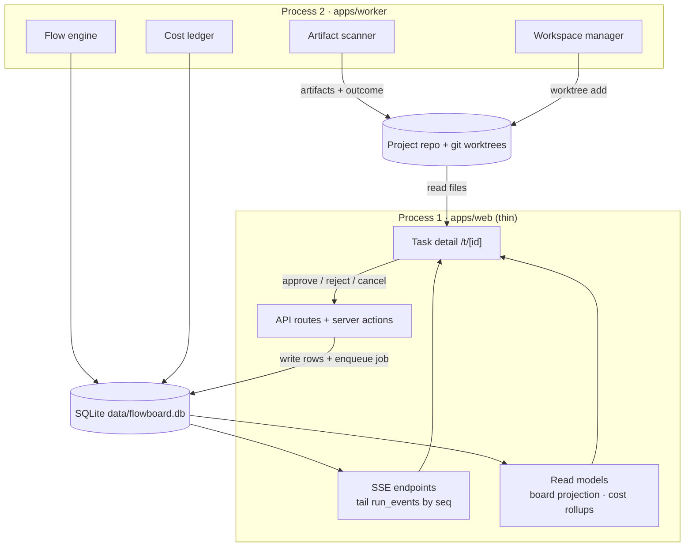

# Task Detail Runtime

How the screen gets its data and stays live, and the two ports underneath it.

## Where task detail sits



Nodes from the drawio *Harness architecture* page. Only four of the edges are drawn there: API → SQLite (*"B write rows + enqueue job"*), SQLite → SSE (*"tail by seq"*), Artifact scanner → repo (*"I artifacts + outcome"*) and Workspace manager → repo (*"worktree add"*). Every other edge, and the *approve / reject / cancel* label, is an inference. The page draws an SSE edge only to the run viewer. The web process is *"thin: validates, calls core, enqueues; never spawns agents"*. Its tech note says: *"EventSource for live updates · no client state store: the server is the source of truth"*.

## Reading

- **No task read model is defined.** The drawio lists two read models: *"board projection (furthest-advanced step, split badges) · cost rollups incl. wasted spend"*. PRD §12 has `GET /api/tasks?project=&status=` and backlog Story 2.1 adds `GET /api/tasks/:id`. Neither says what the response contains. See [[Task Detail API And Routes]].
- **Artifacts are read from disk.** The DB holds the path, and the bytes are a file in the worktree (PRD §6). The viewer reads the file.
- **The working-tree diff** comes from git on the task's branch. No source names the base it is diffed against.

## Staying live

- *"Live updates — A steady stream keeps the board, the viewer, and the inbox current without you refreshing."* (feature map §20). Task detail is not named.
- The drawio SSE node: *"tail run_events by seq, questions and task state from SQLite (works across processes; catches up on reconnect)"*.
- Running cost before the result lands: *"Accumulate per-message token usage as you stream"* (PRD §7). The viewer shows a cost *"estimated from tokens until `result` lands"* (`03` §8). A live running cost (feature map §5's cards) was a past bug: the backlog intro lists *"$0 running cost"*.
- *"Dedupe by `seq` on append (StrictMode double‑subscribe duplicates replay)."* (backlog Story 3.4)

## The mockup's model

The mockup holds one `TASK` object with a `steps[]` array, plus `PLAN[]` and `MEMORY[]`. Everything else is derived:

| Function | Derives |
|---|---|
| `kept()` | Σ step `cost` |
| `waste()` | Σ step `wasted` |
| `bill()` | kept + waste |
| `elapsed()` | Σ step `ms` |
| `gateStep()` | the first step with state `gate` |
| `running()` | the first step with state `running` |
| `isDone()` | every step `done` |

The status pill, topbar actions, gate banner, status bar and key hints all branch on `gateStep()`, `running()` and `isDone()`, in that priority. In *"the small bit of engine"*, approving sets Review done and starts Summarize, which ticks every 250 ms for 7 s of wall time, costing `ms/60000 × RATE[model] × 24` with `RATE = { haiku: 0.008, sonnet: 0.05, opus: 0.14 }` dollars per minute. A 1 s timer re-renders while a gate is open to keep the *waited* figure honest. It also redraws the reason box, which wipes typed edits (see [[Task Detail Controls]]).

> [!note] Single-gate assumption
> `gateStep()` returns the first gated step. With parallel branches two steps can be gated at once (two sign-offs, or two approval steps on parallel branches). The banner, `a` and `r` handle one.

## The two ports underneath (component #11)

The architecture's component **#11 Artifact store & workspace → two ports** (`05` §11): *"two concerns fused today. Separate them"*.

| Port | Role (`05` §11) | v1 adapter | Later |
|---|---|---|---|
| **Workspace** | *"create/destroy/cwd + `execHost`. Isolation lifecycle, and where processes run against it."* | git worktree | devcontainer, Docker sandbox, remote |
| **ArtifactStore** | *"put/scan/resolve path/metadata. The DB stores only type + path + bytes; the bytes live in the store."* | worktree files | S3/remote, content-addressed |

`ArtifactStore` from `docs/old/reference/core/ports/artifact-store.ts`:

```ts
export interface ArtifactStore {
  readonly id: string;
  /** Files created/modified since `sinceMtimeMs` whose type matches one of `produces`. */
  scan(task: TaskRef, sinceMtimeMs: number, produces: string[]): Promise<FileMeta[]>;
  /** Absolute path a step should read/write for a given artifact type. */
  resolve(task: TaskRef, type: string): string;
  register(meta: ArtifactMeta): Promise<void>;
}
```

`Workspace` is in [[Task Workspace]]. The runner composes them: it runs in the Workspace `cwd`, registers each scanned file (`for (const f of files) await deps.store.register(…)`), and returns, with the comment *"→ engine applies §8 advancement"* (`07`).

> [!warning] The port definitions disagree
> `01-ports.md` declares `scan(task, sinceMtime)` with two arguments and `Workspace.id` as a closed union without `gvisor`. The reference `.ts` files take `produces` as a third argument and use `id: string`. `05` §11 names a `put` method that neither interface has. `07`'s disk adapter scans for `NN-<type>.<ext>` but `resolve` returns `${type}.md`. See [[Task Detail Open Questions]].

A plan-vs-built comparison needs nothing new from either port. It reads two artifacts and a branch diff.

## Related

- [[Task Detail Index]]
- [[Task Data Model]]
- [[Task Detail API And Routes]]
- [[Task Storage On Disk]]
