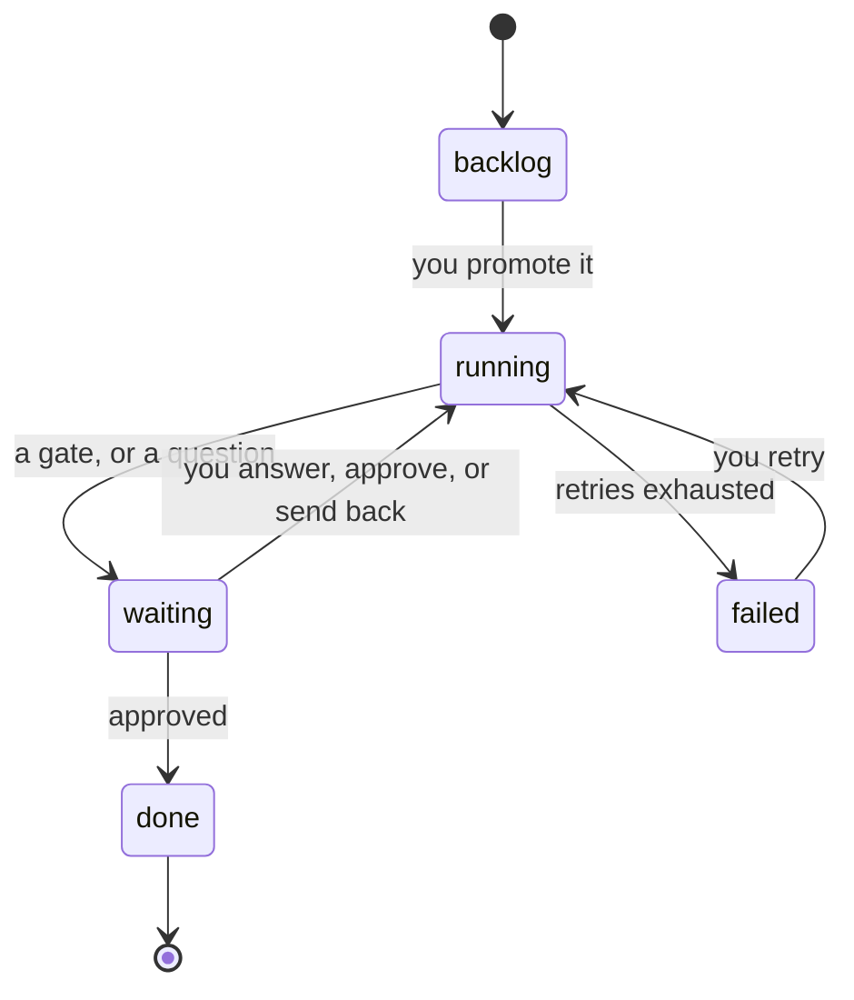
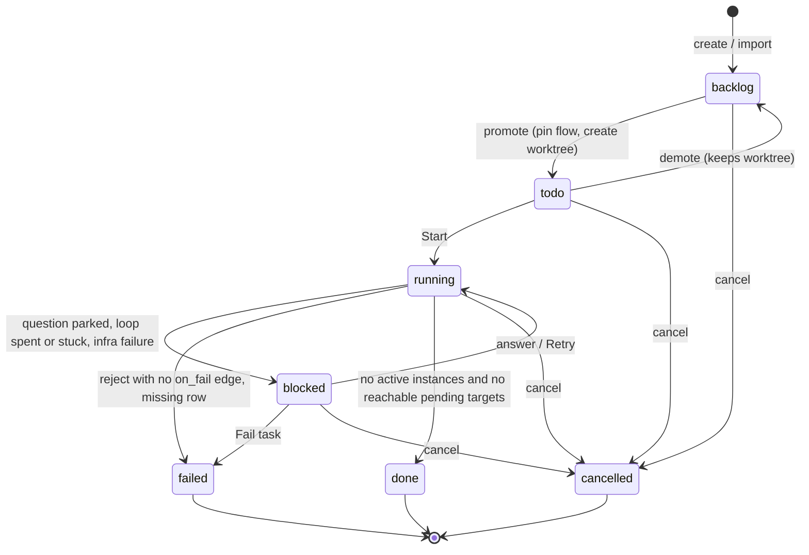

# Task Lifecycle

Where a task can be, and what moves it. The field guide's rule: *"Solid arrows happen on their own. Dashed amber arrows are yours — they are the only places a person moves a task."*

## The guide's diagram

Box subtitles: backlog *"no workspace yet"*, running *"an agent has it"*, waiting *"on you · $0/min"*, done *"workspace kept"*, failed *"spend is wasted"*. Arrows labelled *you promote it*, *you answer, approve, or send back* and *you retry* are the person's.

*"**Pause**, **Send to backlog** and **Cancel** are not drawn because they can happen from anywhere."* (guide). See [[Task Actions]].

## The PRD's statuses

PRD §5 `tasks.status`: `backlog`, `todo`, `running`, `blocked`, `done`, `failed`, `cancelled`. The feature map (§3): *"it moves through states from 'backlog' to 'in progress' to 'done' (or 'blocked' / 'failed' if something goes wrong)."*

Assembled from PRD §5, §7, §8, §11, §12, backlog Stories 2.1, 3.2, 4.2 and 5.2, and `02` §3. Of the `awaiting_approval` cases, only a spent or stuck loop is stated to set `blocked` (*"Set the target step instance to `awaiting_approval` and the task to `blocked`"*, PRD §8). Backlog Story 4.2 sets the task `blocked` when a run parks on questions. No source says what a plain approval gate or a no-outcome gate does to the task's status; this diagram leaves it `running` (an inference), while the mockup's status bar says *"blocked on you"* ([[Task Detail Open Questions]] #34). The edges out of `blocked` and into `cancelled` are inferences too, the latter from *"they can happen from anywhere"*.

## Mapping the vocabularies

| Guide / screen | PRD `tasks.status` | Step-level cause |
|---|---|---|
| backlog | `backlog` (and `todo`?) | — |
| running · `<step> running` | `running` | an instance `running` |
| waiting · `waiting on you` | `running` or `blocked` | `awaiting_approval` or `awaiting_answers` |
| done | `done` | — |
| failed | `failed` | — |
| *(not drawn)* | `todo` | — |
| *(not drawn)* | `cancelled` | — |
| `in progress` (mockup fallback pill) | `running` | nothing running, nothing gated: e.g. a step `queued` for a worker |

The guide has no `todo` and goes straight from backlog to running on *promote*. That matches the PRD only if promotion starts the task. Backlog decision **D1** recommends the opposite: *"Explicit Start button on card + sheet; promote stays cheap"*. See [[Task Detail Open Questions]].

## When a task is done

*"Task‑done condition: 'nothing active and no edge fired' strands a task in `running` when a conditional edge never fires. Use 'no active instances and no reachable pending targets'."* (backlog Story 5.2, **BUG**; `02` §3).

In the mockup the flow simply has no step after Summarize. The monitor guide: *"The flow has no step after summarize, so the task is finished."*

## When a task fails

The sources disagree on whether the engine fails a task by itself when attempts run out.

| Auto-fails | Escalates to you |
|---|---|
| Task-detail guide: *"After the limit the engine gives up and fails the task rather than looping on your money forever."* | PRD §8: *"Escalate, don't fail, when a loop is spent or stuck."* |
| Guide lifecycle: running → failed on *"retries exhausted"* | Backlog D3: *"escalate to a gate, never auto-fail"* — *"Decided 2026-10-15"* |
| Monitor guide: *"Retries are capped, then the task fails."* | PRD §4: *"stops looping and hands the task to me with the last error, rather than retrying again or failing silently"* |
| Flow-designer guide, *Retries*: *"How many attempts before the step gives up and fails the task."* | Feature map §4: *"it stops and hands the task to you with the last error … You either give it one more try with a note, or fail the task."* |
| Drawio card D3: *"Fail on the 4th (default 3)."* | `02` §3, drawio *Loop guard*: *"gate: Retry + note / Fail task"* |
| PRD §16: *"three failed attempts fail the task"* | |
| Backlog Story 10.1: *"Reject → attempt 2; three failures fail the task."* | |

The drawio disagrees with itself: its D3 card fails the task, its *Loop guard* node escalates. The guide's *you retry* arrow out of **failed** rests on the same auto-fail: under backlog D3 there is no auto-failed task to retry ([[Task Detail Open Questions]] #35). Backlog D3 is the latest decision. Under it, *failed* is reached only through **Fail task** at an escalation gate, through a reject with no `on_fail` edge (*"reject with no `on_fail` edge fails the task"*, backlog Story 5.2), or through a missing row (*"fails the task cleanly"*, `02` §3). See [[Attempts And Send Back]].

## Related

- [[Task Detail Index]]
- [[Task Actions]]
- [[Deciding At A Gate]]
- [[Attempts And Send Back]]
- [[Version Pinning]]
