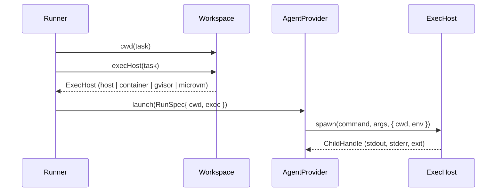

# ExecHost Seam

*"ExecHost — WHERE a process runs, decoupled from WHICH agent runs it."* (`exec-host.ts`)

The Workspace hands it out: `workspace.execHost(task)`. That is why sandboxing lives on the Workspace port and not on the AgentProvider: *"One seam: `ExecHost`, owned by the Workspace."* (`08-sandboxing.md`).

## Why it exists

> *"An AgentProvider builds an argv; the ExecHost decides where it executes: a plain host child_process, a hardened container, or a microVM. This keeps sandboxing orthogonal to the provider — any provider × any isolation tier, for free (2×N, not N×M)."* — `exec-host.ts`

`08-sandboxing.md`: *"`ClaudeCodeProvider` spawning through a container `ExecHost` is Claude-in-a-sandbox; the same provider through the host `ExecHost` is today's behavior, no provider change."*

## The interface

From `docs/old/reference/core/ports/exec-host.ts`:

```ts
export type IsolationTier = 'host' | 'container' | 'gvisor' | 'microvm';

export interface ChildHandle {
  pid: number;
  stdout: AsyncIterable<string>;
  stderr: AsyncIterable<string>;
  /** Resolves with the exit code. */
  exit: Promise<number>;
  kill(signal?: string): void;
}

export interface ExecHost {
  readonly id: IsolationTier;
  /** Absent for the `host` tier; present for sandboxed tiers. */
  readonly profile?: SandboxProfile;
  spawn(command: string, args: string[], opts: { cwd: string; env?: Record<string, string> }): ChildHandle;
}
```

`ChildHandle` is *"A spawned process, normalized so the runner tails it the same way at every tier."*

`SandboxProfile` holds `tier`, `image`, `egressAllow`, `limits`, `mounts`, `env` and `nonRoot`. Two of its comments bear on the workspace:

- `mounts`: *"Extra mounts beyond the task worktree. Never mount host secrets or the Docker socket."*
- `nonRoot`: *"Default true; `bypassPermissions` requires this."*

The rest of the profile belongs to the Sandboxing set: [[Sandbox Security Profile]], [[Egress Allowlist]], [[Credential Injecting Proxy]], [[Resource Limits]] and [[Sandbox Mounts]]. Its [[ExecHost Port]] note covers the same interface from the sandbox side. [[Run Guardrails At Launch]] and [[Step Guardrails]] cover what a run sees.

## How it flows



`RunSpec.exec` in `agent-provider.ts`: *"Where the CLI process runs — host by default, or a sandbox (container/microVM). The adapter spawns through this instead of raw child_process, so sandboxing works for any provider. From `workspace.execHost(task)`."* `RunSpec.cwd`: *"Workspace path (the Workspace port owns its lifecycle)."*

Shell steps use the same seam: *"A `kind='shell'` step runs `command` (or the project's `check_command`) through the same `ExecHost`, so it is sandboxed like any agent."* (`03` §6). See [[Shell Step Execution]].

## The rule it carries

*"The gate: the runner refuses `permission_mode='bypassPermissions'` unless the tier is a sandbox (`container`/`gvisor`/`microvm`)."* (`01-ports.md`). The tier comes from the `ExecHost` the workspace returned, so the workspace choice decides whether a fully autonomous step may run. See [[Workspace Isolation Tiers]] and [[Permission Gate]].

> [!question] Per task or per step?
> `execHost(task)` takes only the task. PRD §11.1 makes the sandbox profile *"overridable per step"*, backlog 1.1 adds *"an optional `step_defs.sandbox_profile` override"*, and the flow-designer mockup gives each step a **Sandbox** field (`none`, `container`, `sealed container`). A per-step tier cannot be expressed through a call that never sees the step. See [[Workspaces Open Questions]] #25 and [[Sandboxing Open Questions]] #39.

## Related

- [[Workspaces Index]]
- [[Workspace Port]]
- [[Workspace Isolation Tiers]]
- [[Workspace In A Run]]
- [[Agent Launch Contract]]
- [[ExecHost Port]]
