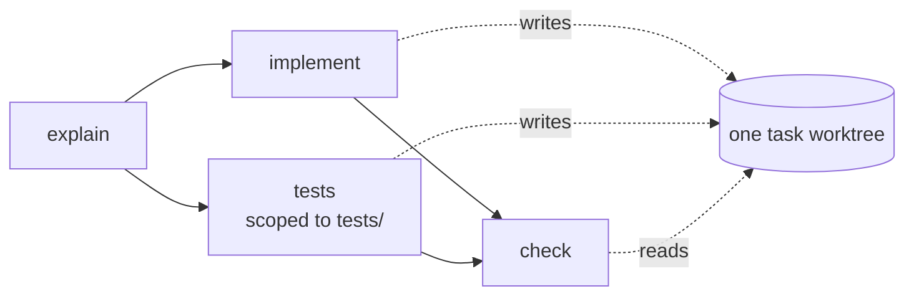

# Shared Worktree Within A Task

Workspaces isolate **tasks** from each other. They do not isolate the **steps** of one task.

## The constraint

> *"Parallel steps within one task share the task's worktree. If two concurrent steps both write code they will conflict — so the seeded default flow puts the test-writing agent on the same worktree but scoped to `tests/` via its prompt and `allowedTools`. Note this limitation in the README as a known constraint."* — PRD §11

Backlog 10.2 lists *"shared worktree"* among the README's known constraints. The monitor guide shows it as a feature: *"Two agents on one task, in the same workspace, on independent work. This is where the board earns its keep — serially this would be two waits, not one."* The drawio *Harness architecture* (concept 7, Graph layer): *"parallel branches in the task's own worktree"*.

*The seeded fan-out (PRD §15). Both branches write the same worktree.*

## The mitigation in v1

- **Scope by prompt and tools.** The tester is *"scoped to `tests/` via its prompt and `allowedTools`"* (PRD §11). PRD §15: *"`tester` writes tests for the acceptance criteria without touching the implementation"*.
- **Nothing mechanical.** No lock, no per-step folder. The hooks deny *"writes outside the task's worktree"* (PRD §7), which does not separate two steps inside it.

## The claimed fix

| Source | Claim |
|---|---|
| `01-ports.md` | a container/microVM adapter *"fixes the spec's own shared-worktree collision constraint (PRD §11)"* |
| `07` | `containerWorkspace` *"removes the shared-worktree collision (PRD §11) and needs no engine change."* |
| `workspace.ts` | a container or microVM adapter *"removes the shared-worktree collision the spec lists as a known constraint"* |
| `05` §11 | *"Beyond fixing the shared-worktree collision (PRD §11), the sandboxed tiers add a security boundary"* |
| Backlog 3.5 | *"Also removes the shared-worktree collision (2.2)."* |

> [!question] How?
> The same sources say the container is *"ephemeral … per run"* with the *"task worktree bind-mounted as `cwd`"* (backlog 3.5), and *"the only writable bind-mount is the task worktree"* (`08`). Two parallel runs would mount the same folder read-write, so the collision stays. No source describes a separate copy per branch. *Proposal (these notes'):* one worktree per parallel branch, merged at the join. See [[Workspaces Open Questions]].

## Related

- [[Workspaces Index]]
- [[Fan-Out And Join]]
- [[Branching Joining And Loops]]
- [[Workspace Adapters]]
- [[Seeded Flows]]
