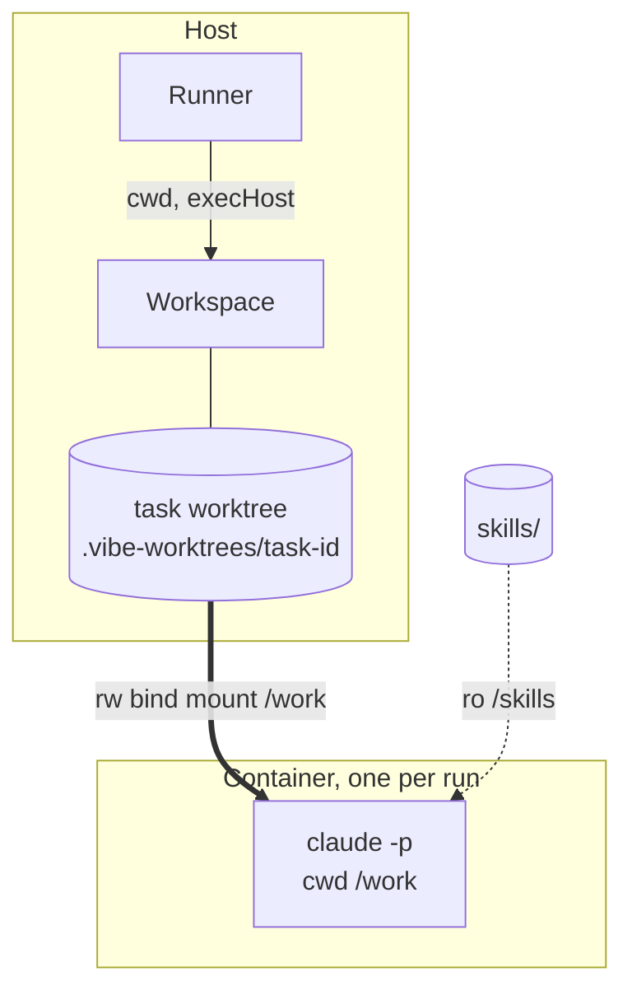

# Workspace In A Run

How one run uses its task's workspace, from launch to artifact scan. The run itself is in [[Runner Pipeline]] and [[Life Of One Step]].

## Touch points

| Moment | Use of the workspace | Source |
|---|---|---|
| Prompt build | Input and output artifact paths are absolute paths in the workspace; `{{worktree}}` is substituted in `prompt_template` | PRD §7 parts 2, 3, 5; `ArtifactRef.path`: *"Absolute path in the task's workspace."* |
| Hooks | *"deny writes outside the worktree"* (`08`); PRD §7: *"writes outside the task's worktree"* | `08`, PRD §7 |
| Launch | *"Run with `cwd` set to the task's worktree path."* | PRD §7 |
| Spawn | through `workspace.execHost(task)` | `03` §6 |
| Sandbox | *"The task's worktree is bind-mounted as the working directory"* | PRD §11.1 |
| Shell step | *"executes `step.command` (or the project's `check_command`) in the task's worktree through the same execution host"* | PRD §7 |
| Artifact scan | *"scans `<worktree>/.vibe/task-<id>/` for files created or modified during the run"* | PRD §6 |

*Drawio Mounts card: "rw: task worktree → /work / ro: skills/ → /skills / socket: ask.sock".*

## Host tier vs container tier

| | Host | Container |
|---|---|---|
| Process | host `child_process`, `cwd` = worktree path | inside a container, worktree at `/work` (drawio) |
| Writable | the whole machine, fenced only by hooks (`08`: *"On the host the blast radius is the host"*, emphasis dropped) | *"the only writable bind-mount is the task worktree"* (`08`) |
| Container lifetime | — | *"One container per run/attempt, destroyed on completion"* (`08`) |

> [!question] Which path does the agent see?
> `workspace.cwd(task)` returns the host path. Inside a container the worktree is `/work` (drawio). The prompt lists absolute artifact paths and substitutes `{{worktree}}` (PRD §7). No source says whether the runner rewrites them to `/work/…` for a sandboxed run. A host path would not exist inside the box *(inference)*. See [[Workspaces Open Questions]] #24, [[Sandboxing Open Questions]] #40 and [[Sandbox Mounts]].

## A known fix from the first build

Backlog 3.2 (**FIX**): *"Per‑run `mcp.json` pointing at `mcp/ask-user.ts` via `tsx --tsconfig <root>/tsconfig.json` (path aliases break when spawned from the worktree cwd)."* Running from the worktree means anything FlowBoard launches inside it must not depend on FlowBoard's own `cwd`. PRD §3's layout has a separate `apps/mcp-shim` instead. See [[Worker Lifecycle]].

## Related

- [[Workspaces Index]]
- [[ExecHost Seam]]
- [[Agent Launch Contract]]
- [[Prompt Assembly]]
- [[Shell Step Execution]]
- [[Capability Runtime Mounting]]
- [[Sandboxed Run Lifecycle]]
