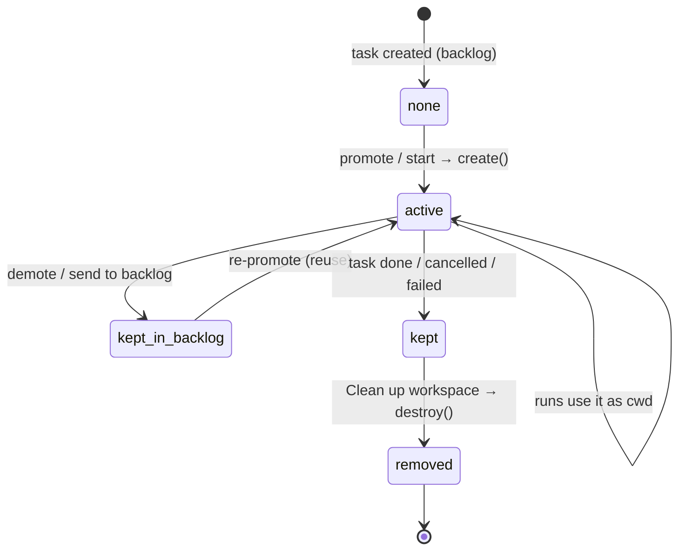

# Workspace Lifecycle

A workspace has no status column of its own. Its life follows the task's status (`tasks.status`: `backlog`, `todo`, `running`, `blocked`, `done`, `failed`, `cancelled`, PRD §5) plus one explicit action, cleanup.

> [!note] Proposal
> The phase names `none`, `active`, `kept_in_backlog`, `kept` and `removed` are these notes' labels, and so is the mapping of task statuses onto them. No source names workspace states. Listed in [[Workspaces Open Questions]].

The task-detail guide's own lifecycle diagram has no `todo` box: its *"you promote it"* arrow goes from *backlog* (*"no workspace yet"*) straight to *running*. The monitor guide's beat 2, *"You promote it"*, also queues the first step. Backlog D1 instead separates promote from Start. See [[Workspaces Open Questions]] #1.

## Phase by phase

| Phase | Task status | What the sources say |
|---|---|---|
| none | `backlog` | Task-detail guide lifecycle: backlog *"no workspace yet"*. Monitor guide beat 1: *"No workspace, no agent, no spend."* |
| active | `todo`, `running`, `blocked` | Created *"On promotion from Backlog to Todo"* (PRD §11). *"All runs for that task use it as `cwd`."* (PRD §11). See [[Creating A Workspace]] |
| kept in backlog | `backlog` again | *"Demote (todo → backlog) keeps worktree; re‑promote reuses it."* (backlog 2.1). See [[Demote And Re-Promote]] |
| kept | `done`, `cancelled`, `failed` | Task-detail guide: done *"workspace kept"*. *"In every case the workspace survives until you clean it up yourself"* |
| removed | any of the end states | *"offer a "clean up worktree" action; never remove it automatically."* (PRD §11). See [[Cleaning Up A Workspace]] |

## What each task action does to it

From the task-detail guide's action table (see [[Task Actions]]):

| Action | Effect on the workspace |
|---|---|
| Pause | *"The workspace stays."* |
| Send to backlog | *"Returns the task to the backlog, keeping its workspace and everything it produced."* |
| Cancel task | *"Stops any running agents and tidies up. The workspace survives until you clean it up."* |
| Clean up workspace | *"Only offered once the task is finished or cancelled. Removes the branch and the folder."* |

> [!warning] "Tidies up" is not cleanup
> Feature map §3 says cancel *"stops any running agents and tidies up"*. Backlog 2.1 defines cancel as *"SIGTERM live runs, cancel pending questions, mark instances skipped."* Neither touches the worktree. See [[Stopping And Cancelling]].

## Edge cases the sources leave open

- **Cancel from the backlog.** A backlog task has no workspace, so there is nothing to keep. Not discussed.
- **Deleting a task.** DB rows cascade (`ON DELETE CASCADE`, PRD §5). No source says what happens to the worktree, and PRD §12 has no delete endpoint. Deleting a whole project has the same gap: [[Projects Open Questions]] #9.
- **Failed tasks.** Backlog 2.1, `05` §11 and `workspace.ts` allow cleanup after `failed`. PRD §11 (`done` or `cancelled`), feature map §14 and the guide (*"finished or cancelled"*) do not mention it.

All three are in [[Workspaces Open Questions]].

## Related

- [[Workspaces Index]]
- [[Task Lifecycle]]
- [[Creating A Workspace]]
- [[Cleaning Up A Workspace]]
- [[Demote And Re-Promote]]
