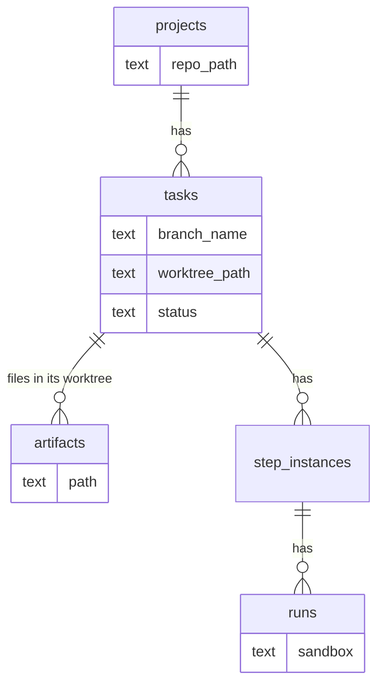

# Workspaces Data Model

Workspaces add no table. They use a few columns on existing tables, a settings key, and the port types.

## Columns

| Table.column | Type | Meaning | Source |
|---|---|---|---|
| `projects.repo_path` | `TEXT NOT NULL` | *"absolute path to the git repo"*; the repo every worktree is cut from | PRD §5 |
| `tasks.branch_name` | `TEXT` | the task's branch; null until created | PRD §5, §11 |
| `tasks.worktree_path` | `TEXT` | the task's folder; every run's `cwd` | PRD §5, §11 |
| `tasks.status` | `TEXT NOT NULL` | decides when cleanup may be offered | PRD §5 |
| `tasks.flow_id` | `TEXT` | *"null while in backlog, pinned on promotion"*, the same moment the worktree is made | PRD §5 |
| `artifacts.path` | `TEXT NOT NULL` | *"absolute path on disk"*, inside the worktree | PRD §5 |
| `runs.sandbox` | — | *"records the tier that actually ran"* | PRD §11.1, backlog 1.1 |
| `step_defs.sandbox_profile` | — | *"an optional `step_defs.sandbox_profile` override"* | backlog 1.1 (**NEW**) |
| `settings` key `sandbox_profile` | JSON value | *"tier, image, egress allowlist, limits"* | PRD §11.1 |

`runs.sandbox` and `step_defs.sandbox_profile` are not in the PRD §5 SQL. They come from §11.1's prose and backlog 1.1. Their types are not given.

PRD §11 says *"Store both paths on the task."* Only one of the two values is a path; the other is a branch name.

## Types

From `docs/old/reference/core/ports/`:

```ts
interface TaskRef { id: string }                       // workspace.ts, shared with ArtifactStore
interface WorkspaceHandle { path: string; branch?: string }
type IsolationTier = 'host' | 'container' | 'gvisor' | 'microvm';   // exec-host.ts
```

`RunSpec` (`agent-provider.ts`) carries the workspace into a run: `cwd: string` (*"Workspace path (the Workspace port owns its lifecycle)."*) and `exec?: ExecHost`.



## Not modelled

- No record of **cleanup**: no `cleaned_up_at`, no status. After cleanup, `worktree_path` still holds a path to nothing. *(Observation.)*
- No **base commit** or base branch on the task.
- No workspace **adapter id** per project or task.

See [[Workspaces Open Questions]].

## Related

- [[Workspaces Index]]
- [[Workspace Port]]
- [[Task Data Model]]
- [[Workspaces Storage]]
