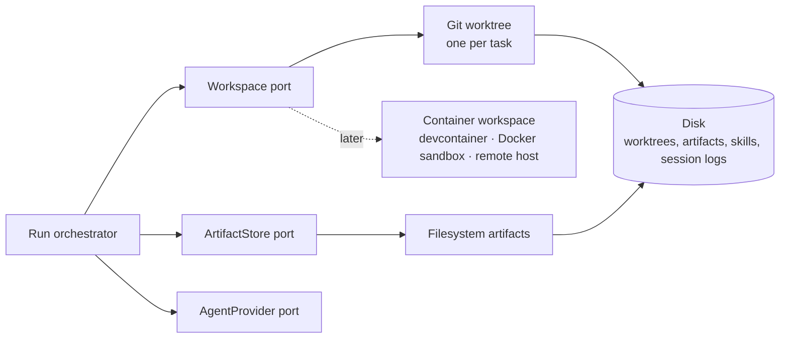

# Workspaces Overview

## Purpose

Feature map §14 sums it up in one line: *"A private copy of the code for each task, so parallel tasks never trip over each other."*

Every task that leaves the backlog gets its own folder and its own branch, cut from the project's repo with `git worktree add`. Every run of every step in that task uses the folder as its working directory. The folder stays after the task ends, until you clean it up yourself.

| Feature (feature map §14) | Wording |
|---|---|
| An isolated copy per task | *"Its own branch and folder, created when the task starts."* |
| Tidy up on your terms | *"The workspace stays until you choose to clean it up (only once the task is finished or cancelled), never deleted from under you."* |
| Stronger isolation when you want it | *"The same idea can run inside a locked-down box for tasks you want fully sealed off (see Sandboxing)."* The box is the [[Sandboxing Overview\|Sandboxing]] component. |

## Where it sits

Workspaces is a **platform** component. It has no screen of its own. The [[Component Documentation Tracker]] lists it with feature map §14 and the Workspace half of architecture component #11.

Architecture component #11 is *"Artifact store & workspace → two ports"* (`05-environment-and-registry.md` §11). It splits one PRD concern into two ports:

- **Workspace**: *"create/destroy/cwd + `execHost`. Isolation lifecycle, and where processes run against it."* These notes cover it.
- **ArtifactStore**: *"put/scan/resolve path/metadata."* The Task Detail set covers it: [[Task Artifacts]], [[Task Storage On Disk]].

*Drawio, Logical components page. The dashed edge is the drawio's own "not in v1" marking.*

On the drawio *Functional components* page, the Execution group holds *"Isolate the workspace / worktree per task today; devcontainer / Docker sandbox / remote host later"*, drawn dashed (not in v1 as a separate feature). On the *Harness architecture* page, a **Workspace manager** sits in the worker: *"git worktree add / remove per task · ExecHost per tier: host · docker · gVisor"*.

## Who uses it

| Consumer | What it takes from the workspace | Note |
|---|---|---|
| Promote / start | `create(task)`; stores path and branch on the task | [[Creating A Workspace]] |
| The runner | `cwd(task)` as the run's `cwd`; `execHost(task)` to spawn through | [[Workspace In A Run]] |
| Shell (check) steps | Same `cwd` and `ExecHost`, so the check *"inherits the sandbox"* (PRD §7) | [[Check Steps]] |
| ArtifactStore | Artifacts live under `<worktree>/.vibe/task-<id>/` | [[Task Artifacts]] |
| Task detail | Shows repo, branch and workspace path; **Open workspace**, **Clean up workspace** | [[Workspaces In The UI]] |
| Clean up | `destroy(task, { force? })` | [[Cleaning Up A Workspace]] |

## Design principles

- **One per task, shared by the task's steps.** *"Every task gets its own worktree so parallel steps cannot collide on the filesystem."* (PRD §11). Parallel steps *within* a task still share it. See [[Shared Worktree Within A Task]].
- **Never deleted from under you.** *"never remove it automatically"* (PRD §11). *"Cleanup is explicit only — never automatic"* (`workspace.ts`).
- **The parent repo stays clean.** *"append `.vibe-worktrees/` to `<repo>/.git/info/exclude` so the parent repo stays clean"* (backlog 2.1). See [[Parent Repo Hygiene]].
- **The host does all git work.** The sandbox [[Egress Allowlist]] excludes *"the project's git remote, because the host does all git work and the agent never needs to push or fetch"* (PRD §11.1). See [[Git Inside A Workspace]].
- **Where a process runs is the workspace's call, not the provider's.** *"The sandbox is not a new kind of AgentProvider — it is where the provider's process runs."* (`08-sandboxing.md`). See [[ExecHost Seam]] and [[ExecHost Port]].
- **Swappable.** The architecture README names the hardwired assumption this port removes: *"isolation is hardwired to git worktrees (§11)."* See [[Workspace Adapters]].

## Related

- [[Workspaces Index]]
- [[Workspace Port]]
- [[Workspace Lifecycle]]
- [[Task Workspace]]
- [[Workspaces Roadmap]]
