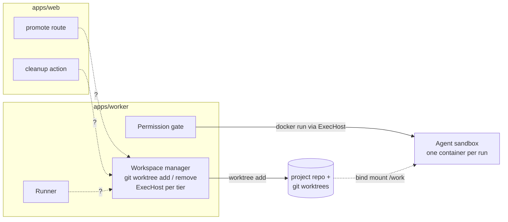

# Workspaces Runtime

Where workspace code lives and which process runs it.

## Two layouts

| Source | Port | Adapters |
|---|---|---|
| Architecture README *Suggested module layout* | `core/ports/` holds *"AgentProvider, Notifier, Workspace, ArtifactStore, TaskSource, MemoryStore"* | `adapters/workspace/worktree/  container/  (05)` |
| PRD §3 | `packages/core/ports/` holds *"AgentProvider, ExecHost, MemoryStore, Notifier, TaskSource interfaces"* | `adapters/exec/` *"host, docker"* |
| Drawio *Harness architecture* | — | *"packages/adapters: agent · exec · notify · memory"*; **Workspace manager** in `apps/worker` |

The PRD and drawio make **ExecHost** the port and keep worktree handling in the worker. The architecture makes **Workspace** the port and ExecHost something it hands out. See [[Workspaces Open Questions]].

## The dependency rule

*"`core/` and `runner/` must never import from `adapters/` — only from `core/ports/`. Enforce with a lint rule."* (architecture README). PRD §3: *"`packages/core` imports no framework, no database driver and no CLI."* Running `git` is a CLI call, so it belongs in an adapter or the worker, not in core. *(Inference from the rule.)*

## Processes



*From the drawio Harness page: "worktree add" runs from the Workspace manager to the repo; "E docker run via ExecHost" runs from the **Permission gate**, not the Workspace manager; "bind mount /work" is drawn dashed (optional or later). The `?` edges are not on the drawio and are this note's gap markers: `apps/web` is "thin: validates, calls core, enqueues; never spawns agents", no job kind creates or removes a workspace, and the drawio draws no edge from the runner to the Workspace manager.*

## In the runner

`07` *Composing them*:

```ts
const run = deps.provider.launch({
  prompt: buildPrompt(step, task, deps.store),
  model: step.model, effort: step.effort,
  cwd: deps.workspace.cwd(task),                         // Workspace port
  resume: step.resume,
});
```

The sketch passes `cwd` but not `exec`. `03` §6 adds it: *"the runner gets an `ExecHost` from `workspace.execHost(task)` … and puts it on the `RunSpec`"*; `08` says it *"passes it in the `RunSpec`"*. See [[Runner Pipeline]].

## Startup

*"Probe for Docker at startup; if absent, fall back to the host tier and disable `bypassPermissions`."* (PRD §11.1, backlog 0.1). The probe decides which `ExecHost` tiers the workspace can return.

## Related

- [[Workspaces Index]]
- [[Workspace Port]]
- [[ExecHost Seam]]
- [[Git Worktree Adapter]]
- [[Execution Runtime]]
- [[Sandboxing Runtime]]
