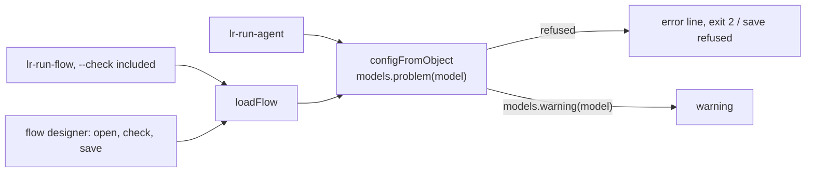

# OpenCode Models

OpenCode's steps run on models from two sources: **OpenRouter**, paid or free, and **Ollama on this machine**, local and free. Lamproom controls **which models a step may use**, from either source, and **which OpenRouter key pays** for OpenRouter's. Both are app-wide settings, for every project. Lamproom has no OpenRouter or Ollama adapter: the runs still go through [[OpenCode Adapter|OpenCode]], and these settings decide what OpenCode is allowed to run on.

Was *OpenRouter Models And Key* until Ollama joined it on 2026-11-15.

> [!check] Built 2026-11-13 (OpenRouter), 2026-11-15 (Ollama)
> OpenRouter on `feature/opencode-models`, merged into `dev` as `0839946`. Ollama on `feature/ollama-models`, merged into `dev` as `9d2f082` (2026-11-16), verified first (the handoff spec's Part 1, `docs/superpowers/specs/2026-11-13-ollama-provider-handoff.md`). Code: `packages/cli/src/models.ts` (both sources' rules, `prepareRun`), `openrouter.ts` (the key, OpenRouter's list), `ollama.ts` (Ollama's address, list, window and OpenCode config), `settings.ts` (`ApprovedModel`, `modelProblem`, `modelWarning`), the check in `config.ts`, the pages in `app/settings/models.tsx`, the routes `app/api/models/` and `app/api/openrouter/key/`. Tests: `packages/cli/test/openrouter.test.ts`, `ollama.test.ts`, and `ollama-live.test.ts` (in `pnpm test:live` since 2026-11-16; free, and skips when Ollama does not answer).

## The rule

An OpenCode step runs only on an **approved** model. Free, paid and local models all need approving; nothing is allowed by default. The source is the id's prefix: `openrouter/…` or `ollama/…`.

| The step's model | What happens |
|---|---|
| Approved, priced as when it was approved | Runs |
| Approved, and free on OpenRouter | Runs, with a privacy warning |
| Approved, local, window known and below 32,768 tokens | Runs, with a context warning |
| Not approved | Refused: `<model> is not an approved model; approve it in Settings → Agents → OpenCode models` |
| OpenRouter's, and OpenRouter no longer lists it | Refused: `<model> is no longer listed by OpenRouter; pick another model` |
| OpenRouter's, and now dearer, input or output | Refused until approved again: `<model> costs more than when you approved it (output $0.4 → $0.6 per million tokens); approve it again in …` |
| Local, and Ollama answered without it | Refused: `<model> is no longer in Ollama; pick another model` |
| Local, and Ollama does not answer at run start | Refused before anything launches: `Ollama does not answer on http://127.0.0.1:11434; start it, then run again` |
| Local, and `OLLAMA_HOST` names another machine | Refused: `OLLAMA_HOST is <value>, which is not this machine; Lamproom uses only Ollama on this machine (127.0.0.1, localhost or ::1)` |

A model that got cheaper still runs. Without a saved list (before the first fetch), only the approval is checked. The designer's check never asks Ollama, so it never refuses for "does not answer".

**The privacy warning.** A free OpenRouter model costs no money, but its provider may keep the prompts and train on them, and the prompts include the project's code. Lamproom says so when you approve such a model, under the model field wherever you pick one, in a flow's check (`steps.<name>.model: <model> is a free model: …`) and at the start of a `lr-run-agent` run. It warns; it never blocks. If OpenRouter refuses a free model over your data policy, allow such providers in your OpenRouter privacy settings. A local model gets no privacy warning: its prompts stay on this machine.

**The context warning.** A local model's window can be small enough for an agent to outgrow it: OpenCode's own prompt is about 7,000 tokens before any work. Below **32,768** tokens Lamproom warns, in the same places as the privacy warning: `<model> runs with a 4,096-token window, which an agent can outgrow; set num_ctx on the model, or OLLAMA_CONTEXT_LENGTH`. It warns; it never blocks (Alex, 2026-11-13). See [The window a local model runs with](#the-window-a-local-model-runs-with) for when the window is known.

## Where you set it

| Page | What it does |
|---|---|
| **Settings → LLM Provider → OpenRouter** (`/settings/llm-providers/openrouter`) | Save, replace or remove the key. Shows which key runs would use, by its last four characters, never the key. **Test** asks OpenRouter for the key's name, credit limit, spend and what is left |
| **Settings → LLM Provider → Ollama** (`/settings/llm-providers/ollama`) | Ollama's address, whether it answers and its version, how many local tool-capable models it has, and how the address, the list and the window are decided |
| **Settings → Agents → OpenCode models** (`/settings/agents/models`) | One tab per source. **OpenRouter**: the models with their prices per million input and output tokens and context size, filtered by text or by *all / free / approved*; **Fetch again** reloads the list. **Ollama**: the local models with their size, the window they run with (with where it was read from, or *default*, and a warning mark below 32,768) and their maximum; **Ask again** asks Ollama. A checkbox approves a model; a free OpenRouter one asks first, with the privacy warning; a local one does not. Above the tabs, a banner lists each approved model that is refused now, with **Approve again** (a price rise) or **Remove** |

The model is then **picked, never typed**, from the approved models:

- in the flow designer, on an OpenCode step and in the flow's defaults when their adapter is OpenCode;
- on **Internal steps**, when a step runs on OpenCode (switching to OpenCode empties the model; **Save** stays off until one is picked);
- on **Agents**, as OpenCode's default model, with *none: each step names one*.

Each list marks free models `· free` and local ones `· local`. A model the file or setting already names that is not approved stays shown, marked *(not approved)*, until it is changed. Under the picker, a free OpenRouter model shows the privacy line and a local one with a small window shows the context warning.

## Where it is enforced

The check sits in `configFromObject` (`config.ts`), which every OpenCode run passes through:



- `lr-run-agent` and `lr-run-flow` get Lamproom's data folder from `defaultDataDir()`: `LAMPROOM_DATA_DIR`, else `data/` in the app's folder, as the app has it. A run started from the runs page is handed the app's own data folder.
- At start (`prepareRun`, `models.ts`), each source an approved model comes from is asked for its list: OpenRouter when its saved list is over an hour old, Ollama every time. A source nothing is approved from is not asked.
- The flow designer's routes (`/api/flows`, `/api/flows/<name>`, `/api/flows/<name>/check`) pass the same rules, against the saved lists, so a flow with a refused model shows the error and **cannot be saved**, as with any other check error.
- Saving OpenCode's default model or an internal step's OpenCode model refuses one that is not approved (`updateAppSettings`). Withdrawing an approval later is allowed; runs then refuse the model.
- A resumed run (`lr-run-flow --resume`) keeps the models it was checked with when it started. Its local steps still get Ollama's provider, from the saved list.
- Without a data folder, as in the package tests, no model is checked (`ModelRules` is optional on the loaders).

## How a run reaches Ollama

OpenCode's server starts with a fresh config folder for each run, so the owner's own `~/.config/opencode` (and any `ollama` provider in it) is never read. Lamproom adds the provider itself, as a **native capability pack** merged into OpenCode's config (`ExecContext.opencodeConfig`, `flow-exec.ts`; `run.ts` for lr-run-agent). The [[OpenCode Adapter]] is unchanged:

```json
{ "provider": { "ollama": {
  "npm": "@ai-sdk/openai-compatible", "name": "Ollama",
  "options": { "baseURL": "http://127.0.0.1:11434/v1" },
  "models": { "gemma4:26b-64k": { "name": "gemma4:26b-64k", "limit": { "context": 65536, "output": 8192 } } } } } }
```

- It names **only the step's model**. `limit.context` is the window Ollama runs it with, else its maximum; `limit.output` is a fixed 8,192.
- It is added once `spec.exec` is known, as the address depends on where the step runs:

| Where the step runs | `baseURL` |
|---|---|
| This machine | Ollama's own address, from `OLLAMA_HOST` (default `http://127.0.0.1:11434`), plus `/v1` |
| Docker sandbox | `http://host.docker.internal:<port>/v1` |
| OpenSandbox box | `http://host.docker.internal:<port>/v1`; the box's egress allows `host.docker.internal` |

  Each sandboxed `ExecHost` says how it reaches this machine (`hostName`, `DOCKER_HOST_NAME` in `exec/docker.ts`). Docker Desktop forwards `host.docker.internal` to the host's loopback too, so **Ollama stays on 127.0.0.1**: nothing needs `OLLAMA_HOST=0.0.0.0`. OpenSandbox's egress filter lets an allowed host through on port 11434, not only 443. Checked on 2026-11-13 (handoff spec, V4 and V5).
- OpenCode 1.19.3 ships `@ai-sdk/openai-compatible`, so nothing is downloaded at run time, in a box or out of one.
- **Cost.** OpenCode reports `$0` for a local model, which is right. Instead of "no price for …", a run prints once per attempt: `-- <step>: <model> runs locally at $0, so only limits.max_turns or a timeout stops it`. The flow check's "no `limits.max_turns`" warning still applies.

## The key

| | |
|---|---|
| Stored in | `secrets.json` in Lamproom's data folder, `{ "openrouter": "sk-or-…" }`, written owner-only (mode `0600`). Windows ignores the mode: there, whoever can read the data folder can read the key |
| Never in | `settings.json`, which `/api/settings` sends to the pages |
| Accepted | `sk-or-` and 8 to 300 more characters, no spaces; OpenRouter's **Test** says whether it works |
| Overridden by | `OPENROUTER_API_KEY` in Lamproom's environment, which wins over the saved key |
| How a run gets it | `lr-run-agent` and `lr-run-flow` put the saved key in `OPENROUTER_API_KEY` at start, unless one is set. OpenCode's server inherits it; the Docker sandbox passes it when `sandbox.env` names it; OpenSandbox injects it at the egress proxy as before. Shell steps never get it: their environment drops every `*_KEY` |
| Without one | Runs use OpenCode's own credentials (`opencode auth login`), as before |

Ollama needs no key: it is on this machine.

Not the OS keychain: Lamproom may run on Windows too, and a file works on every OS (Alex, 2026-11-13). `@napi-rs/keyring` would move it into the macOS Keychain, Windows Credential Manager or Linux Secret Service if a plain file is ever not enough.

For a hard ceiling outside Lamproom, give the key a credit limit on openrouter.ai.

## OpenRouter's model list

| | |
|---|---|
| Source | `GET https://openrouter.ai/api/v1/models`, public, no key sent |
| Saved as | `openrouter-models.json` in the data folder: `{ fetchedAt, models: [{ id, name, free, price: { in, out }, context }] }` |
| Prices | OpenRouter's per-token prices × 1,000,000, so dollars per million tokens |
| Ids | OpenRouter's id with `openrouter/` in front, as an OpenCode step names it |
| Free | input and output price both `0` |
| Left out | models with a negative or missing price (OpenRouter's own routers, such as `openrouter/auto`) |
| Fetched again | when over an hour old: by the settings pages, and by `lr-run-agent` and `lr-run-flow` at start when an OpenRouter model is approved; **Fetch again** forces it. A failed fetch keeps the saved list and says so (`-- warning: could not fetch OpenRouter's models: …`) |

## Ollama's model list

| | |
|---|---|
| Address | `OLLAMA_HOST` read as the ollama CLI reads it: `host`, `host:port`, `:port` or `scheme://host:port`; default `127.0.0.1:11434`. Only `127.0.0.1`, `localhost` and `::1` are accepted: **Ollama on this machine only** (Alex, 2026-11-13). Not a setting |
| Source | `/api/version`, `/api/tags`, `/api/show` for each model, and `/api/ps` for the loaded ones; 5 seconds each |
| Kept | models whose capabilities include **tools**, from `/api/tags` (or `/api/show` on an older Ollama) |
| Left out | models without tools (embedding models), and **cloud models**: those with `remote_host` or `remote_model` set, as Ollama's API documents them, or whose tag is `cloud` or ends in `-cloud` (`gemma4:cloud`, `gpt-oss:120b-cloud`). Cloud models run on ollama.com, not here, and are excluded for now (Alex, 2026-11-13) |
| Ids | `ollama/` and the name exactly as `/api/tags` gives it, tag included: `ollama/gemma4:26b-64k` |
| Saved as | `ollama-models.json` in the data folder: `{ fetchedAt, models: [{ id, name, free: true, price: { in: 0, out: 0 }, local: true, context, contextFrom, maxContext, size }] }`, for the designer's check and resumed runs |
| Asked | every time a settings page loads (`/api/models`), and by `lr-run-agent` and `lr-run-flow` at start when a local model is approved. Local, so there is no hourly cache. A failed ask keeps the saved list |

### The window a local model runs with

Decided by Alex on 2026-11-15 (handoff spec, "Verification results", option (a)). In order:

| | Window | `contextFrom` |
|---|---|---|
| 1 | `num_ctx` in the model's `/api/show` parameters | `num_ctx` |
| 2 | `OLLAMA_CONTEXT_LENGTH` in **Lamproom's** environment | `OLLAMA_CONTEXT_LENGTH` |
| 3 | `context_length` from `/api/ps`, if the model is loaded now | `loaded` |
| 4 | Unknown: Ollama picks its own default | `null`, shown as *default* |

Only a known window (1 to 3) below 32,768 is warned of. **An unknown window is not warned of**, because Ollama's default depends on the machine's memory, and its API does not report it. On Alex's 128 GB Mac, `qwen3-coder:30b` (no `num_ctx`) loads with 262,144 tokens, its full maximum: warning there would be a false alarm.

Caveats:
- Rule 2 sees `OLLAMA_CONTEXT_LENGTH` only if Lamproom runs with the Ollama server's environment. The Ollama app on macOS does not share it, so this rule is best effort.
- Rule 3 is a snapshot: the window changes if Ollama reloads the model with other settings.
- **Revisit** if this runs on a machine with less memory: there Ollama picks a small default (for example 4,096), Lamproom cannot see it, and an agent may lose its prompt with no warning. The fix is to set `num_ctx` on the model (`ollama create` from a Modelfile with `PARAMETER num_ctx 32768`), which rule 1 reads.

## The approved list

`AppSettings.opencodeModels`, in `settings.json`:

```json
[
  { "id": "openrouter/deepseek/deepseek-v4.1-flash", "free": false, "price": { "in": 0.3, "out": 1.2 }, "approvedAt": "2026-11-13T18:00:00.000Z" },
  { "id": "ollama/gemma4:26b-64k", "free": true, "price": { "in": 0, "out": 0 }, "approvedAt": "2026-11-15T10:00:00.000Z", "local": true }
]
```

`price` is what OpenRouter listed when the model was approved; a later rise is compared against it. Ids must start with `openrouter/` or `ollama/` and appear once. `local: true` marks a local model; an entry without it, as every entry saved before 2026-11-15 is, is not local. The default is `[]`.

## Routes

| Route | Does |
|---|---|
| `GET /api/models` (`?refresh=1` to fetch OpenRouter's list now) | `{ key: { source: 'env' \| 'saved' \| null, last4 }, catalogue, error?, ollama: { address, version, models, error? }, approved: [{ …, free, problem, warning }] }`. Was `GET /api/openrouter` |
| `PUT /api/openrouter/key` `{ key }` | Saves the key; answers with `key` as above |
| `DELETE /api/openrouter/key` | Removes the saved key |
| `POST /api/openrouter/key` | Tests the key runs would use against OpenRouter's `/key` |
| `PATCH /api/settings` `{ opencodeModels }` | Approves or withdraws models (the page sends the whole list) |

Like every Lamproom route, they answer only on localhost, and refuse a change from another site.

## Limits

- **Two sources only.** An OpenCode step on another provider (`opencode/…`, `anthropic/…`) cannot be approved, so it is refused.
- **Ollama on this machine only**, local models only: no Ollama on another host, no Ollama cloud models, no per-project model lists (Alex, 2026-11-13).
- **The window of a model without `num_ctx` is unknown** until it is loaded, and is then not warned of. See above.
- **`limit.output` is fixed at 8,192 tokens** for a local model: a reply longer than that, such as one huge file write, is cut off. Derive it from the window if that happens.
- **Images built before 2026-11-15 have no ripgrep**, so OpenCode's `glob` and `grep` tools fail in a box (`ripgrep execution failed`), whatever the model. Seen in the Ollama flow runs; fixed on `fix/sandbox-ripgrep` (`76c5c92`), which adds `ripgrep` to `docker/Dockerfile`. Rebuild `lamproom-cli`, then `lamproom-sandbox`, to get it.
- **Which key wins inside OpenCode** when its own `auth.json` also holds an OpenRouter key is OpenCode's rule; not checked.
- **A price rise is seen only once the list is fetched again**, within the hour, or at the next run.
- **No direct model calls.** Lamproom calls OpenRouter only for the model list and the key test, and Ollama only for its list; every model call is OpenCode's. A model-provider service of Lamproom's own (for tool-less steps such as the backlog importer) was analysed and left out of scope (Alex, 2026-11-13).
- **Not used for cost.** The run's cost still comes from OpenCode's `usage`; the list's prices are not read by `budget_usd` or a pricing service. See [[Pricing Service]].

## Related

- [[OpenCode Adapter]] — how the runs themselves work
- [[Providers And Sandboxing]] — credentials per tier, and how a box reaches Ollama
- [[Run Config Reference]] — the `model` field
- [[Run Flow Reference]] — checks, warnings and the run's output
- [[Settings Catalogue]] — every app setting
- [[Agent Providers Index]]
