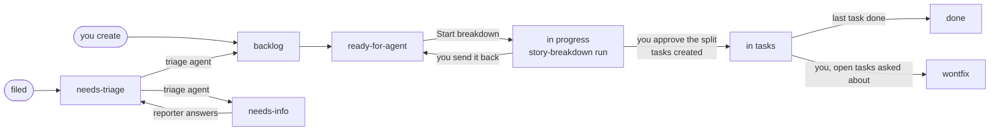

# Task Types And Workflows

> **Proposal, 2026-11-17.** How Jira builds workflows out of statuses, what Lamproom should take from it, and whether Lamproom should have a **story** type that a flow splits into tasks. Mocked up in [`workflows.html`](../../mockups/workflows.html) and [`board.html`](../../mockups/board.html). Nothing here is built: the code has no `tasks` table yet.

**Short answer.**

- Take Jira's **status with a category**. Add the board mockup's **owner** (you, an agent, or a story's tasks) on top.
- Take Jira's **type → workflow map**. Add a **type → flow** map next to it, so each type runs its own recipe.
- Skip Jira's habit of drawing every transition. Moves between your statuses are free, and a rule is written only where the move has a condition or a side effect.
- Add **story**, but only as a container. A story's flow ends by producing a list of tasks, not code. Once you approve the split, those tasks run like any other. Stop at two levels, story → task: no epics, and no sub-tasks, because a flow's steps already are the sub-tasks.

## How Jira does it

| Concept | What it is in Jira |
|---|---|
| **Status** | A named step, such as *In Review* or *Blocked*. Each status belongs to one of three fixed **categories**: *To Do* (grey), *In Progress* (blue) or *Done* (green). Reports, filters and boards read the category, not the name. |
| **Transition** | A one-way arrow between two statuses. Going back needs a second transition. A **global transition** lets every status move to one target. Team-managed projects start with *all statuses can move to any status*. |
| **Transition rules** | Company-managed projects only. **Conditions** decide who sees a transition and when. **Validators** check input and block the move when they fail. **Post functions** run after the move, for example setting the resolution. |
| **Workflow** | Statuses plus transitions. Company-managed workflows also set a **resolution** when work is done. |
| **Workflow scheme** | Maps each **issue type** to one workflow in a project. Any type without a mapping uses the default workflow. One issue type has exactly one workflow per project. |
| **Issue type hierarchy** | Three default levels: **Epic** (1), standard types such as **Story**, **Task** and **Bug** (0), and **Sub-task** (−1). Premium adds levels above Epic. Types on the same level differ only in their fields, screens and workflow. |
| **Board** | Columns are mapped to one or more statuses. A status that no column maps is left off the board. |

What not to copy:

- **Drawing every arrow.** A company-managed workflow with eight statuses has dozens of transitions, and the editor becomes a hairball. That's why team-managed projects default to "any to any".
- **Indirection.** Behind every project sit a workflow scheme, a screen scheme, an issue type scheme and a field configuration scheme. Lamproom needs one table.
- **Statuses shared by every project.** In company-managed Jira, renaming a status renames it everywhere.

## What Lamproom has today

- **One list of statuses**, from the [board mockup](../../mockups/board.html). You manage `backlog`, `ready-for-agent`, `ready-for-human`, `done` and `wontfix`. Agents manage `needs-triage`, `needs-info`, `needs-context` and `in progress`. The move rules (`canMove`) already behave like Jira's transition rules:
  - Only *Start run* puts a card in progress, which works like a **condition**.
  - The triage agent checks every card moved to `ready-for-agent`, which works like a **validator**.
  - The provider command queued after each move works like a **post function**.
- **One default flow per project.** A task pins a version of it ([[Project Default Flow]]). The docs list "several flows per project" as a gap.
- **No task type and no parent task**, neither in the [[Intake Data Model]] nor in the code.

Lamproom has a layer Jira doesn't: the **flow**. In Jira, a team adds statuses such as *In Review* or *QA* inside the In Progress category. In Lamproom, those are the steps of a run, shown as the flow bar on an `in progress` card. **Don't turn flow steps into statuses.** Statuses say who holds the card. Steps say what the run is doing.

## Jira → Lamproom

| Jira | Lamproom (proposed) |
|---|---|
| status | status |
| status category | `category`: `todo` · `doing` · `done`. Drives roll-up, reports, and closing the issue on providers that only know open and closed. |
| — | `owner`: `you` · `agent` · `tasks`. Lamproom-only. Decides who may move cards out and whether the column shows by default. |
| transition | A **move rule**. Free between your statuses, and drawn only where a rule applies. |
| condition | Who may make the move, and when (*Start run*, *not blocked*). |
| validator | The triage check on `ready-for-agent`. |
| post function | The provider command, starting a run, or creating a story's tasks. |
| workflow | workflow: a set of statuses plus its move rules |
| workflow scheme | **Task types** in project settings: type → workflow **and** flow |
| issue type | task type: `bug`, `task`, `story` |
| Epic / Story / Sub-task | story / task / (flow steps) |

## Statuses: category, owner, rules

Creating a status takes five things:

1. **Name**: kebab-case and unique in the project, because it becomes a markdown heading and a label.
2. **Category**: `todo`, `doing` or `done`.
3. **Owner**: you, or an agent. If an agent owns it, name the agent that moves cards *out*, or cards get stuck.
4. **Workflows** it belongs to.
5. **Where cards come from.** Statuses you own get free moves from your other statuses. A status an agent owns needs at least one rule leading into it. Otherwise Lamproom warns that nothing can reach it, the same way flow validation warns about a step nothing feeds.

Where a new status lands depends on the issue provider:

| Provider | Status | Type | A story's tasks |
|---|---|---|---|
| Markdown backlog | A `## needs-repro` section. Free, because the file is the board. | A class on the bullet: `{#chf-symbol .bug}` | Each task names its story: `{#amount-minor .task parent=bill-in-currency}`. Tasks can't nest under the story's bullet, because a card's `##` section is its status. |
| GitHub Issues | A label (`gh label create`). The `done` category closes the issue, and `wontfix` closes it as *not planned*. | GitHub issue type (Bug, Task, Feature; a story maps to Feature unless the org has a Story type) | Sub-issues |
| Beads | Beads has fixed statuses (`open`, `in_progress`, `blocked`, `closed`). A custom status is a label on the nearest fixed status for its category. | `--type` (`bug`, `task`, `feature`, `epic`, `chore`). A story maps to `epic`. | `parent-child` dependencies |
| Jira (future) | **Jira owns statuses and transitions.** Lamproom can't create them. It maps each of its statuses to an existing Jira status, several to one if needed, and keeps the finer status in a `lamproom:<status>` label. A push fails when the Jira workflow has no matching transition. | Native issue type | Sub-tasks, which have their own workflow in Jira |

The exact `bd` commands are illustrative, as in the board mockup.

## Move rules: open by default

- **Free moves** between statuses you own, and out of an agent's status into one of yours, as in the board mockup today.
- **Rules** only where something happens, and those are what the workflow view draws:
  - `needs-triage → *`: the triage agent.
  - `ready-for-agent → needs-context`: the check fails.
  - `ready-for-agent → in progress`: Start run, once the check has passed and nothing blocks the card.
  - `in progress → done`: the run lands.
- The workflow view hides free moves. A toggle draws them, which shows why Jira users stop drawing them.

## Task types

| Type | Workflow | Default flow | What it is |
|---|---|---|---|
| `bug` | standard | `bugfix` (proposed: reproduce with a failing test → fix → check → review ✋) | Something is broken. The flow proves it before fixing it. |
| `task` | standard | `software-delivery` v4 | A change with a clear ask |
| `story` | story | `story-breakdown` (proposed: research → split → approve ✋) | User-facing value too big for one run. It never builds code itself. |

- **Who sets the type:** you, when you create a card. Otherwise the importer, or the triage agent while it reads `needs-triage`, decides it along with where the card goes.
- **Bug and task share a workflow but run different flows.** The type map lets them differ in either, like Jira's workflow scheme plus Lamproom's flow.
- **The project's `default_flow_id`** stays as the fallback for a type without its own flow, like Jira's default workflow.

## Should Lamproom have a story type?

**Yes, as a container.**

For:

- **Agents do best on small, well-scoped tasks.** A story is the unit people think in. Splitting it into tasks the agents can run is real planning work, and it's the work the plan step of `software-delivery` already does, only one level up.
- **Parallel runs.** Each task gets its own worktree and branch, so independent tasks run side by side. Each one lands as a small change that's easy to review.
- **Every provider already has parent and child issues.** GitHub has sub-issues, Beads has epics with `parent-child`, Jira has sub-tasks and epic children, and Linear has sub-issues. Lamproom doesn't invent a structure, it maps onto one.
- **A role flow already writes stories.** The business-analyst flow in [[Role Starter Flows]] ends with *"write user stories with acceptance criteria"*. A story type gives that output somewhere to go.

Risks, and the answer to each:

| Risk | Answer |
|---|---|
| Nobody checks the story as a whole once each task has landed alone | Later: an `acceptance` run when the last task is done, which reviews the merged result against the story's acceptance criteria. Open question 1. |
| Tasks depend on each other | The split step writes `after:` dependencies. A task stays blocked until the task it depends on is done, like Beads' `blocked` in the board mockup. |
| The split is too fine or too coarse | The **approve** gate. You see the list before anything is created, and you can send it back with a note. |
| Duplicate issues | The split step reads the open issues and **links** a matching one instead of creating it again. In the mockup, #224, #219 and #231 already exist. |
| Cost: one breakdown run, then a run per task | The story shows the sum of its tasks' spend. A per-story cap could reuse the project budget, later. |
| Hierarchy creep: epics, initiatives, sub-sub-tasks | Two levels. A story can't hold a story, and a task can't hold anything. A flow's steps are the sub-tasks. |

### How a story moves



- **The split step's output is a `task_list` artifact** in [[Backlog File Shapes|Shape B]] markdown. Approving the gate passes it to the existing backlog-importer path, with `parent_id` set to the story. Nothing new parses it.
- **Approving offers two choices.** *New tasks to backlog* keeps "nothing runs until you move it" true. *Queue in ready-for-agent* is for when the split is the go-ahead.
- **`in tasks` is a status** in the `doing` category, owned by `tasks`. You can see it, but you can't drag a card into it or out of it. The story moves on by itself when its last task is done or wontfix, as long as at least one task is done.
- **A story moved to `wontfix`** asks what to do with its open tasks: close them too, or keep them as stand-alone tasks.

## Data model (proposal)

```sql
ALTER TABLE tasks ADD COLUMN type      TEXT NOT NULL DEFAULT 'task';   -- 'bug'|'task'|'story'
ALTER TABLE tasks ADD COLUMN parent_id TEXT REFERENCES tasks(id);      -- a story; null otherwise; never a task's task

CREATE TABLE statuses (                 -- per project: renaming one never touches another project
  project_id TEXT NOT NULL REFERENCES projects(id) ON DELETE CASCADE,
  name       TEXT NOT NULL,             -- kebab-case; becomes the heading or label
  category   TEXT NOT NULL,             -- 'todo'|'doing'|'done'
  owner      TEXT NOT NULL,             -- 'you'|'agent'|'tasks'
  agent      TEXT,                      -- who moves cards out when owner = 'agent'
  means      TEXT,                      -- the one line under the column name
  PRIMARY KEY (project_id, name)
);

CREATE TABLE task_types (               -- Jira's workflow scheme and Lamproom's flow choice in one row
  project_id TEXT NOT NULL REFERENCES projects(id) ON DELETE CASCADE,
  type       TEXT NOT NULL,
  workflow   TEXT NOT NULL,             -- 'standard'|'story'; a workflow = statuses + move rules, kept as JSON
  flow_id    TEXT REFERENCES flows(id), -- null → projects.default_flow_id
  PRIMARY KEY (project_id, type)
);
```

- `tasks.status` keeps its column. Its values become this table's names, not a fixed list.
- **Move rules** stay in code for the built-in statuses. Custom statuses get free moves plus the "where cards come from" list. Turning rules into data is premature until custom rules exist.

## Open questions

1. **Story acceptance run.** When the last task is done, should a review run check the merged result against the story's acceptance criteria before the story moves to done?
2. **Story branch.** Each task branches off the default branch (proposed). The alternative is a story branch that the tasks land into, merged once at the end, which is safer for half-finished features but adds a second landing.
3. **More types.** `spike` and `chore` are cheap to add once types are rows. Are they wanted, or are three enough?
4. **A bug inside a story.** Proposed: allowed. The bug keeps its own flow (#231 in the mockup).
5. **The board.** Should the board show every type together, with an `in tasks` column for stories (as the mockup does), or offer a filter per type?
6. **Jira mapping.** Many Lamproom statuses can map to one Jira status. Is a `lamproom:<status>` label acceptable on a team's Jira issues?

## Sources

- [Workflows and statuses for boards in business spaces](https://support.atlassian.com/jira-software-cloud/docs/workflows-and-statuses-for-boards-in-business-projects/): status categories.
- [What are work item statuses, priorities, and resolutions?](https://support.atlassian.com/jira-cloud-administration/docs/what-are-issue-statuses-priorities-and-resolutions/)
- [Manage how work flows in your team-managed space](https://support.atlassian.com/jira-software-cloud/docs/manage-how-work-flows-in-your-team-managed-project/)
- [Manage work item transitions in team-managed spaces](https://support.atlassian.com/jira-software-cloud/docs/create-edit-and-delete-transitions-in-team-managed-projects/): one-way transitions.
- [Configure advanced work item workflows](https://support.atlassian.com/jira-cloud-administration/docs/configure-advanced-issue-workflows/): conditions, validators, post functions.
- [Configuring workflow schemes](https://confluence.atlassian.com/adminjiraserver/configuring-workflow-schemes-938847421.html): issue type → workflow, default workflow.
- [Configure the work type hierarchy](https://support.atlassian.com/jira-cloud-administration/docs/configure-the-issue-type-hierarchy/): epic, standard, sub-task levels.
- [What are Jira workflows?](https://www.atlassian.com/software/jira/guides/workflows/overview)

## Related

- [[Board Projection]]
- [[Project Default Flow]]
- [[Role Starter Flows]]
- [[Artifact Contract]]
- [[Backlog File Shapes]]
- [[TaskSource Port]]
